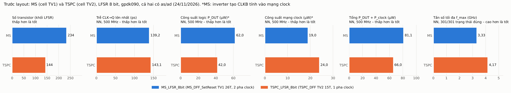
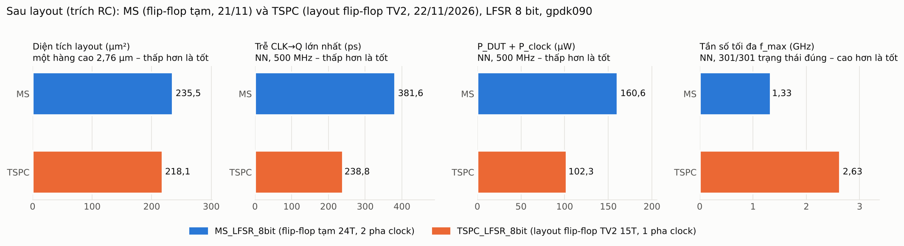

# Kết quả TV4 – Lõi PRNG/LFSR 8 bit và kiểm chứng toán học

Huỳnh Anh Tuấn (TV4). Cập nhật 24/11/2026. Trang này tóm tắt kết quả; số liệu đầy đủ ở [docs/4_ket_qua.md](docs/4_ket_qua.md) và [docs/5_layout.md](docs/5_layout.md), cách dùng khối ở [HUONG_DAN_TV4.md](HUONG_DAN_TV4.md).

## Tiến độ theo kế hoạch nhóm

| Tuần | Việc của TV4 | Trạng thái |
|---|---|---|
| 1 | Golden model, bảng giá trị chuẩn | **Xong** (MATLAB) |
| 2 | Ghép MS_LFSR_8bit, TSPC_LFSR_8bit; so khớp golden model; dạng sóng; bảng định thời MS và TSPC | **Xong**: TSPC dùng flip-flop TV2, MS dùng flip-flop TV1 (24/11); thêm PVT 81 điểm |
| 3 | Layout dải LFSR 8 bit (pitch-matching), DRC/LVS | **Xong** (layout flip-flop TV2): DRC 0 lỗi, LVS khớp, RCX, hậu layout PASS. Dải MS dùng flip-flop tạm, chỉ để so sánh |
| 4 | Phần viết Chương 1 + Chương 4 | **Xong**: [`report1,4.docx`](report1,4.docx) (cập nhật 24/11 với cell TV1, PVT); riêng bảng so sánh sau layout MS chờ layout TV1 |

**Trạng thái phần TV4: Hoàn thành.** ⚠️ **Chưa hoàn thành chỉ ở phần so sánh sau layout với TV1:** layout `MS_DFF_SetReset` của TV1 (commit `fa999e9`) chưa có hình vẽ, nên dải layout MS vẫn dùng flip-flop tạm. So sánh trước layout đã dùng cell thật của TV1.

## Golden model (MATLAB)

| Kiểm tra | Kết quả |
|---|---|
| P(x) = 1 + x + x⁶ + x⁷ + x⁸, seed 0x01 | chu kỳ **255**, không qua 0x00; T²⁵⁵ = I, T⁸⁵, T⁵¹, T¹⁵ ≠ I ⇒ đa thức nguyên thủy |
| Golomb trên Q7 | cân bằng 128/127; phân bố run đúng; tự tương quan hai mức (255 / −1) |
| CFSR từ 0x00 | **256** trạng thái |
| LT-RTPG k = 2 | số bit lật −50,0 % (4,016 → 2,008 mỗi chu kỳ), 101 vector khác nhau |
| MISR tham khảo (CUT cộng 4 bit) | chữ ký đúng 0xDE (LP = 0), 0x79 (LP = 1); phát hiện 10/10 lỗi stuck-at ở ngõ ra |

## Kiểm chứng Spectre trước layout (500 MHz, 300 chu kỳ)

**27/27 testbench PASS 301/301** ở NN, SS, FF: phần cứng khớp golden model ở từng chu kỳ.

| NN, 27 °C (cả hai có as/ad) | Transistor | Trễ CLK→Q | P_DUT (logic) | P mạng clock | P_DUT + P_clock | f_max NN / SS |
|---|---:|---:|---:|---:|---:|---:|
| MS_LFSR_8bit (cell TV1, 26T/FF) | 234 | 139,2 ps | 62,0 µW | 19,0 µW | 81,1 µW | 3,33 / 2,22 GHz |
| **TSPC_LFSR_8bit (cell TV2, 15T/FF)** | **144** | **143,1 ps** | **42,0 µW** | **24,0 µW** | **66,0 µW** | **4,17 / 2,86 GHz** |
| TSPC so với MS | **−38,5 %** | +2,8 % | **−32,3 %** | +26 % | **−18,5 %** | **×1,25 / ×1,29** |
| TSPC_CFSR_8bit (CFSR_FB_OPT của TV3, netlist TV2 gốc) | 162 | 165,1 ps | 67,1 µW | 24,1 µW | 91,2 µW | 3,33 / 2,22 GHz |
| LFSR + LT_RTPG, LP = 0 → 1 (netlist TV2 gốc) | 144 + 362 | 315,6 → 269,4 ps | 168,1 → 161,0 µW | 41,0 µW | – | – |

Netlist gốc của TV2 không có `as/ad`; bảng trên thêm `as/ad` cho TV2 theo đúng quy ước TV2 dùng khi so với TV1, để hai bên cùng điều kiện. Với netlist TV2 gốc, TSPC_LFSR_8bit: 186,6 ps, 63,5 + 24,0 µW, f_max 3,45 / 2,38 GHz. P mạng clock của MS gồm cả inverter tạo CLKB nằm trong khối.

- **PVT** (3 corner × VDD 0,8/1,0/1,2 V × 0/27/125 °C): **81/81 điểm PASS 301/301** (MS, TSPC trước layout, TSPC sau layout). Trễ xấu nhất ở SS, 0,8 V, 125 °C: MS 465,9 ps, TSPC 475,1 ps, TSPC sau layout 776,8 ps.
- **LT-RTPG bật:** công suất tải ngõ vào CUT 14,44 → 7,97 µW (**−44,8 %**).
- **Tải clock:** 32 cổng MOS nối clock (TSPC) so với 66 (MS), không cần CLKB; nhưng công suất mạng clock của TSPC cao hơn 26 % vì MOS nối clock của cell TV2 rộng 240–480 nm (cổng truyền TV1 chỉ 120 nm).
- **Sườn clock:** TSPC đúng tới 200 ps, sai từ 300 ps (netlist TV2 gốc: đúng tới 400 ps); MS của TV1 đúng tới 1000 ps.
- **CFSR_FB_OPT so với CFSR_FB** trong thanh ghi TSPC: f_max +14–27 %, P_DUT chỉ −1,6–2 %.

## Layout và hậu layout (Assura, gpdk090)

> ⚠️ **Chưa hoàn thành (chờ layout TV1):** dòng MS và "TSPC so với MS" sau layout đo với flip-flop tạm DFF_MS_TMP.

| Sau layout, NN, 500 MHz | Diện tích | Trễ CLK→Q | P_DUT + P_clock | f_max NN |
|---|---:|---:|---:|---:|
| MS_LFSR_8bit (flip-flop tạm, 21/11) | 235,48 µm² | 381,6 ps | 160,6 µW | 1,33 GHz |
| **TSPC_LFSR_8bit (layout flip-flop TV2)** | **218,10 µm²** | **238,8 ps** | **102,3 µW** | **2,63 GHz** |
| TSPC so với MS | −7,4 % | −37,4 % | −36,3 % | ×2,0 |

- Cả hai dải: một hàng cao 2,76 µm theo khuôn cell TV3, **DRC 0 lỗi, LVS khớp**, trích RC, hậu layout **PASS 301/301** ở NN, SS, FF.
- Dải TSPC chỉ nhỏ hơn MS 7,4 % vì cell TV2 rộng 8,00–8,68 µm (2 keeper L = 0,40 µm). Với flip-flop tạm 17T con số là −32,3 %.
- Sau layout, f_max giới hạn bởi đường hồi tiếp Q0 → XOR → D0 chạy dọc hàng (dây 62–75 µm).

## Kết luận cho báo cáo

1. Golden model chứng minh đại số P(x) nguyên thủy và chuỗi đạt Golomb; phần cứng Spectre khớp golden model ở mọi chu kỳ, mọi corner, trước và sau layout, và ở cả 81 điểm PVT.
2. So với MS của TV1 (cùng điều kiện, trước layout): TSPC ít hơn 38,5 % transistor (−42,3 % mỗi flip-flop, mục tiêu nhóm ≥ 45 %), tổng công suất −18,5 %, f_max cao hơn 25–29 %; trễ gần ngang (+2,8 %). Công suất mạng clock của TSPC cao hơn 26 %, nên mục tiêu giảm công suất clock **không đạt** với kích thước cell TV2 hiện tại.
3. Sau layout, TSPC đạt 238,8 ps, 102,3 µW, 2,63 GHz, 218,10 µm². So sánh sau layout với MS chờ layout của TV1.
4. Giới hạn của TSPC: cần sườn clock ≤ 200 ps (cây clock hiện cho 20–40 ps).

## File chính

| Nội dung | File |
|---|---|
| Golden model | [`golden_model/lfsr_golden_tv4.m`](golden_model/lfsr_golden_tv4.m), kết quả [`golden_model/out/`](golden_model/out/) |
| Netlist khối | [`blocks/`](blocks/), cell của TV4 [`cells/`](cells/), bản sao TV1/TV2/TV3 [`depend/`](depend/) |
| Kết quả Spectre | [`results/`](results/README.md) |
| Layout | [`layout/`](layout/), ảnh Virtuoso trong [docs/5_layout.md](docs/5_layout.md) |
| Thư viện Virtuoso | [`cadence/`](cadence/README.md) |
