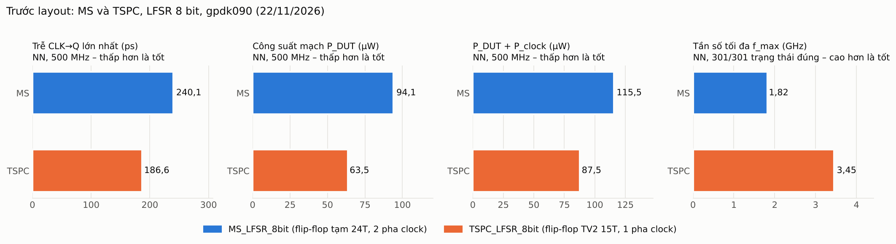
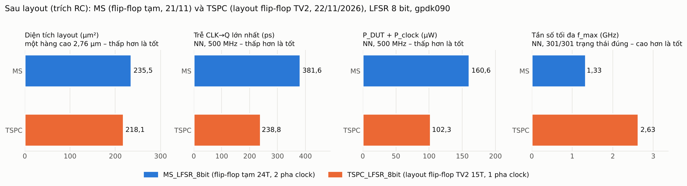
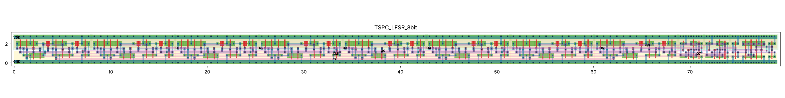
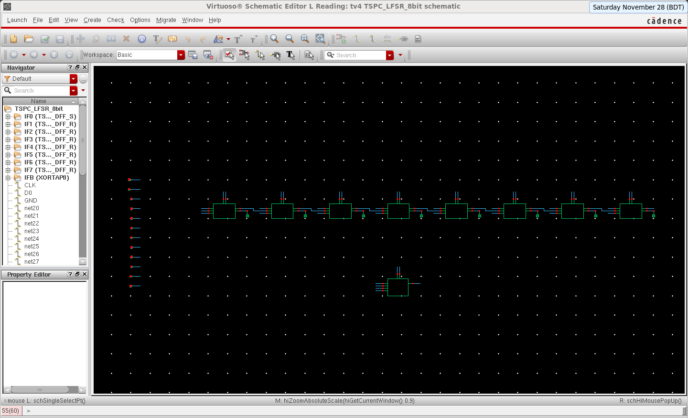

# TV4 – Lõi PRNG/LFSR 8 bit và kiểm chứng toán học

Phần việc của **Thành viên 4 – Huỳnh Anh Tuấn** trong đồ án *8-bit TSPC LFSR BIST* (Cadence Virtuoso IC6.1.5, gpdk090, VDD 1,2 V).

Bộ sinh mẫu giả ngẫu nhiên 8 bit (PRPG) với đa thức nguyên thủy **P(x) = 1 + x + x⁶ + x⁷ + x⁸**, làm theo hai kiểu flip-flop để so sánh: master-slave cổng truyền (bản chuẩn) và TSPC một pha clock (bản đề xuất). Kèm theo bộ sinh mẫu ít chuyển mạch LT-RTPG và một golden model MATLAB để kiểm chứng từng chu kỳ.

| Hạng mục | Trạng thái |
|---|---|
| Golden model MATLAB (255 trạng thái, đa thức nguyên thủy, Golomb, CFSR, LT-RTPG) | Xong |
| MS_LFSR_8bit, TSPC_LFSR_8bit, TSPC_CFSR_8bit, LT_RTPG_8bit (netlist + schematic/symbol) | Xong; bản TSPC dùng flip-flop của TV2, bản MS dùng flip-flop tạm |
| Mô phỏng Spectre trước layout, 300 chu kỳ, 3 corner NN/SS/FF | 18/18 testbench PASS 301/301 (TSPC với flip-flop TV2) |
| f_max, độ dốc sườn clock, so sánh MS và TSPC | Xong |
| Thay flip-flop TV2 (TSPC) | **Xong** (22/11): netlist (15/15 testbench TSPC PASS 301/301) và layout (commit TV2 `ac228bf`) |
| Thay flip-flop TV1 (MS) | Chờ cell |
| Layout dải TSPC_LFSR_8bit và MS_LFSR_8bit (khuôn cell TV3), DRC/LVS/RCX | Xong: DRC 0 lỗi, LVS khớp. TSPC dùng layout flip-flop TV2; MS dùng flip-flop tạm (TV1 chưa có cell) |
| Mô phỏng hậu layout (RCX) NN/SS/FF | 6/6 testbench PASS 301/301 |

> **Flip-flop đang dùng:** bản TSPC dùng **cell thật của TV2** (TSPC_DFF_R/S 15T, có keeper) cả ở netlist (commit `25fc686`) lẫn layout (commit `ac228bf`). Bản MS dùng **flip-flop tạm** DFF_MS_TMP (24T) của TV4 ở cả netlist và layout, cho đến khi TV1 nộp cell. Cách thay: [Thiết kế mạch, 2.5](docs/2_thiet_ke_mach.md#25-thay-flip-flop-tạm).

## Kết quả chính



| Trước layout, NN, 27 °C, 500 MHz | Transistor | Trễ CLK→Q | P_DUT | P_DUT + P_clock | f_max (NN / SS) |
|---|---:|---:|---:|---:|---:|
| MS_LFSR_8bit (flip-flop tạm) | 218 | 240,1 ps | 94,1 µW | 115,5 µW | 1,82 / 1,25 GHz |
| **TSPC_LFSR_8bit (flip-flop TV2)** | **144** | **186,6 ps** | **63,5 µW** | **87,5 µW** | **3,45 / 2,38 GHz** |
| TSPC so với MS | −33,9 % | −22,3 % | −32,6 % | −24,2 % | ×1,9 / ×1,9 |

**Sau layout** (trích RC, NN, 500 MHz; TSPC dùng layout flip-flop TV2, MS dùng flip-flop tạm; chi tiết ở [5. Layout](docs/5_layout.md)):

| | Diện tích | Trễ CLK→Q | P_DUT + P_clock | f_max NN |
|---|---:|---:|---:|---:|
| MS_LFSR_8bit | 235,48 µm² | 381,6 ps | 160,6 µW | 1,33 GHz |
| **TSPC_LFSR_8bit** | **218,10 µm²** | **238,8 ps** | **102,3 µW** | **2,63 GHz** |
| TSPC so với MS | −7,4 % | −37,4 % | −36,3 % | ×2,0 |

Diện tích chỉ còn nhỏ hơn 7,4 % vì cell flip-flop của TV2 (8,00–8,68 µm, có keeper L = 0,40 µm) rộng hơn flip-flop tạm (5,94 µm). Bản 21/11 với flip-flop tạm: 159,47 µm², 201,5 ps, 89,8 µW, 3,45 GHz.





- **Đúng chức năng:** cả 4 mạch LFSR/CFSR và LT-RTPG khớp golden model ở **301/301 trạng thái** (300 cạnh clock, qua trọn chu kỳ 255 và quay về seed 0x01) ở cả 3 corner.
- **CFSR_FB_OPT của TV3 trong thanh ghi TSPC:** đúng 256 trạng thái ở cả 3 corner; so với CFSR_FB cũ, f_max tăng **14–27 %** (NN 2,63 → 3,33 GHz trước layout khối, 3,13 → 3,57 GHz với netlist RCX của khối), công suất chỉ giảm 1,6–2 % vì 8 flip-flop chiếm phần lớn ([4.3.1](docs/4_ket_qua.md#431-so-sánh-3-khối-hồi-tiếp-cfsr-của-tv3-trong-thanh-ghi-tspc-22112026)).
- **Tải clock:** 32 cổng MOS nối clock (TSPC) so với 66 (MS), không cần tạo CLKB.
- **LT-RTPG bật (LP = 1):** công suất tải ngõ vào CUT giảm **44,8 %**; golden model dự đoán giảm 50 % số bit lật.
- **Giới hạn của TSPC:** với flip-flop TV2, sai khi sườn clock ≥ 600 ps (MS vẫn đúng tới 800 ps), nên cây clock phải giữ sườn ≤ 400 ps; ngoài ra cần đủ lề hold khi Q của flip-flop trước nối thẳng vào D (lỗi race của flip-flop tạm ở hậu layout corner FF đã sửa; dải dùng layout flip-flop TV2 không bị, xem [5. Layout](docs/5_layout.md#lỗi-race-tìm-thấy-ở-hậu-layout-của-bản-flip-flop-tạm-2111-và-cách-sửa)).

![Dạng sóng Q[7:0] của TSPC_LFSR_8bit trong ViVA, 42 ns đầu](docs/images/wave_tspc_0-42ns.png)

## Kiến trúc


| Khối | Mô tả | Transistor |
|---|---|---:|
| `MS_LFSR_8bit` | bản chuẩn: 8 DFF_MS + XORTAP8 + INV_CLK tạo CLKB | 218 |
| `TSPC_LFSR_8bit` | bản đề xuất: 8 flip-flop TSPC của TV2 + XORTAP8, một pha clock | 144 |
| `TSPC_LFSR_8bit_CMOS` | đối chứng mạng hồi tiếp: XORTAP8_CMOS (3 XOR CMOS 12T) | 156 |
| `TSPC_CFSR_8bit` | LFSR đầy đủ 256 trạng thái (thêm 0x00), dùng CFSR_FB_OPT của TV3 | 162 |
| `LT_RTPG_8bit` | bộ sinh mẫu ít chuyển mạch (k = 2) | 362 |

Schematic TSPC_LFSR_8bit trong Virtuoso (thêm ảnh khối, symbol, testbench ở [Thiết kế mạch, 2.6](docs/2_thiet_ke_mach.md#26-ảnh-schematic-trong-virtuoso)):



## Cấu trúc thư mục

```text
Huynh_Anh_Tuan/
├── README.md                 trang này
├── docs/                     tài liệu kỹ thuật
│   ├── 1_golden_model.md     kiểm chứng toán học
│   ├── 2_thiet_ke_mach.md    cell, khối, chân, cách thay flip-flop
│   ├── 3_mo_phong.md         testbench, cách chạy Spectre / ngspice / Virtuoso
│   ├── 4_ket_qua.md          toàn bộ bảng kết quả và dạng sóng
│   ├── 5_layout.md           layout dải LFSR 8 bit, DRC/LVS/RCX, hậu layout
│   └── images/
├── golden_model/
│   ├── lfsr_golden_tv4.m     golden model MATLAB (R2019b trở lên)
│   └── out/                  bảng giá trị chuẩn (CSV/HEX), từ điển lỗi, báo cáo kiểm chứng
├── cells/                    cell của TV4: INV_CLK, AND2_T, MUX2_N, flip-flop tạm (DFF_MS_TMP; DFF_TSPC_TMP cho layout), lớp chuyển đổi DFF_MS
├── blocks/                   LFSR_8bit.scs, LT_RTPG_8bit.scs
├── tb/                       testbench Spectre NN/SS/FF + giá trị mong đợi .exp (sinh từ golden model)
├── layout/
│   ├── gds/                  GDS cell lá (DFF_TSPC_TMP, DFF_MS_TMP, INV_CLK) và hai dải LFSR 8 bit
│   ├── cdl/                  netlist so sánh LVS
│   ├── assura/               báo cáo LVS
│   ├── rcx/                  netlist trích RC (HSPICE) + bản include Spectre cho testbench hậu layout
│   └── dien_tich.json        kích thước, diện tích, rãnh Metal4
├── scripts/
│   ├── gen_tb.py             sinh testbench từ golden_model/out
│   ├── run_tv4.sh            chạy Spectre và kiểm tra từng vector
│   ├── run_fmax.sh           quét chu kỳ clock tìm f_max
│   ├── run_slew.sh           quét độ dốc sườn clock
│   ├── gen_tb_cfsr_cmp.py, run_cfsr_cmp.sh  so sánh 3 khối hồi tiếp CFSR của TV3 trong thanh ghi TSPC
│   ├── check_tv4.awk         so dạng sóng với .exp, đo trễ và công suất
│   ├── count_tx.py           đếm transistor, cổng nối clock
│   ├── ve_so_sanh.py         vẽ biểu đồ so sánh MS và TSPC (trước và sau layout)
│   ├── cadence/              SKILL: tạo thư viện tv4, vẽ schematic + symbol từ netlist, vẽ khối/testbench dễ đọc + mô phỏng OCEAN
│   ├── hinh/                 xử lý ảnh: schematic nền trắng, ghép dạng sóng ViVA với dải giá trị bus
│   ├── layout/               sinh layout (Python + gdstk), Assura DRC/LVS/RCX, đổi netlist RCX sang Spectre
│   └── ngspice/              kiểm tra logic nhanh không cần Cadence
├── results/                  kết quả Spectre dạng chữ (RESULT, f_max, sườn clock, số transistor)
└── depend/                  bản sao phần của thành viên khác mà mạch TV4 dùng (dependencies), chỉ đọc
    ├── tv2/                  bản sao flip-flop TSPC của TV2 (branch TV2): netlist TSPC_DFF_R/S (25fc686), layout GDS/CDL/RCX (ac228bf)
    └── tv3/                  bản sao cell TV3 (branch TV3, commit 435f6f0, giống hệt 195bacb) mà khối LFSR dùng, kèm GDS và RCX khối CFSR
```

## Chạy nhanh

Gõ trong terminal, đứng ở thư mục `Huynh_Anh_Tuan/` (không gõ trong CIW của Virtuoso). Lệnh Spectre và Assura chạy trong terminal Linux của máy có Cadence; lệnh Python chạy được trên máy bất kỳ có Python 3.

```bash
# 1. Golden model (MATLAB): tạo golden_model/out/*.csv
cd golden_model && matlab -batch lfsr_golden_tv4        # hoặc mở MATLAB và chạy lfsr_golden_tv4

# 2. Sinh testbench từ golden model (Python 3, máy nào cũng được)
python3 scripts/gen_tb.py

# 3. Mô phỏng Spectre (máy có Cadence MMSIM, model gpdk090)
bash scripts/run_tv4.sh                                  # 24 testbench NN/SS/FF (18 trước layout + 6 hậu layout)
bash scripts/run_tv4.sh tb/tb_TSPC_LFSR_NN.scs           # chạy một testbench

# 4. Layout (Python 3 + gdstk) và Assura DRC/LVS/RCX (máy có Assura)
python3 scripts/layout/build_layout.py
bash scripts/layout/assura.sh drc TSPC_LFSR_8bit
bash scripts/layout/assura.sh lvs TSPC_LFSR_8bit
```

Đường dẫn model gpdk090 mặc định là `/home/buet/cadence/gpdk090_v4.6/models/spectre/gpdk090.scs` (biến `MODEL` trong `scripts/gen_tb.py`). Chi tiết: [docs/3_mo_phong.md](docs/3_mo_phong.md).

## Tài liệu

1. [Golden model và kiểm chứng toán học](docs/1_golden_model.md)
2. [Thiết kế mạch: cell, khối, chân](docs/2_thiet_ke_mach.md)
3. [Testbench và cách mô phỏng](docs/3_mo_phong.md)
4. [Kết quả đầy đủ](docs/4_ket_qua.md)
5. [Layout dải LFSR 8 bit, DRC/LVS/RCX, hậu layout](docs/5_layout.md)

## Phụ thuộc vào thành viên khác

| Thành viên | Dùng gì | Trạng thái |
|---|---|---|
| TV1 | `MS_DFF_SetReset` (netlist + layout cùng khuôn cell) thay cho DFF_MS_TMP | chờ |
| TV2 | `TSPC_DFF_R`, `TSPC_DFF_S` (15T, có keeper) | **đã dùng**: netlist (commit `25fc686`) và layout (GDS, CDL, RCX, commit `ac228bf`), 22/11 |
| TV3 | INV_X1, NAND2_X1, NOR2_X1, NOR3_X1, XOR2_X1, XOR2_TG6, AOI21_X1, XNOR2_X1, XORTAP8, CFSR_FB_OPT; khuôn cell và GDS XOR2_TG6, XOR2_X1 cho layout | đã dùng, branch TV3 commit `435f6f0` (kiểm lại với `195bacb` ngày 22/11: netlist không đổi); đã thử 3 khối CFSR trong thanh ghi TSPC |
| TV5, TV6 | nhận V[7:0] từ LT_RTPG_8bit cho CUT và MISR | – |

Quy ước chung của nhóm: chân nguồn `VDD`, `GND`; tín hiệu reset hiện đặt tên `RST`, tích cực mức cao.

## Tài liệu tham khảo

- N. H. E. Weste, D. M. Harris, *CMOS VLSI Design: A Circuits and Systems Perspective*, 4th ed., 2011: Bảng 11.8 (đa thức LFSR), chương 10 (flip-flop TSPC).
- J. Yuan, C. Svensson, "High-speed CMOS circuit technique," *IEEE JSSC*, vol. 24, no. 1, 1989.
- S. Wang, S. K. Gupta, "LT-RTPG: A new test-per-scan BIST TPG for low switching activity," *IEEE Trans. CAD*, 2006.
