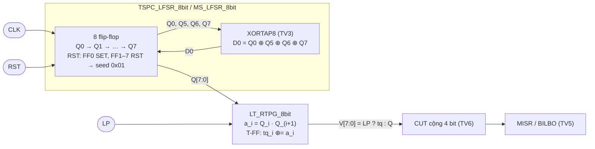

# TV4 – Lõi PRNG/LFSR 8 bit và kiểm chứng toán học

Phần việc của **Thành viên 4 – Huỳnh Anh Tuấn** trong đồ án *8-bit TSPC LFSR BIST* (Cadence Virtuoso IC6.1.5, gpdk090, VDD 1,2 V).

Bộ sinh mẫu giả ngẫu nhiên 8 bit (PRPG) với đa thức nguyên thủy **P(x) = 1 + x + x⁶ + x⁷ + x⁸**, làm theo hai kiểu flip-flop để so sánh: master-slave cổng truyền (bản chuẩn) và TSPC một pha clock (bản đề xuất). Kèm theo bộ sinh mẫu ít chuyển mạch LT-RTPG và một golden model MATLAB để kiểm chứng từng chu kỳ.

| Hạng mục | Trạng thái |
|---|---|
| Golden model MATLAB (255 trạng thái, đa thức nguyên thủy, Golomb, CFSR, LT-RTPG) | Xong |
| MS_LFSR_8bit, TSPC_LFSR_8bit, TSPC_CFSR_8bit, LT_RTPG_8bit (netlist + schematic/symbol) | Xong, dùng flip-flop tạm |
| Mô phỏng Spectre 300 chu kỳ, 3 corner NN/SS/FF | 18/18 testbench PASS 301/301 |
| f_max, độ dốc sườn clock, so sánh MS và TSPC | Xong |
| Thay flip-flop của TV1 (MS) và TV2 (TSPC) | Chờ cell |
| Layout dải LFSR 8 bit, DRC/LVS | Chờ layout cell của TV2, TV3 |

> Mọi số liệu dưới đây đo với **flip-flop tạm do TV4 viết** (DFF_MS_TMP 24T, DFF_TSPC_TMP 17T) để ghép và kiểm chứng lõi LFSR trong lúc chờ cell của TV1/TV2. Số cuối cùng sẽ cập nhật khi thay cell thật (chỉ phải sửa 2 file, xem [Thiết kế mạch](docs/2_thiet_ke_mach.md#24-thay-flip-flop-tạm)).

## Kết quả chính


| NN, 27 °C, 500 MHz | Transistor | Trễ CLK→Q | P_DUT | P_DUT + P_clock | f_max (NN / SS) |
|---|---:|---:|---:|---:|---:|
| MS_LFSR_8bit | 218 | 240,1 ps | 94,1 µW | 115,4 µW | 1,82 / 1,25 GHz |
| **TSPC_LFSR_8bit** | **160** | **181,2 ps** | **59,0 µW** | **82,5 µW** | **3,57 / 2,50 GHz** |
| TSPC so với MS | −26,6 % | −24,5 % | −37,3 % | −28,5 % | ×1,96 / ×2,0 |

- **Đúng chức năng:** cả 4 mạch LFSR/CFSR và LT-RTPG khớp golden model ở **301/301 trạng thái** (300 cạnh clock, qua trọn chu kỳ 255 và quay về seed 0x01) ở cả 3 corner.
- **Tải clock:** 32 cổng MOS nối clock (TSPC) so với 66 (MS), không cần tạo CLKB.
- **LT-RTPG bật (LP = 1):** công suất tải ngõ vào CUT giảm **44,8 %**; golden model dự đoán giảm 50 % số bit lật.
- **Giới hạn của TSPC:** sai khi sườn clock ≥ 300 ps (MS vẫn đúng tới 800 ps), nên cây clock phải giữ sườn ≤ 200 ps.

![Dạng sóng Q[7:0] của TSPC_LFSR_8bit, 80 ns đầu](docs/images/spectre_TSPC_LFSR_8bit_NN_0-80ns.png)

## Kiến trúc



| Khối | Mô tả | Transistor |
|---|---|---:|
| `MS_LFSR_8bit` | bản chuẩn: 8 DFF_MS + XORTAP8 + INV_CLK tạo CLKB | 218 |
| `TSPC_LFSR_8bit` | bản đề xuất: 8 DFF_TSPC + XORTAP8, một pha clock | 160 |
| `TSPC_LFSR_8bit_CMOS` | đối chứng mạng hồi tiếp: XORTAP8_CMOS (3 XOR CMOS 12T) | 172 |
| `TSPC_CFSR_8bit` | LFSR đầy đủ 256 trạng thái (thêm 0x00), dùng CFSR_FB của TV3 | 192 |
| `LT_RTPG_8bit` | bộ sinh mẫu ít chuyển mạch (k = 2) | 378 |

## Cấu trúc thư mục

```text
Huynh_Anh_Tuan/
├── README.md                 trang này
├── docs/                     tài liệu kỹ thuật
│   ├── 1_golden_model.md     kiểm chứng toán học
│   ├── 2_thiet_ke_mach.md    cell, khối, chân, cách thay flip-flop
│   ├── 3_mo_phong.md         testbench, cách chạy Spectre / ngspice / Virtuoso
│   ├── 4_ket_qua.md          toàn bộ bảng kết quả và dạng sóng
│   └── images/
├── golden_model/
│   ├── lfsr_golden_tv4.m     golden model MATLAB (R2019b trở lên)
│   └── out/                  bảng giá trị chuẩn (CSV/HEX), từ điển lỗi, báo cáo kiểm chứng
├── cells/                    cell của TV4: INV_CLK, AND2_T, MUX2_N, flip-flop tạm, lớp chuyển đổi DFF_MS/DFF_TSPC
├── blocks/                   LFSR_8bit.scs, LT_RTPG_8bit.scs
├── tb/                       testbench Spectre NN/SS/FF + giá trị mong đợi .exp (sinh từ golden model)
├── scripts/
│   ├── gen_tb.py             sinh testbench từ golden_model/out
│   ├── run_tv4.sh            chạy Spectre và kiểm tra từng vector
│   ├── run_fmax.sh           quét chu kỳ clock tìm f_max
│   ├── run_slew.sh           quét độ dốc sườn clock
│   ├── check_tv4.awk         so dạng sóng với .exp, đo trễ và công suất
│   ├── count_tx.py           đếm transistor, cổng nối clock
│   ├── cadence/              SKILL: tạo thư viện tv4, vẽ schematic + symbol từ netlist
│   └── ngspice/              kiểm tra logic nhanh không cần Cadence
├── results/                  kết quả Spectre dạng chữ (RESULT, f_max, sườn clock, số transistor)
└── deps/tv3/                 bản sao cell TV3 (commit 86e42ee) mà khối LFSR dùng
```

## Chạy nhanh

```bash
# 1. Golden model (MATLAB): tạo golden_model/out/*.csv
cd golden_model && matlab -batch lfsr_golden_tv4        # hoặc mở MATLAB và chạy lfsr_golden_tv4

# 2. Sinh testbench từ golden model (Python 3, máy nào cũng được)
python3 scripts/gen_tb.py

# 3. Mô phỏng Spectre (máy có Cadence MMSIM, model gpdk090)
bash scripts/run_tv4.sh                                  # 18 testbench NN/SS/FF
bash scripts/run_tv4.sh tb/tb_TSPC_LFSR_NN.scs           # chạy một testbench
```

Đường dẫn model gpdk090 mặc định là `/home/buet/cadence/gpdk090_v4.6/models/spectre/gpdk090.scs` (biến `MODEL` trong `scripts/gen_tb.py`). Chi tiết: [docs/3_mo_phong.md](docs/3_mo_phong.md).

## Tài liệu

1. [Golden model và kiểm chứng toán học](docs/1_golden_model.md)
2. [Thiết kế mạch: cell, khối, chân](docs/2_thiet_ke_mach.md)
3. [Testbench và cách mô phỏng](docs/3_mo_phong.md)
4. [Kết quả đầy đủ](docs/4_ket_qua.md)

## Phụ thuộc vào thành viên khác

| Thành viên | Dùng gì | Trạng thái |
|---|---|---|
| TV1 | `MS_DFF_SetReset` thay cho DFF_MS_TMP | chờ |
| TV2 | `TSPC_DFF_SetReset` (có keeper) thay cho DFF_TSPC_TMP | chờ |
| TV3 | INV_X1, NAND2_X1, NOR2_X1, NOR3_X1, XOR2_X1, XOR2_TG6, XORTAP8, CFSR_FB | đã dùng, commit `86e42ee` |
| TV5, TV6 | nhận V[7:0] từ LT_RTPG_8bit cho CUT và MISR | – |

Quy ước chung của nhóm: chân nguồn `VDD`, `GND`; tín hiệu reset hiện đặt tên `RST`, tích cực mức cao.

## Tài liệu tham khảo

- N. H. E. Weste, D. M. Harris, *CMOS VLSI Design: A Circuits and Systems Perspective*, 4th ed., 2011: Bảng 11.8 (đa thức LFSR), chương 10 (flip-flop TSPC).
- J. Yuan, C. Svensson, "High-speed CMOS circuit technique," *IEEE JSSC*, vol. 24, no. 1, 1989.
- S. Wang, S. K. Gupta, "LT-RTPG: A new test-per-scan BIST TPG for low switching activity," *IEEE Trans. CAD*, 2006.
