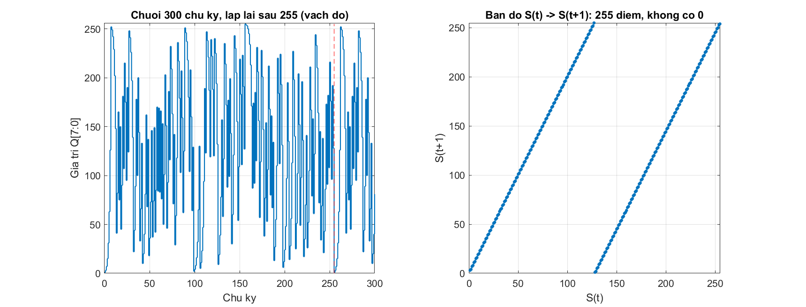
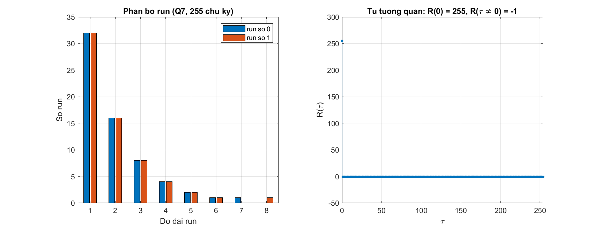
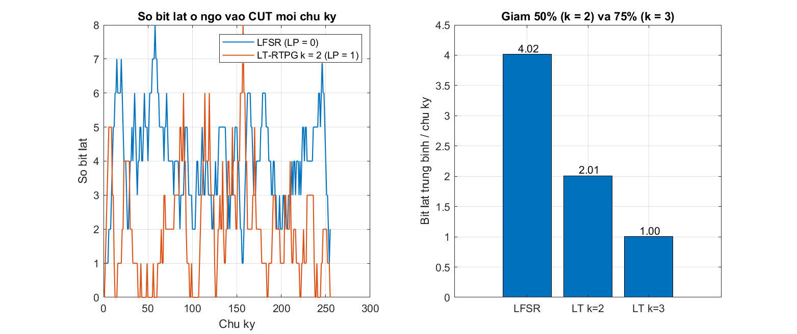

# 1. Golden model và kiểm chứng toán học

[← README](../README.md) · [2. Thiết kế mạch →](2_thiet_ke_mach.md)

Golden model là mô hình phần mềm của đúng phần cứng TV4 làm: cùng đa thức, cùng chiều dịch, cùng seed. Nó dùng cho hai việc:
1. chứng minh đa thức chọn đúng (chu kỳ tối đa, nguyên thủy, tính giả ngẫu nhiên);
2. sinh **bảng giá trị chuẩn** cho testbench: mỗi trạng thái Q[7:0] ở mỗi chu kỳ mà mạch Spectre phải ra đúng.

File: [`golden_model/lfsr_golden_tv4.m`](../golden_model/lfsr_golden_tv4.m) (MATLAB R2019b trở lên, không cần toolbox).

```bash
cd golden_model
matlab -batch lfsr_golden_tv4      # hoặc mở MATLAB, cd vào thư mục này, gõ lfsr_golden_tv4
```

## 1.1. Mô hình phần cứng

| Thông số | Giá trị |
|---|---|
| Đa thức | P(x) = 1 + x + x⁶ + x⁷ + x⁸ (Weste & Harris, Bảng 11.8) |
| Thanh ghi | 8 flip-flop, dịch Q0 → Q1 → … → Q7 mỗi cạnh lên clock |
| Hồi tiếp | D0 = Q0 ⊕ Q5 ⊕ Q6 ⊕ Q7 (khối XORTAP8 của TV3) |
| Seed | 0x01 sau RST (FF0 nạp 1 bằng chân SET, FF1..FF7 nạp 0 bằng RST) |
| CFSR | thêm ZERO7: khi Q0..Q6 = 0 thì đảo D0, đưa 0x00 vào chuỗi |

Dạng ma trận: Q(t+1) = T·Q(t) (mod 2), với T là ma trận đồng hành 8×8 (hàng đầu `1 0 0 0 0 1 1 1`, phần còn lại là dịch).

## 1.2. Kết quả kiểm chứng

| Hạng mục | Kết quả | Lý thuyết |
|---|---|---|
| Chu kỳ từ seed 0x01 | 255 trạng thái khác nhau, không có 0x00; sau 255 cạnh quay về 0x01 | 2⁸ − 1 = 255 |
| Ma trận đồng hành | khớp mô phỏng 255 bước; T²⁵⁵ = I; T⁸⁵, T⁵¹, T¹⁵ ≠ I | 255 = 3·5·17 → bậc của T là 255 → đa thức **nguyên thủy** |
| CFSR từ 0x00 | 256 trạng thái khác nhau, đoạn qua 0: 80 → 00 → 01 | 2⁸ = 256 |
| Golomb 1 (cân bằng), bit Q7 | 128 số 1, 127 số 0 | 128 / 127 |
| Golomb 2 (run) | 128 run: độ dài 1: 32/32, 2: 16/16, 3: 8/8, 4: 4/4, 5: 2/2, 6: 1/1, 7: 0/1, 8: 1/0 (số 1 / số 0) | một nửa run dài 1, một phần tư dài 2, … |
| Golomb 3 (tự tương quan) | R(0) = 255, R(τ) = −1 với mọi τ = 1..254 | hai mức |

11 trạng thái đầu: `01 03 07 0F 1F 3F 7E FC F9 F2 E5`.





## 1.3. LT-RTPG: giảm số bit lật ở ngõ vào CUT

Mỗi bit i: a_i = Q_i · Q_(i+1 mod 8) (k = 2 bit liên tiếp), flip-flop T: tq_i(t+1) = tq_i(t) ⊕ a_i(t), ngõ ra V_i = LP ? tq_i : Q_i.

| Chế độ | Bit lật trung bình / chu kỳ | Vector khác nhau trong 255 chu kỳ | Phủ A[3:0] / B[3:0] của CUT cộng 4 bit |
|---|---:|---:|---|
| LFSR thường (LP = 0) | 4,016 | 255 | – |
| LT-RTPG k = 2 (chọn làm phần cứng) | 2,008 (−50 %) | 101 | 14/16, 16/16 |
| LT-RTPG k = 3 | 1,004 (−75 %) | 61 | 14/16, 16/16 |

Chọn k = 2: giảm một nửa chuyển mạch mà vẫn giữ đủ đa dạng mẫu. T-FF tự về 0 sau 255 chu kỳ nên V cũng tuần hoàn 255.



## 1.4. Chữ ký MISR tham khảo (cho TV5, TV6)

MISR 8 bit cùng đa thức, reset 0x00, CUT là bộ cộng 4 bit (A = V[3:0], B = V[7:4]), chạy 255 chu kỳ:

| Chế độ | Chữ ký đúng | Lỗi SA0/SA1 ở 5 ngõ ra CUT |
|---|---|---|
| LP = 0 | 0xDE | phát hiện 10/10 |
| LP = 1 (LT k = 2) | 0x79 | phát hiện 10/10 |

Chạy đúng 255 chu kỳ thì SA0 và SA1 trên cùng một dây cho **cùng chữ ký**, vì I + T + … + T²⁵⁴ = 0 khi T²⁵⁵ = I: lỗi vẫn bị phát hiện nhưng không phân biệt được SA0 hay SA1. Muốn chẩn đoán thì chạy số chu kỳ khác 255. Bảng đầy đủ: [`golden_model/out/fault_dictionary.csv`](../golden_model/out/fault_dictionary.csv).

## 1.5. File xuất ra (`golden_model/out/`)

| File | Nội dung | Dùng cho |
|---|---|---|
| `golden_lfsr_255.csv`, `.hex` | 256 dòng (chu kỳ 0..255): hex, nhị phân, từng bit, D0 kế tiếp | bảng giá trị chuẩn |
| `golden_lfsr_300.csv` | 301 trạng thái (300 cạnh clock) | testbench LFSR |
| `golden_cfsr_256.csv` | 257 trạng thái CFSR từ 0x00 | testbench CFSR |
| `golden_lt_rtpg_k2.csv` | Q, V (LP = 1), số bit lật | testbench LT-RTPG |
| `fault_dictionary.csv` | chữ ký MISR khi tiêm lỗi | TV5, TV6 |
| `bao_cao_golden_matlab.txt` | toàn bộ kết quả kiểm chứng ở trên | – |
| `hinh_*.png` | hình trong trang này (không đưa lên git, sinh lại khi chạy) | – |

`scripts/gen_tb.py` đọc trực tiếp các file CSV này để viết file `.exp` cho testbench, nên mạch Spectre được so với đúng golden model MATLAB.
