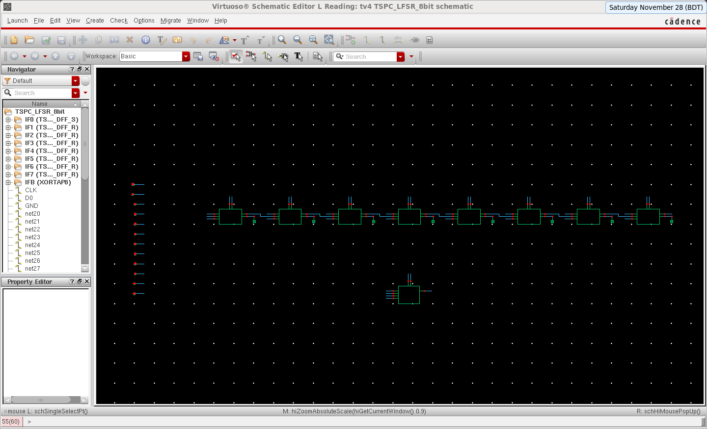
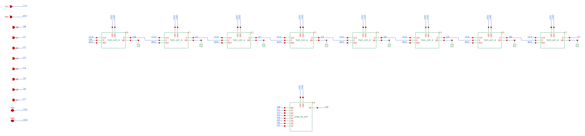
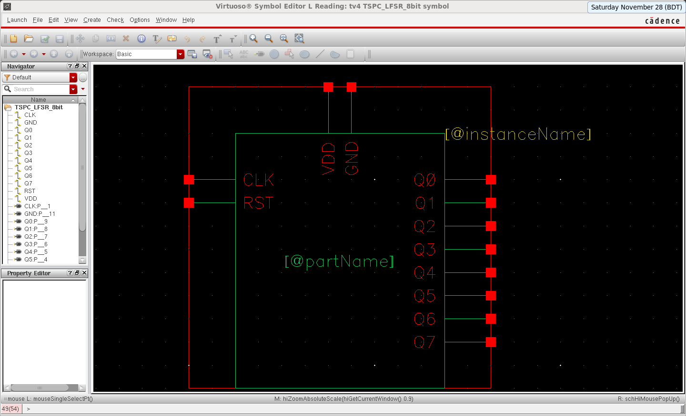
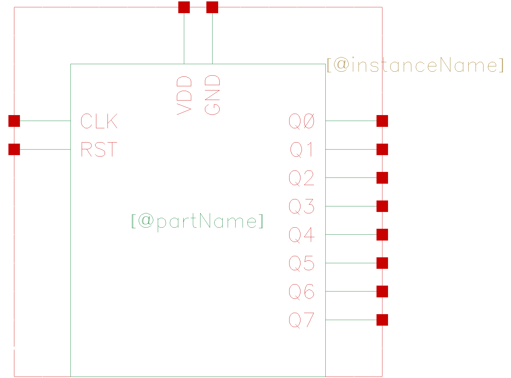
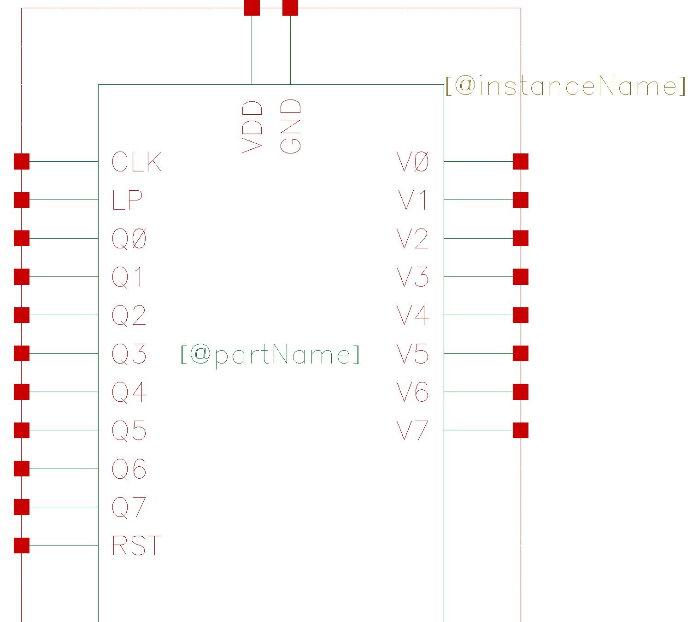
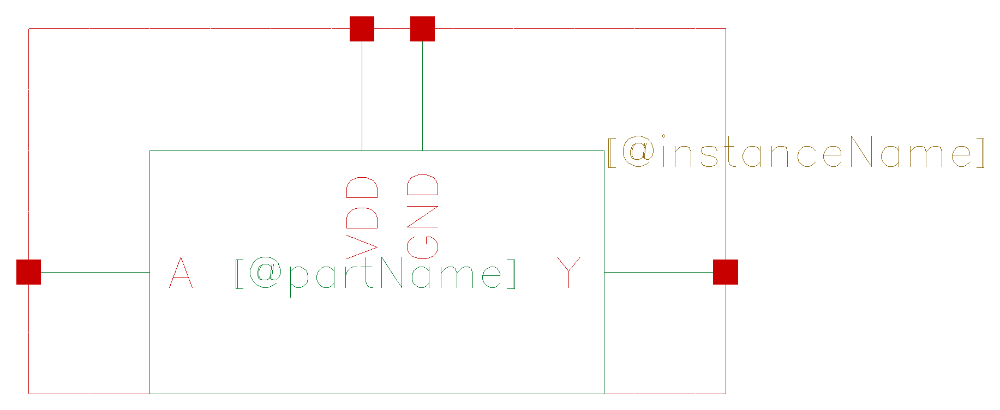
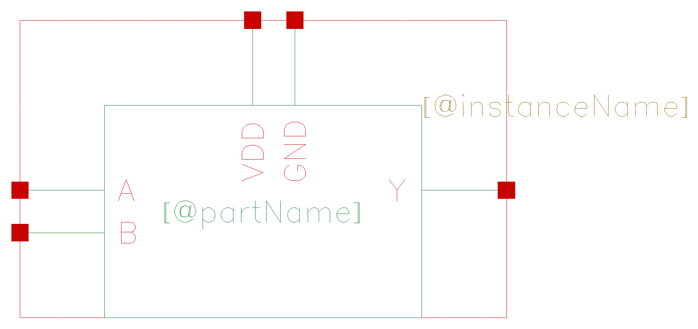
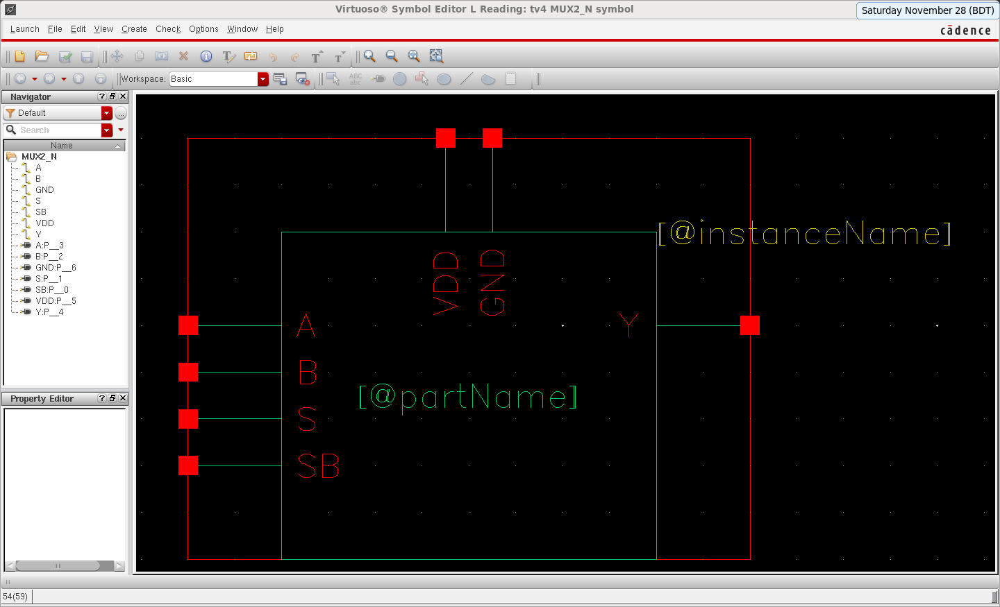
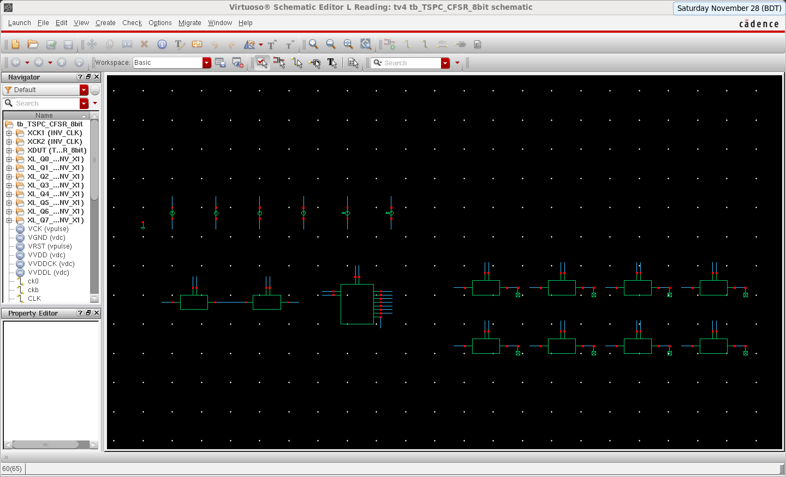
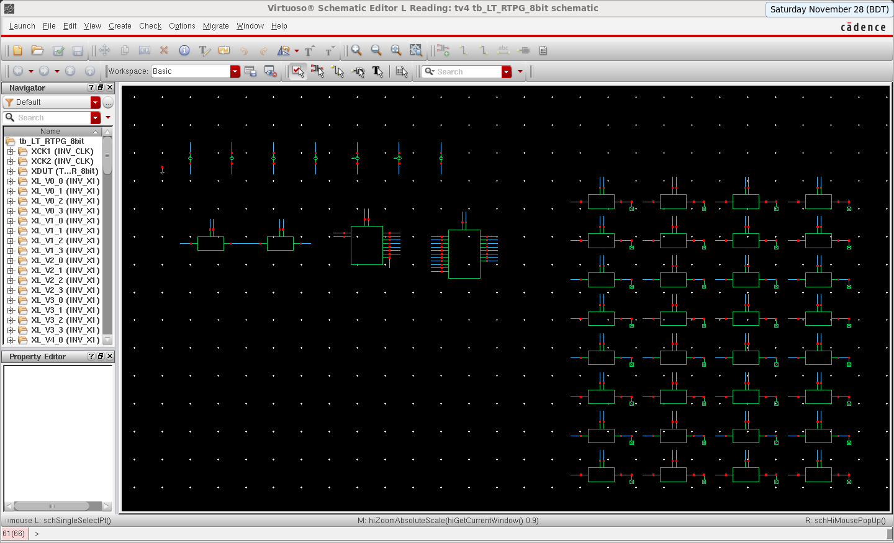

# 2. Thiết kế mạch: cell, khối, chân

[← 1. Golden model](1_golden_model.md) · [README](../README.md) · [3. Mô phỏng →](3_mo_phong.md)

Công nghệ gpdk090 (`gpdk090_nmos1v`, `gpdk090_pmos1v`), VDD 1,2 V, L = 0,1 µm cho mọi transistor. Chân nguồn thống nhất của nhóm: `VDD`, `GND`.
Mỗi cell là một file Spectre (`subckt`), ghép theo thứ tự include: model → cell TV3 → flip-flop TV2 → `cells/cells.scs` → `blocks/`.

## 2.1. Cell của TV4 (`cells/`)

| Cell | Chân | Chức năng | T |
|---|---|---|---:|
| `INV_CLK` | A Y VDD GND | inverter gấp 4 lần INV_X1 (N 0,48 / P 0,96 µm): đệm clock, tạo CLKB | 2 |
| `AND2_T` | A B Y VDD GND | NAND2_X1 + INV_X1, tính a_i trong LT-RTPG | 6 |
| `MUX2_N` | A B S SB Y VDD GND | Y = S ? B : A bằng 3 NAND2_X1; SB đưa từ ngoài vào để 8 mux dùng chung một inverter | 12 |
| `DFF_MS_TMP` | D CLK CLKB SET RST Q VDD GND | flip-flop master-slave cổng truyền tạm của TV4, 4 TG + 4 NOR2 (NOR làm luôn SET/RST); từ 24/11 chỉ còn dùng trong dải layout MS (TV1 chưa có layout) | 24 |
| `DFF_TSPC_TMP` | D CLK SET RST Q VDD GND | flip-flop TSPC 9T (Yuan–Svensson) kích cạnh lên + SET/RST, chưa có keeper; **không còn dùng** từ 22/11 (netlist và layout dải TSPC đều dùng cell TV2), giữ lại để đối chiếu | 17 |
| `DFF_MS` | như DFF_MS_TMP | **lớp chuyển đổi**: khối MS chỉ gọi tên này; từ 24/11/2026 trỏ tới `MS_DFF_SetReset` của TV1 ([`depend/tv1/`](../depend/tv1/NGUON.md), 26T) | – |

SET/RST tích cực mức cao, bất đồng bộ. Từ 22/11/2026 các khối TSPC dùng flip-flop thật của TV2 (mục 2.2); từ 24/11/2026 khối MS dùng flip-flop thật của TV1 (`MS_DFF_SetReset`: 4 NOR2 + 4 cổng truyền + inverter ra Q_bar, chân `D CLK CLKB SET RESET Q Q_bar VDD GND`, CLKB lấy từ inverter ngoài cell).

**DFF_TSPC_TMP**: tầng 1 p-C2MOS (X = D̅ khi CLK = 0), tầng 2 n-precharge (Y = 1 khi CLK = 0, Y = X̅ khi CLK = 1), tầng 3 n-C2MOS ra QB, cộng một inverter ra Q. pMOS SET đặt sát VDD, nMOS RST̅ đặt sát GND để tránh chia sẻ điện tích vào nút QB khi nhả SET/RST (lỗi này từng làm Q0 chỉ lên ~0,75 V, đã sửa). MN1 (tầng 1) để 0,12 µm: với 0,24 µm, mô phỏng hậu layout ở corner FF bị race khi D đổi ngay sau cạnh clock ([5. Layout](5_layout.md#lỗi-race-tìm-thấy-ở-hậu-layout-của-bản-flip-flop-tạm-2111-và-cách-sửa)).

## 2.2. Flip-flop TSPC của TV2 (`depend/tv2/`)

| Cell | Chân | Chức năng | T |
|---|---|---|---:|
| `TSPC_DFF_R` | D CLK RST Q QB VDD GND | TSPC kích cạnh lên, Reset bất đồng bộ (RST = 1 → Q = 0); tầng 2 có pMOS/nMOS reset; 2 keeper yếu (L 0,4 µm) giữ QB và Y | 15 |
| `TSPC_DFF_S` | D CLK SET Q QB VDD GND | như trên nhưng Set bất đồng bộ (SET = 1 → Q = 1), đặt ở tầng 3 | 15 |

Bản sao lấy từ branch `cell/TSPC_DFF(2)`, commit `25fc686` (22/11/2026), không sửa ([`depend/tv2/NGUON.md`](../depend/tv2/NGUON.md)). Quy tắc của TV2: chỉ nhả SET khi CLK = 0 (testbench của TV4 nhả RST ở 0,5T, trước cạnh clock đầu tiên); QB là nút động bên trong, để hở.

## 2.3. Cell của TV3 dùng lại (`depend/tv3/`)

INV_X1, NAND2_X1, NOR2_X1, NOR3_X1, AOI21_X1, XOR2_X1 (CMOS 12T), XNOR2_X1 (CMOS 12T), XOR2_TG6 (6T) và các khối:

| Khối | Chức năng | T |
|---|---|---:|
| `XORTAP8` | D0 = Q0 ⊕ Q5 ⊕ Q6 ⊕ Q7: tầng 1 hai XOR2_TG6, tầng 2 XOR2_X1 phục hồi mức | 24 |
| `XORTAP8_CMOS` | cùng hàm, 3 XOR2_X1 (đối chứng) | 36 |
| `CFSR_FB_OPT` | cùng hàm D0 = Q0 ⊕ Q5 ⊕ Q6 ⊕ Q7 ⊕ NOR(Q0..Q6), thêm trạng thái 0x00; rút gọn thành (Q6 ⊕ Q7) ⊕ [(Q0 ⊕ Q5) + NOR3(Q0,Q1,Q2)·NOR3(Q3,Q4,Q6)]: 2 XOR2_TG6 + 2 NOR3 + AOI21 + XNOR2 | 42 |
| `CFSR_FB` | bản cũ, XORTAP8 ⊕ ZERO7 (TV3 giữ để so sánh, TV4 không dùng nữa) | 56 |

Bản sao lấy từ branch `cell/XOR-CFSR-LOGIC(3)`, commit `435f6f0` (PR #2, chưa gộp vào `main`; bản `195bacb` ngày 22/11 có netlist giống hệt), không sửa ([`depend/tv3/NGUON.md`](../depend/tv3/NGUON.md)).

## 2.4. Khối của TV4 (`blocks/`)

| Khối | Chân | Cấu tạo | T | MOS nối clock |
|---|---|---|---:|---:|
| `MS_LFSR_8bit` | CLK RST Q0..Q7 VDD GND | 8 DFF_MS (MS_DFF_SetReset của TV1) + XORTAP8 + INV_CLK tạo CLKB dùng chung | 234 | 66 |
| `TSPC_LFSR_8bit` | CLK RST Q0..Q7 VDD GND | 1 TSPC_DFF_S + 7 TSPC_DFF_R (TV2) + XORTAP8, chỉ một pha clock | 144 | 32 |
| `TSPC_LFSR_8bit_CMOS` | như trên | như trên nhưng XORTAP8_CMOS (đối chứng mạng hồi tiếp) | 156 | 32 |
| `TSPC_CFSR_8bit` | như trên | 8 TSPC_DFF_R + CFSR_FB_OPT, reset về 0x00, 256 trạng thái | 162 | 32 |
| `LT_RTPG_8bit` | Q0..Q7 CLK RST LP V0..V7 VDD GND | mỗi bit: AND2_T + XOR2_X1 + TSPC_DFF_R (T-FF) + MUX2_N; 1 INV_X1 tạo LPB | 362 | 32 |

Nối dây LFSR (giống nhau ở cả 4 khối):

```text
FF0: D = D0 (từ XORTAP8),  SET = RST, RST = GND   → nạp 1
FF1: D = Q0,               SET = GND, RST = RST   → nạp 0
...
FF7: D = Q6,               SET = GND, RST = RST   → nạp 0
XORTAP8: (Q0, Q5, Q6, Q7) → D0
```

Seed 0x01 nạp bằng chân SET của FF0 (TSPC_DFF_S ở bản TSPC, MS_DFF_SetReset ở bản MS), nên không cần mạch nạp seed riêng. CFSR không cần seed: reset cả 8 FF về 0, nhánh phát hiện 0 trong CFSR_FB_OPT tự đưa chuỗi ra khỏi 0x00.

LT-RTPG: T-FF reset về 0 cùng RST của LFSR. LP = 0 thì V = Q (LFSR thường), LP = 1 thì V = tq (chuỗi ít lật). Ngõ ra V[7:0] đi tới CUT của TV6.

Số transistor và MOS nối clock đếm tự động từ netlist: `python3 scripts/count_tx.py` → [`results/so_transistor.md`](../results/so_transistor.md).

## 2.5. Thay flip-flop tạm

**TSPC (TV2) – đã thay ngày 22/11/2026.** TV2 nộp hai cell riêng (chỉ Reset, chỉ Set) thay vì một cell có cả SET/RST, nên các khối gọi thẳng `TSPC_DFF_S` (FF0) và `TSPC_DFF_R` (các FF còn lại), bỏ lớp chuyển đổi `DFF_TSPC`. Layout của TV2 (commit `ac228bf`) đã thay vào dải `TSPC_LFSR_8bit` cùng ngày ([5. Layout](5_layout.md)). Khi TV2 cập nhật: chép lại `depend/tv2/`, chạy lại mô phỏng, `build_layout.py`, Assura và mô phỏng hậu layout.

**MS (TV1) – đã thay netlist ngày 24/11/2026.** TV1 nộp `MS_DFF_SetReset` (branch `cell/MS_DFF(1)`, commit `fa999e9`, chỉ có thư viện Virtuoso). TV4 xuất netlist từ schematic bằng OCEAN, chép vào [`depend/tv1/`](../depend/tv1/NGUON.md) và đổi dòng `X0` của [`cells/DFF_MS/DFF_MS.scs`](../cells/DFF_MS/DFF_MS.scs) sang cell này (RESET của TV1 tích cực cao, nối thẳng RST; Q_bar để hở). Khối MS, testbench và golden model không đổi. Layout `MS_DFF_SetReset` trên branch chưa có hình vẽ, nên dải layout MS vẫn dùng DFF_MS_TMP.

Khi TV1 cập nhật cell (hoặc có layout):

1. Xuất lại netlist, chép đè `depend/tv1/cells/MS_DFF_SetReset/MS_DFF_SetReset.scs`.
2. Nếu đổi thứ tự hay tên chân, sửa dòng `X0` trong `cells/DFF_MS/DFF_MS.scs`.
3. Chạy lại `scripts/ngspice/precheck_ngspice.py`, `scripts/run_tv4.sh`, `run_fmax.sh`, `run_slew.sh`, `count_tx.py`; cập nhật [`4_ket_qua.md`](4_ket_qua.md).
4. Chạy lại `scripts/cadence/gen_skill.py` và vẽ lại thư viện `tv4`.
5. Layout: chép GDS + CDL của TV1 vào `depend/tv1/layout/`, thêm vị trí chân vào bảng `ACC` (và `DROP` nếu chân chỉ có Metal1) trong `scripts/layout/build_layout.py`, cho dải MS đọc cell mới như dải TSPC đọc cell TV2, rồi chạy lại Assura và mô phỏng hậu layout ([5.6](5_layout.md#56-cách-chạy-lại)).

Khối, testbench và golden model giữ nguyên.

## 2.6. Ảnh schematic trong Virtuoso

Các khối TSPC và testbench được vẽ lại cho dễ đọc bằng [`scripts/cadence/ve_khoi_de_doc.il`](../scripts/cadence/ve_khoi_de_doc.il) (8 flip-flop một hàng, Q(k−1) → D(k) nối dây thật, mạng hồi tiếp ở dưới; CLK, RST, nguồn nối bằng nhãn tên net). Mọi schematic `schCheck` 0 lỗi 0 cảnh báo; ảnh xuất bằng `hiExportImage` rồi đổi nền trắng. Bản MS chưa vẽ lại, chờ flip-flop của TV1.

**TSPC_LFSR_8bit** (1 TSPC_DFF_S + 7 TSPC_DFF_R của TV2, XORTAP8 của TV3):



**TSPC_CFSR_8bit** (8 TSPC_DFF_R, CFSR_FB_OPT):



<details>
<summary>TSPC_LFSR_8bit_CMOS (đối chứng XORTAP8_CMOS)</summary>


</details>

**LT_RTPG_8bit** (mỗi cột một bit: AND2_T, XOR2_X1, TSPC_DFF_R làm T-FF, MUX2_N; INV_X1 tạo LPB):


**Symbol** (dùng khi ghép vào hệ thống BIST):

| TSPC_LFSR_8bit | TSPC_CFSR_8bit | LT_RTPG_8bit |
|---|---|---|
|  |  |  |

| INV_CLK | AND2_T | MUX2_N |
|---|---|---|
|  |  |  |

**Testbench schematic** (giống testbench netlist `tb/*.scs`: nguồn riêng cho DUT `VDD`, clock `VDDCK`, tải `VDDL`; clock qua 2 INV_CLK; mỗi Q tải 1 INV_X1, mỗi V tải 4 INV_X1; biến thiết kế `tclk`, `trf`, `lp`):


<details>
<summary>tb_TSPC_CFSR_8bit và tb_LT_RTPG_8bit</summary>





</details>

## 2.7. Thư viện Virtuoso `tv4`

Thư viện `tv4` (gắn gpdk090) có 26 cell (bản sao cell TV3 và TV2, cell TV4, 5 khối trên) và 3 testbench schematic. Cell vẽ tự động từ chính các netlist đã mô phỏng bằng script SKILL ([3. Mô phỏng, mục 3.5](3_mo_phong.md#35-virtuoso-thư-viện-tv4)). Các khối TSPC, LT_RTPG và testbench sau đó được vẽ lại cho dễ đọc (mục 2.6). Kết quả 22/11/2026: 26/26 cell và 3 testbench schCheck 0 lỗi 0 cảnh báo.
