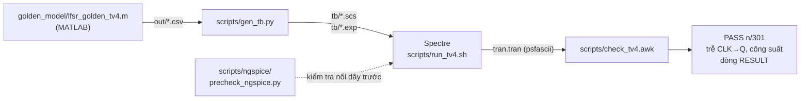

# 3. Testbench và cách mô phỏng

[← 2. Thiết kế mạch](2_thiet_ke_mach.md) · [README](../README.md) · [4. Kết quả →](4_ket_qua.md)

## 3.1. Luồng kiểm chứng



## 3.2. Testbench (`tb/`)

| Testbench | Mạch | Corner | Ghi chú |
|---|---|---|---|
| `tb_MS_LFSR` | MS_LFSR_8bit | NN, SS, FF | mỗi Q tải 1 INV_X1 |
| `tb_TSPC_LFSR` | TSPC_LFSR_8bit | NN, SS, FF | như trên |
| `tb_TSPC_LFSR_CMOS` | TSPC_LFSR_8bit_CMOS | NN, SS, FF | như trên |
| `tb_TSPC_CFSR` | TSPC_CFSR_8bit | NN, SS, FF | chuỗi 256 trạng thái từ 0x00 |
| `tb_LT_RTPG_LP0`, `tb_LT_RTPG_LP1` | TSPC_LFSR_8bit + LT_RTPG_8bit, LP = 0 / 1 | NN, SS, FF | mỗi V_i tải 4 INV_X1 (giả lập ngõ vào CUT) |
| `tb_MS_LFSR_slew`, `tb_TSPC_LFSR_slew` | clock nối thẳng nguồn, không qua đệm | NN | quét độ dốc sườn clock |

Mỗi testbench gồm: thân `tb_<tên>.scs`, ba file corner `tb_<tên>_<NN|SS|FF>.scs` (chỉ khác `section=` của model) và bảng mong đợi `tb_<tên>.exp`. Tất cả sinh bằng `python3 scripts/gen_tb.py`, không sửa tay.

**Kích thích** (T = 2 ns, 500 MHz):
- RST = 1 trong [0; 0,5T] rồi về 0; cạnh lên clock thứ k tại thời điểm kT;
- **300 cạnh clock → 301 vector** (k = 0..300): đi qua trọn chu kỳ 255, quay về seed 0x01 rồi chạy tiếp 45 chu kỳ;
- clock lý tưởng (sườn 20 ps) qua 2 tầng `INV_CLK` để có sườn và tải thật.

**Ba nguồn riêng** để tách công suất:

| Nguồn | Cấp cho | Đo |
|---|---|---|
| `VVDD` | mạch đang thử (DUT) | P_DUT |
| `VVDDCK` | 2 INV_CLK đệm clock | P_clock |
| `VVDDL` | tải INV_X1 ở ngõ ra | P_tải (công suất ngõ vào CUT) |

**Bảng mong đợi `.exp`** (cùng định dạng với TV3, thêm nhiều ngõ ra):
```text
T 2e-09                          chu kỳ clock (s)
MARGIN 1e-10                     lấy mẫu tại (k+1)T - MARGIN = 5 % T trước cạnh kế tiếp
STRICT 1                         mức ra phải cách ray <= 10 % VDD
OUT Q0 Q1 Q2 Q3 Q4 Q5 Q6 Q7
V 0 0 10000000 ; k=0 Q=01        vector k, có đo trễ (0/1), bit mong đợi theo thứ tự OUT
V 1 1 11000000 ; k=1 Q=03
```

**Kiểm tra** (`scripts/check_tv4.awk`, mở rộng từ `check.awk` của TV3): đọc `tran.tran` (psfascii), so từng ngõ ra ở từng vector, đo trễ CLK→Q lớn nhất (lần cắt VDD/2 cuối của ngõ ra, tính từ giữa sườn clock lý tưởng, đã gồm 2 tầng đệm) và công suất trung bình của 3 nguồn. Mạch đạt khi **mọi** vector đúng.

## 3.3. Chạy Spectre

Cần Cadence MMSIM (Spectre) và model gpdk090. Đường dẫn model nằm ở biến `MODEL` trong `scripts/gen_tb.py` (mặc định `/home/buet/cadence/gpdk090_v4.6/models/spectre/gpdk090.scs`); đổi xong chạy lại `gen_tb.py`.

```bash
cd Huynh_Anh_Tuan
bash scripts/run_tv4.sh                                   # 18 testbench NN/SS/FF (khoảng 40 phút)
bash scripts/run_tv4.sh tb/tb_TSPC_LFSR_NN.scs            # một testbench
```

Kết quả trong `out/` (không đưa lên git):

| File | Nội dung |
|---|---|
| `out/<tb>.check` | PASS/FAIL, số vector đúng, vector có trễ lớn nhất, công suất 3 nguồn |
| `out/spectre_results.txt` | một dòng `RESULT` mỗi lần chạy |
| `out/<tb>/tran.tran.gz` | dạng sóng (nén; đặt `KEEP_RAW=1` để giữ nguyên) |

Ví dụ một dòng kết quả:
```text
PASS: 301/301 vector dung, 0 sai
RESULT tb_TSPC_LFSR_NN PASS 301/301 T=2e-09 tre_ps=181.2 P_dut_uW=59.007 P_clk_uW=23.486 P_tai_uW=3.288 ...
```

Xem dạng sóng: `gunzip out/tb_TSPC_LFSR_NN/tran.tran.gz && viva -datadir out/tb_TSPC_LFSR_NN &`.

## 3.4. Tần số tối đa và độ dốc sườn clock

```bash
# f_max: quét chu kỳ clock (ps), mỗi điểm chạy đủ 301 vector
bash scripts/run_fmax.sh tb_TSPC_LFSR NN "500 400 350 320 300 280 260 250"
bash scripts/run_fmax.sh tb_MS_LFSR   SS "1000 900 800 700 650 600"

# Sườn clock: quét thời gian lên/xuống (ps), T = 2 ns
bash scripts/run_slew.sh tb_TSPC_LFSR_slew NN "20 100 200 300 400 600 800"
```

f_max là tần số cao nhất mà mọi vector đều đúng và mọi chu kỳ dài hơn cũng đúng. Kết quả: `out/fmax_<tb>_<corner>.txt`, `out/slew_<tb>_<corner>.txt`.

## 3.5. Virtuoso: thư viện `tv4`

Schematic và symbol vẽ tự động từ netlist, nên luôn khớp với mạch đã mô phỏng.

```bash
python3 scripts/cadence/gen_skill.py        # netlist -> scripts/cadence/tv4_build.il
```

Trong CIW của Virtuoso:
```lisp
load("<thu muc>/scripts/cadence/tv4_lib.il")     ; tao thu vien tv4 gan gpdk090 (neu chua co), them DEFINE vao cds.lib
tv4Overwrite = t                                 ; (tuy chon) ve lai cell da co
load("<thu muc>/scripts/cadence/tv4_build.il")   ; ve schematic + symbol tung cell, chay schCheck, in so loi
```

Thư viện tạo tại `/home/buet/pjck_tv4/tv4` (biến `path` trong `tv4_lib.il`), nhật ký `/home/buet/pjck_tv4/tv4_build_log.txt`; đổi hai đường dẫn này nếu máy khác. `tv4_build.il` xóa cell cũ (hoặc CDF cũ) trước khi vẽ lại, để không bật hộp thoại "Overwrite Base Cell CDF".

Mô phỏng bằng ADE L: tạo cell testbench có DUT lấy từ `tv4`, nguồn `vdc` 1,2 V cho VDD, `vpulse` cho CLK (chu kỳ 2 ns, sườn 20 ps) và RST (1 → 0 tại 1 ns); Model Libraries trỏ tới `gpdk090.scs`, section NN; `tran` 602 ns, `moderate`; cách dựng giống testbench Spectre ở mục 3.2.

## 3.6. Kiểm tra nhanh bằng ngspice (không cần Cadence)

```bash
python3 scripts/ngspice/precheck_ngspice.py                 # 6 testbench NN
python3 scripts/ngspice/precheck_ngspice.py tb_TSPC_LFSR    # một testbench
```

Script dịch netlist Spectre sang SPICE, dùng mô hình MOS level 1 giả (VT 0,35 V) và cùng bảng `.exp`. Chỉ để bắt lỗi nối dây, thứ tự chân, logic trước khi chạy Spectre; số trễ và công suất ở đây **không** dùng làm kết quả. Đã bắt được 2 lỗi trước khi vào Spectre: trùng tên nút hoa/thường (SPICE không phân biệt `d` và `D`) và chia sẻ điện tích ở chân SET của TSPC tạm.
