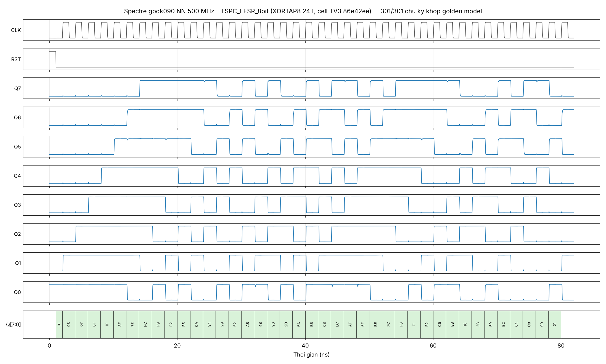
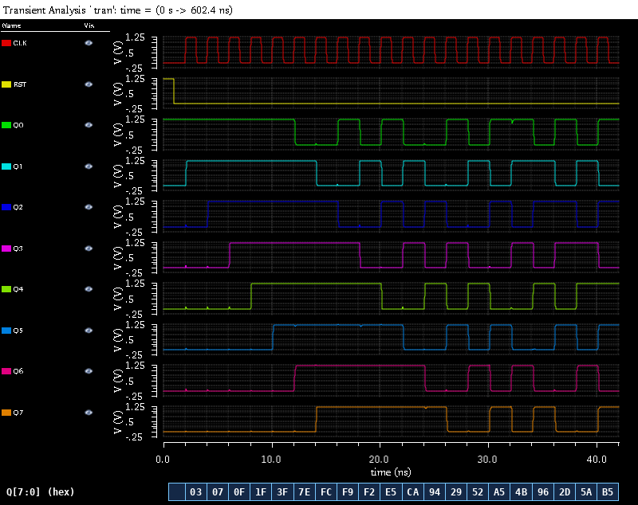
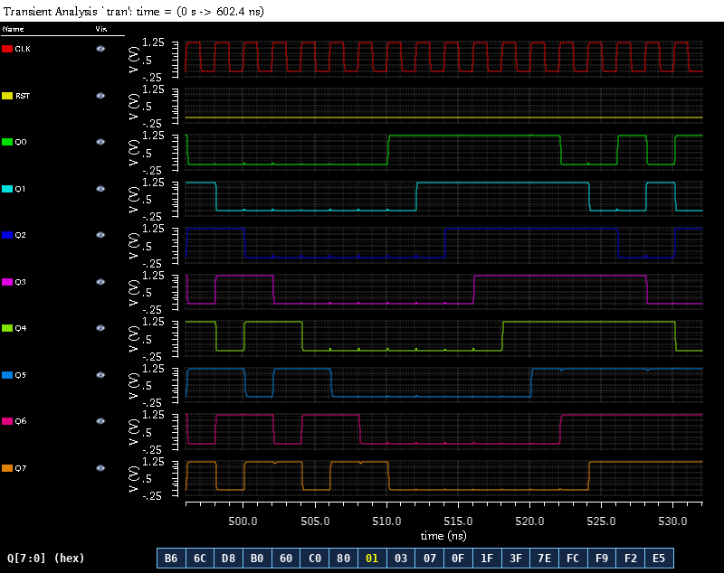

# 4. Kết quả

[← 3. Mô phỏng](3_mo_phong.md) · [README](../README.md)

**Điều kiện:** Spectre (MMSIM 12.1), gpdk090, 27 °C, VDD 1,2 V, T = 2 ns (500 MHz), 300 cạnh clock (301 vector, qua trọn chu kỳ 255). Mỗi Q tải 1 INV_X1; trong LT-RTPG mỗi V_i tải 4 INV_X1. Clock đi qua 2 INV_CLK đệm, cấp từ nguồn riêng.
**Trễ** = trễ CLK→Q lớn nhất trên mọi vector, tính từ giữa sườn clock lý tưởng (đã gồm 2 tầng đệm).
Cell TV3 commit `86e42ee`. **Flip-flop là bản tạm của TV4**; số cuối cùng sẽ thay khi có cell TV1/TV2. Chạy ngày 19/11/2026.

File gốc: [`results/spectre_500MHz.txt`](../results/spectre_500MHz.txt) (dòng RESULT), [`results/spectre_chi_tiet.txt`](../results/spectre_chi_tiet.txt) (vector có trễ lớn nhất, công suất từng nguồn).

## 4.1. Chức năng: 18/18 testbench PASS 301/301

| Mạch | T | Trễ NN / SS / FF (ps) | P_DUT NN / SS / FF (µW) | P_clock NN (µW) | Kết quả |
|---|---:|---|---|---:|---|
| MS_LFSR_8bit | 218 | 240,1 / 336,5 / 188,2 | 94,1 / 89,9 / 99,4 | 21,3 | PASS ×3 |
| TSPC_LFSR_8bit | 160 | 181,2 / 256,5 / 141,2 | 59,0 / 55,6 / 63,5 | 23,5 | PASS ×3 |
| TSPC_LFSR_8bit_CMOS | 172 | 167,9 / 237,8 / 130,8 | 61,9 / 58,3 / 66,6 | 23,5 | PASS ×3 |
| TSPC_CFSR_8bit | 192 | 185,6 / 262,4 / 144,6 | 63,7 / 60,0 / 68,5 | 23,5 | PASS ×3 |
| LFSR + LT_RTPG, LP = 0 | 160 + 378 | 312,0 / 441,2 / 245,4 | 173,8 / 157,2 / 199,0 | 39,9 | PASS ×3 |
| LFSR + LT_RTPG, LP = 1 | 160 + 378 | 286,8 / 406,1 / 223,5 | 166,8 / 150,3 / 192,2 | 39,9 | PASS ×3 |

Dạng sóng Q[7:0] của TSPC_LFSR_8bit (Spectre NN), 80 ns đầu, dải dưới cùng là giá trị hex đọc từ mạch, khớp golden model:

Cùng mạch trong Cadence ViVA: nhả RST rồi 20 chu kỳ đầu (`01 03 07 0F 1F 3F 7E FC F9 F2 …`):

Quanh chu kỳ 255: `… C0 80 → 01`, quay về seed sau đúng 255 cạnh clock:

Bản MS_LFSR_8bit (cùng chuỗi trạng thái)

## 4.2. So sánh ở NN

| So sánh | Kết quả |
|---|---|
| **TSPC so với MS** | trễ −24,5 %, P_DUT −37,3 %, P_DUT + P_clock −28,5 %; ít hơn 58 transistor (−26,6 %); MOS nối clock 32 so với 66; không cần CLKB |
| **XORTAP8 (24T) so với XORTAP8_CMOS (36T)**, cùng TSPC | P_DUT −4,7 %, nhưng trễ CLK→Q +7,9 %: XOR2_TG6 lấy tín hiệu thẳng từ Q nên Q0, Q5, Q6, Q7 tải nặng hơn |
| **CFSR so với LFSR** (TSPC) | thêm 32 transistor (ZERO7), trễ +2,4 %, P_DUT +8,0 %, đổi lại có đủ 256 trạng thái |
| **LT-RTPG bật (LP = 1)** | công suất tải ngõ vào CUT 14,44 → 7,97 µW (**−44,8 %**); golden model dự đoán −50 % số bit lật; trễ lớn nhất đến V giảm 8,1 % |

P_clock chỉ là công suất của 2 INV_CLK đệm bên ngoài khối. Ở bản MS, inverter tạo CLKB nằm trong khối nên công suất của nó tính vào P_DUT; vì vậy so sánh P_DUT + P_clock là công bằng nhất giữa hai bản.

## 4.3. Tần số tối đa

Mỗi điểm chạy đủ 300 chu kỳ; PASS khi cả 301 trạng thái đúng.

| Mạch | NN | SS | FF |
|---|---|---|---|
| MS_LFSR_8bit | **1,82 GHz** (550 ps đúng, 500 ps sai) | **1,25 GHz** (800 ps đúng, 650 ps sai) | ≥ 2,22 GHz (đúng mọi điểm đã thử, nhỏ nhất 450 ps) |
| TSPC_LFSR_8bit | **3,57 GHz** (280 ps đúng, 260 ps sai) | **2,50 GHz** (400 ps đúng, 350 ps sai) | ≥ 4,0 GHz (đúng mọi điểm đã thử, nhỏ nhất 250 ps) |

TSPC đạt khoảng **2 lần** tần số của MS ở cả NN và SS. Ở SS các điểm thử thưa nên số trên là cận dưới. Chi tiết từng điểm: [`results/fmax/`](../results/fmax/).

## 4.4. Độ dốc sườn clock (NN, T = 2 ns, clock nối thẳng nguồn)

| Sườn lên/xuống | 20 ps | 100 ps | 200 ps | 300 ps | 400 ps | 600 ps | 800 ps |
|---|---|---|---|---|---|---|---|
| MS_LFSR_8bit | đúng | đúng | đúng | – | đúng | đúng | đúng |
| TSPC_LFSR_8bit | đúng | đúng | đúng | **sai** | sai | sai | sai |

TSPC dùng chung một pha clock cho cả ba tầng; khi sườn chậm, có khoảng thời gian các tầng kế tiếp cùng mở nên dữ liệu có thể chạy xuyên qua (race), đây là giới hạn đã biết của TSPC. Cây clock cho bản TSPC phải giữ sườn ≤ 200 ps; 2 tầng INV_CLK đệm hiện cho sườn khoảng 20–40 ps nên đạt. Cần kiểm tra lại với flip-flop TSPC có keeper của TV2. Chi tiết: [`results/slew/`](../results/slew/).

## 4.5. Số transistor ([`results/so_transistor.md`](../results/so_transistor.md))

| Cell / khối | T | MOS nối CLK/CLKB |
|---|---:|---:|
| DFF_MS_TMP / DFF_TSPC_TMP | 24 / 17 | 8 / 4 |
| XORTAP8 / XORTAP8_CMOS / ZERO7 / CFSR_FB | 24 / 36 / 20 / 56 | 0 |
| AND2_T / MUX2_N | 6 / 12 | 0 |
| MS_LFSR_8bit / TSPC_LFSR_8bit | 218 / 160 | 66 / 32 |
| TSPC_LFSR_8bit_CMOS / TSPC_CFSR_8bit | 172 / 192 | 32 / 32 |
| LT_RTPG_8bit | 378 | 32 |

## 4.6. Schematic, symbol, kiểm tra sơ bộ

- Thư viện Virtuoso `tv4`: 22 cell vẽ từ netlist, **22/22 schCheck 0 lỗi 0 cảnh báo**.
- ngspice (mô hình giả, chỉ kiểm tra logic): 6/6 testbench NN PASS 301/301.
- Chạy lại Spectre từ chính thư mục này (testbench sinh từ golden model MATLAB), 19/11/2026: tb_TSPC_LFSR_NN, tb_MS_LFSR_NN, tb_TSPC_CFSR_NN đều PASS 301/301, trễ và công suất trùng bảng 4.1.

## 4.7. Việc tiếp theo

1. Thay DFF_MS_TMP, DFF_TSPC_TMP bằng cell của TV1, TV2; chạy lại toàn bộ trang này.
2. Layout dải LFSR 8 bit: chiều cao cell và ray VDD/GND theo TV2/TV3, 8 FF một hàng Q0 → Q7, XORTAP8 đặt gần FF0 và FF5–FF7, clock một đường Metal2 dọc hàng; DRC, LVS, diện tích.
3. Mô phỏng sau layout (PEX) cho TSPC_LFSR_8bit và so lại với bảng 4.1.
