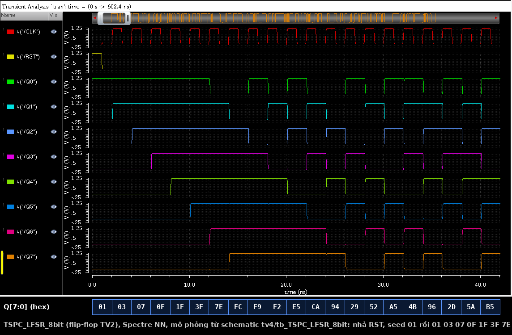
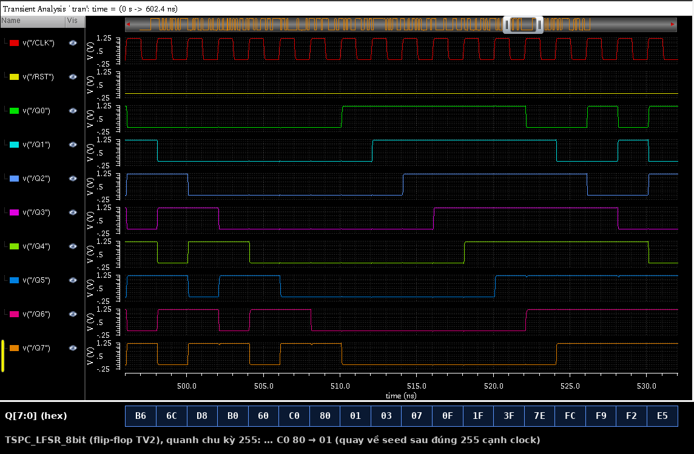
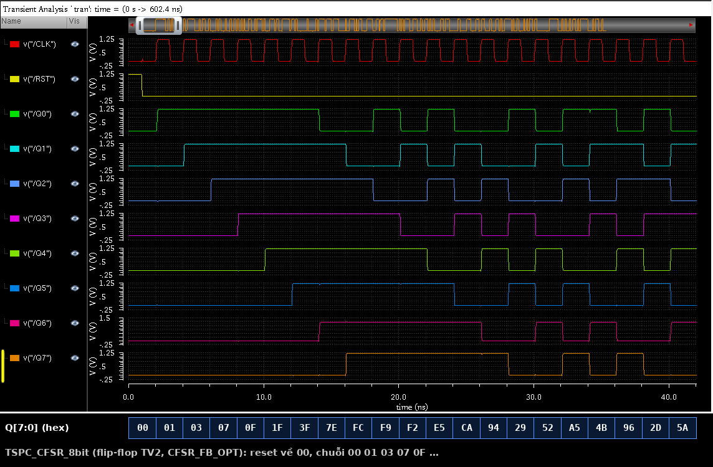
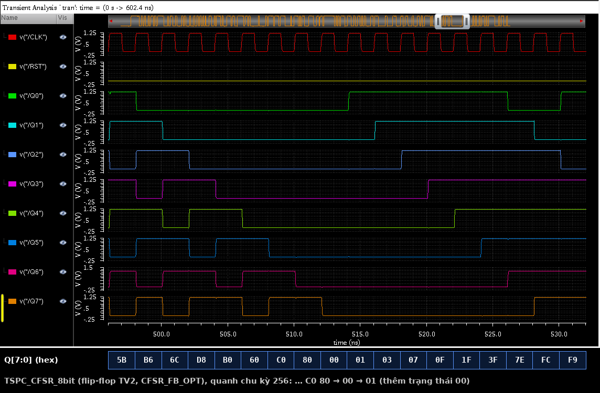
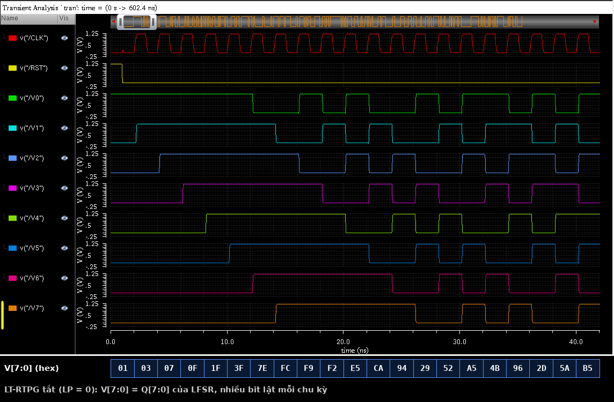
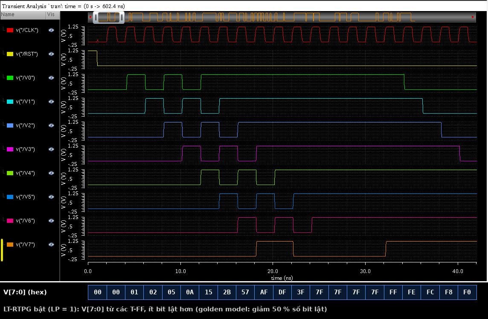
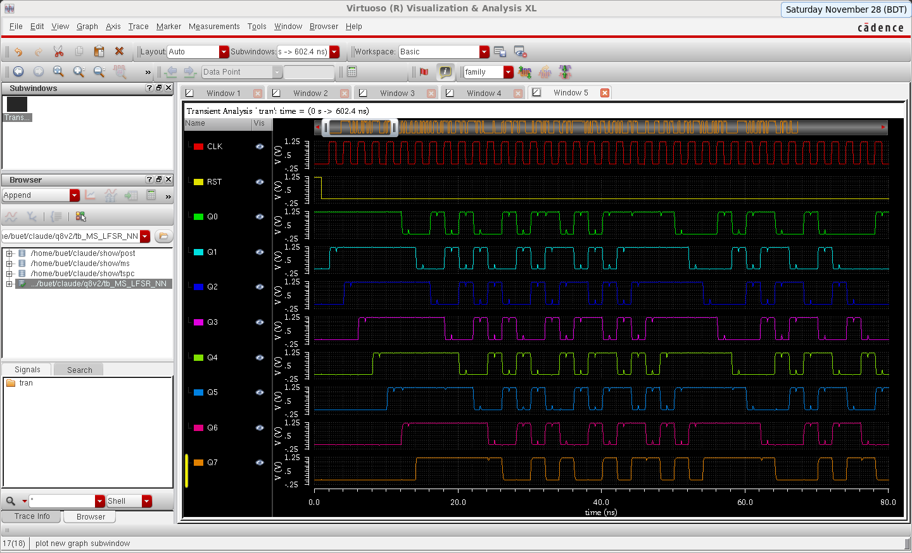
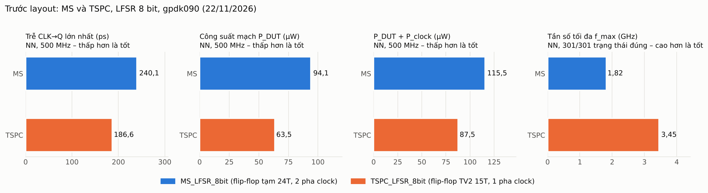

# 4. Kết quả

[← 3. Mô phỏng](3_mo_phong.md) · [README](../README.md) · [5. Layout →](5_layout.md)

**Điều kiện:** Spectre (MMSIM 12.1), gpdk090, 27 °C, VDD 1,2 V, T = 2 ns (500 MHz), 300 cạnh clock (301 vector, qua trọn chu kỳ 255). Mỗi Q tải 1 INV_X1; trong LT-RTPG mỗi V_i tải 4 INV_X1. Clock đi qua 2 INV_CLK đệm, cấp từ nguồn riêng.
**Trễ** = trễ CLK→Q lớn nhất trên mọi vector, tính từ giữa sườn clock lý tưởng (đã gồm 2 tầng đệm).
Cell TV3 commit `435f6f0` (TSPC_CFSR_8bit dùng CFSR_FB_OPT). **Bản TSPC dùng flip-flop thật của TV2** (TSPC_DFF_R/S, commit `25fc686`, chạy 22/11/2026). **Bản MS vẫn dùng flip-flop tạm DFF_MS_TMP của TV4** (chạy 19/11/2026), số MS sẽ thay khi TV1 nộp cell.

File gốc: [`results/spectre_500MHz.txt`](../results/spectre_500MHz.txt) (dòng RESULT), [`results/spectre_chi_tiet.txt`](../results/spectre_chi_tiet.txt) (vector có trễ lớn nhất, công suất từng nguồn).

## 4.1. Chức năng: 18/18 testbench PASS 301/301

| Mạch | T | Trễ NN / SS / FF (ps) | P_DUT NN / SS / FF (µW) | P_clock NN (µW) | Kết quả |
|---|---:|---|---|---:|---|
| MS_LFSR_8bit | 218 | 240,1 / 336,5 / 188,2 | 94,1 / 89,9 / 99,4 | 21,3 | PASS ×3 |
| TSPC_LFSR_8bit | 144 | 186,6 / 263,7 / 145,6 | 63,5 / 60,4 / 67,3 | 24,0 | PASS ×3 |
| TSPC_LFSR_8bit_CMOS | 156 | 172,2 / 243,7 / 134,2 | 65,8 / 62,7 / 69,8 | 24,0 | PASS ×3 |
| TSPC_CFSR_8bit (CFSR_FB_OPT) | 162 | 165,1 / 231,1 / 129,8 | 67,1 / 63,9 / 71,1 | 24,1 | PASS ×3 |
| LFSR + LT_RTPG, LP = 0 | 144 + 362 | 315,6 / 446,1 / 246,3 | 168,1 / 157,1 / 182,1 | 41,0 | PASS ×3 |
| LFSR + LT_RTPG, LP = 1 | 144 + 362 | 269,4 / 380,2 / 210,3 | 161,0 / 150,2 / 174,5 | 41,0 | PASS ×3 |

### Dạng sóng trong Cadence ViVA (22/11/2026, flip-flop TV2)

Mô phỏng chạy ngay trong Virtuoso: testbench vẽ thành schematic (`tv4/tb_*`, [2.6](2_thiet_ke_mach.md#26-ảnh-schematic-trong-virtuoso)), netlist và chạy Spectre qua OCEAN (cùng luồng với ADE L), NN, 500 MHz. Cả 4 lần chạy khớp golden model **301/301** (so cùng bảng `.exp` với testbench netlist). Dải dưới mỗi ảnh là giá trị bus đọc từ chính kết quả mô phỏng, căn theo trục thời gian.

TSPC_LFSR_8bit: nhả RST, seed 01 rồi `01 03 07 0F 1F 3F 7E FC F9 F2 …`

Quanh chu kỳ 255: `… C0 80 → 01`, quay về seed sau đúng 255 cạnh clock:

TSPC_CFSR_8bit: reset về 00; quanh chu kỳ 256 có thêm trạng thái 00 (`… 80 → 00 → 01`):

LT-RTPG tắt và bật (ngõ ra V[7:0] tới CUT): khi LP = 1 các bit lật thưa hơn hẳn.

Bản MS_LFSR_8bit (ảnh 19/11, flip-flop tạm; chụp lại khi TV1 nộp cell)

## 4.2. So sánh ở NN

| So sánh | Kết quả |
|---|---|
| **TSPC (TV2) so với MS (tạm)** | trễ −22,3 %, P_DUT −32,6 %, P_DUT + P_clock −24,2 %; ít hơn 74 transistor (−33,9 %); MOS nối clock 32 so với 66; không cần CLKB |
| **XORTAP8 (24T) so với XORTAP8_CMOS (36T)**, cùng TSPC | P_DUT −3,6 %, nhưng trễ CLK→Q +8,4 %: XOR2_TG6 lấy tín hiệu thẳng từ Q nên Q0, Q5, Q6, Q7 tải nặng hơn |
| **CFSR so với LFSR** (TSPC) | thêm 18 transistor (CFSR_FB_OPT 42T thay XORTAP8 24T), P_DUT +5,7 %, đổi lại có đủ 256 trạng thái. Trễ lớn nhất của CFSR lại thấp hơn (−11,5 %) vì ở LFSR trễ lớn nhất nằm ở Q0 xuống 0, mà FF0 là TSPC_DFF_S (Q xuống chậm hơn cell R, đúng như số đo của TV2); CFSR dùng toàn cell R |
| **LT-RTPG bật (LP = 1)** | công suất tải ngõ vào CUT 14,44 → 7,97 µW (**−44,8 %**); golden model dự đoán −50 % số bit lật; trễ lớn nhất đến V giảm 14,6 % |

P_clock chỉ là công suất của 2 INV_CLK đệm bên ngoài khối. Ở bản MS, inverter tạo CLKB nằm trong khối nên công suất của nó tính vào P_DUT; vì vậy so sánh P_DUT + P_clock là công bằng nhất giữa hai bản.

## 4.3. Tần số tối đa

Mỗi điểm chạy đủ 300 chu kỳ; PASS khi cả 301 trạng thái đúng.

| Mạch | NN | SS | FF |
|---|---|---|---|
| MS_LFSR_8bit | **1,82 GHz** (550 ps đúng, 500 ps sai) | **1,25 GHz** (800 ps đúng, 650 ps sai) | ≥ 2,22 GHz (đúng mọi điểm đã thử, nhỏ nhất 450 ps) |
| TSPC_LFSR_8bit (flip-flop TV2) | **3,45 GHz** (290 ps đúng, 280 ps sai) | **2,38 GHz** (420 ps đúng, 400 ps sai) | ≥ 4,0 GHz (đúng mọi điểm đã thử, nhỏ nhất 250 ps) |
| TSPC_CFSR_8bit (flip-flop TV2, CFSR_FB_OPT) | **3,33 GHz** (300 ps đúng, 290 ps sai) | **2,22 GHz** (450 ps đúng, 430 ps sai) | – |
| MS_LFSR_8bit, hậu layout (flip-flop tạm) | **1,33 GHz** (750 ps đúng, 700 ps sai) | – | – |
| TSPC_LFSR_8bit, hậu layout (layout flip-flop TV2, 22/11) | **2,63 GHz** (380 ps đúng, 370 ps sai) | **1,85 GHz** (540 ps đúng, 530 ps sai) | – |
| TSPC_LFSR_8bit, hậu layout bản 21/11 (flip-flop tạm DFF_TSPC_TMP) | 3,45 GHz (290 ps đúng, 280 ps sai) | – | – |

Trước layout, TSPC (TV2) đạt khoảng **1,9 lần** tần số của MS (tạm) ở cả NN và SS; sau layout (TSPC dùng layout flip-flop TV2, MS dùng flip-flop tạm) **2,0 lần** ở NN. Số MS ở SS là cận dưới (điểm thử thưa). Chi tiết từng điểm: [`results/fmax/`](../results/fmax/); TSPC_CFSR_8bit ở [`results/cfsr_cmp/`](../results/cfsr_cmp/) (`fmax_cmp_CFSR_OPT_*`).

### 4.3.1. So sánh 3 khối hồi tiếp CFSR của TV3 trong thanh ghi TSPC (22/11/2026)

TV3 cập nhật branch (`195bacb`) với bản tối ưu `CFSR_FB_OPT`. Netlist của khối này giống hệt bản `435f6f0` mà `TSPC_CFSR_8bit` đang dùng, nên mục này không thay mạch. Mục này đo xem phần lợi TV3 báo ở mức khối còn lại bao nhiêu khi khối nằm trong thanh ghi thật. Có 6 biến thể: `TSPC_CFSR_8bit` (8 TSPC_DFF_R của TV2) với mỗi khối hồi tiếp `CFSR_FB_CMOS` (74T), `CFSR_FB` (56T), `CFSR_FB_OPT` (42T), dùng netlist schematic và netlist sau layout (Assura RCX của TV3). Flip-flop vẫn là netlist schematic. Kích thích, tải và bảng golden model giống `tb_TSPC_CFSR`. Cả 18 testbench (6 biến thể × NN/SS/FF) ở 500 MHz đều **PASS 301/301**, tức thanh ghi tự thoát khỏi 0x00 và đi đủ 256 trạng thái.

| Khối hồi tiếp | T khối / thanh ghi | P_DUT NN 500 MHz (µW) | Trễ CLK→Q NN (ps) | f_max NN | f_max SS |
|---|---|---|---|---|---|
| CFSR_FB_CMOS | 74 / 194 | 72,47 | 154,4 | 2,78 GHz (360 ps) | 1,82 GHz (550 ps) |
| CFSR_FB | 56 / 176 | 68,20 | 166,3 | 2,63 GHz (380 ps) | 1,82 GHz (550 ps) |
| **CFSR_FB_OPT** | **42 / 162** | **67,10** | 165,1 | **3,33 GHz** (300 ps) | **2,22 GHz** (450 ps) |
| CFSR_FB_CMOS, sau layout | 74 / 194 | 71,10 | 160,9 | 3,13 GHz (320 ps) | 2,13 GHz (470 ps) |
| CFSR_FB, sau layout | 56 / 176 | 67,04 | 170,3 | 3,13 GHz (320 ps) | 2,13 GHz (470 ps) |
| **CFSR_FB_OPT, sau layout** | **42 / 162** | **65,67** | 166,7 | **3,57 GHz** (280 ps) | **2,50 GHz** (400 ps) |

Chu kỳ trong ngoặc là điểm nhỏ nhất còn đúng; điểm kế tiếp trong lưới quét (bước 10–20 ps ở NN, 20–50 ps ở SS) đã sai. Cột SS của CFSR_FB và CFSR_FB_CMOS là cận dưới, vì lưới chỉ có 550 và 500 ps.

| CFSR_FB_OPT so với CFSR_FB, trong thanh ghi | Schematic | Sau layout |
|---|---|---|
| Transistor (khối / cả thanh ghi) | −25 % / −8,0 % | −25 % / −8,0 % |
| P_DUT ở 500 MHz, NN | −1,6 % | −2,0 % |
| f_max NN | **+26,7 %** | **+14,3 %** |
| f_max SS | +22,2 % | +17,5 % |
| Trễ CLK→Q | gần như không đổi (−0,7 %) | −2,1 % |

Nhận xét:
- **Bản tối ưu đúng chức năng trong thanh ghi thật** (256 trạng thái, tự thoát 0x00, cả 3 corner). Đã mở log ở điểm sai đầu tiên của CFSR_FB, CFSR_FB_OPT và CFSR_FB_OPT sau layout: lần nào bit sai đầu tiên cũng là Q0. Q0 lấy D0 từ khối hồi tiếp, nên f_max do đường CLK→Q → khối hồi tiếp → D0 của FF0 quyết định. Khối hồi tiếp nhanh hơn thì f_max tăng thẳng.
- **f_max tăng 14–27 %** là phần lợi rõ nhất. Với CFSR_FB_OPT, CFSR (3,33 GHz) chỉ chậm hơn LFSR thường (TSPC_LFSR_8bit, 3,45 GHz) khoảng 3 %. Với CFSR_FB cũ, mức chậm hơn là 24 %.
- **Công suất chỉ giảm 1,6–2 %**: P_DUT chủ yếu do 8 flip-flop TSPC được clock mỗi chu kỳ, còn khối hồi tiếp chỉ chiếm phần nhỏ. Mức −10 % năng lượng và −43 % tích diện tích × trễ × năng lượng mà TV3 báo là con số **của riêng khối**, không phải của cả thanh ghi.
- Netlist schematic của TV3 không khai báo `ad/as/pd/ps`. Netlist RCX có kích thước vùng khuếch tán thật (dùng chung giữa các MOS nối tiếp) cộng RC dây, nên trong thí nghiệm này bản sau layout lại nhanh hơn bản schematic. Đây là phép so sánh tương đối giữa 3 khối, cùng flip-flop schematic. Số chính thức của thanh ghi sau layout chờ có layout TSPC_CFSR_8bit với cell flip-flop của TV2.

Chạy lại: `python3 scripts/gen_tb_cfsr_cmp.py && bash scripts/run_cfsr_cmp.sh` (trong máy ảo). Số liệu: [`results/cfsr_cmp/`](../results/cfsr_cmp/).

## 4.4. Độ dốc sườn clock (NN, T = 2 ns, clock nối thẳng nguồn)

| Sườn lên/xuống | 20 ps | 100 ps | 200 ps | 300 ps | 400 ps | 600 ps | 800 ps |
|---|---|---|---|---|---|---|---|
| MS_LFSR_8bit | đúng | đúng | đúng | – | đúng | đúng | đúng |
| TSPC_LFSR_8bit (flip-flop TV2) | đúng | đúng | đúng | đúng | đúng | **sai** | sai |
| TSPC_LFSR_8bit (flip-flop tạm, 21/11) | đúng | đúng | đúng | sai | sai | sai | sai |

TSPC dùng chung một pha clock cho cả ba tầng; khi sườn chậm, có khoảng thời gian các tầng kế tiếp cùng mở nên dữ liệu có thể chạy xuyên qua (race), đây là giới hạn đã biết của TSPC. Với flip-flop của TV2 (có keeper, tầng 2 rộng 0,48 µm), dải LFSR chịu được sườn tới 400 ps, sai từ 600 ps (bản tạm sai từ 300 ps). Cây clock nên giữ sườn ≤ 400 ps; 2 tầng INV_CLK đệm hiện cho sườn khoảng 20–40 ps nên đạt. Chi tiết: [`results/slew/`](../results/slew/).

## 4.5. Số transistor ([`results/so_transistor.md`](../results/so_transistor.md))

| Cell / khối | T | MOS nối CLK/CLKB |
|---|---:|---:|
| DFF_MS_TMP / DFF_TSPC_TMP (tạm) | 24 / 17 | 8 / 4 |
| TSPC_DFF_R / TSPC_DFF_S (TV2) | 15 / 15 | 4 / 4 |
| XORTAP8 / XORTAP8_CMOS / CFSR_FB_OPT (CFSR_FB cũ) | 24 / 36 / 42 (56) | 0 |
| AND2_T / MUX2_N | 6 / 12 | 0 |
| MS_LFSR_8bit / TSPC_LFSR_8bit | 218 / 144 | 66 / 32 |
| TSPC_LFSR_8bit_CMOS / TSPC_CFSR_8bit | 156 / 162 | 32 / 32 |
| LT_RTPG_8bit | 362 | 32 |

## 4.6. Schematic, symbol, kiểm tra sơ bộ

- Thư viện Virtuoso `tv4`: 26 cell vẽ từ netlist (gồm TSPC_DFF_R/S của TV2), **26/26 schCheck 0 lỗi 0 cảnh báo** (vẽ lại 22/11/2026; QB để hở của cell TV2 gắn `basic/noConn`).
- ngspice (mô hình giả, chỉ kiểm tra logic): 6/6 testbench NN PASS 301/301.
- Các số TSPC ở bảng 4.1 chạy từ chính thư mục này ngày 22/11/2026 (testbench sinh từ golden model MATLAB, flip-flop TV2); bản MS chạy 19/11/2026, netlist MS không đổi. Kiểm tra logic bằng ngspice: 6/6 PASS 301/301.

## 4.7. Việc tiếp theo

1. Bản TSPC đã dùng cell TV2 ở cả netlist và layout (22/11). Còn: thay DFF_MS_TMP bằng cell TV1 (netlist + layout) rồi chạy lại trang này và [5. Layout](5_layout.md).
2. Đã xong tuần 3: layout hai dải LFSR 8 bit (TSPC với layout flip-flop TV2), DRC/LVS, trích RC, mô phỏng hậu layout NN/SS/FF, ảnh chụp Virtuoso; xem [5. Layout](5_layout.md).
3. Ghép layout với BILBO/MISR của TV5 và CUT của TV6 khi có.
