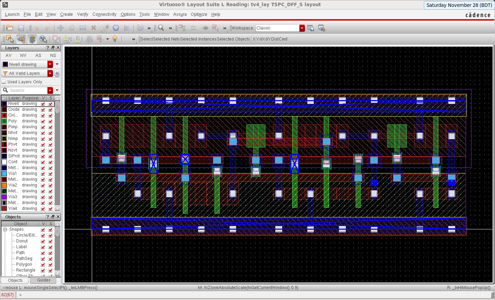
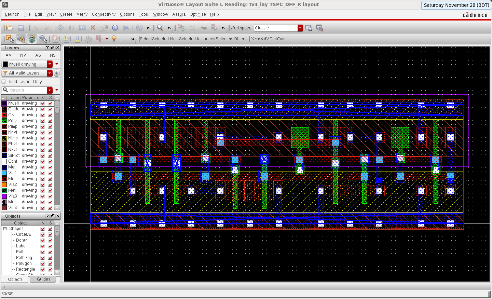
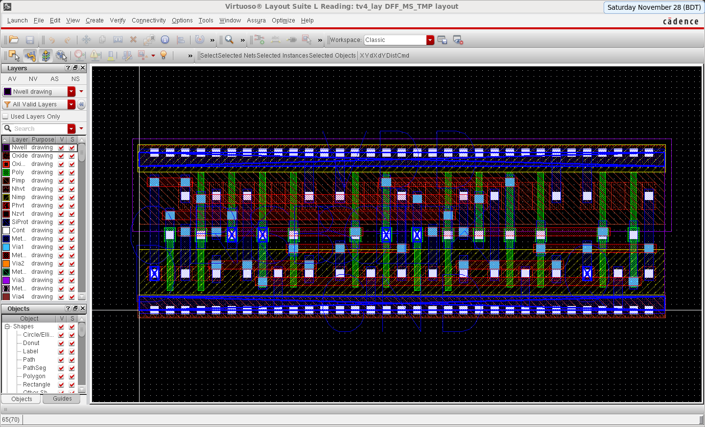
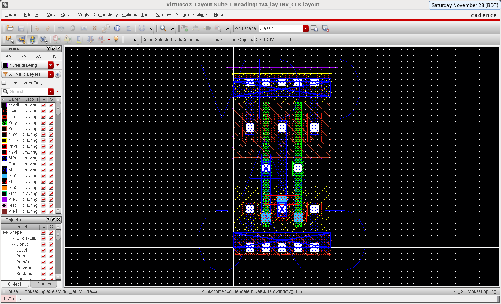
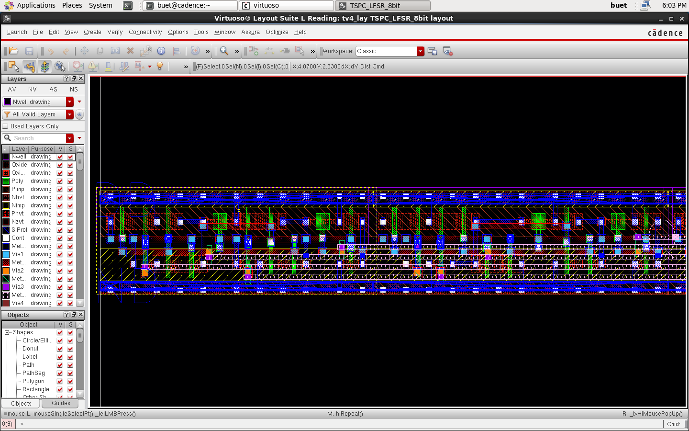
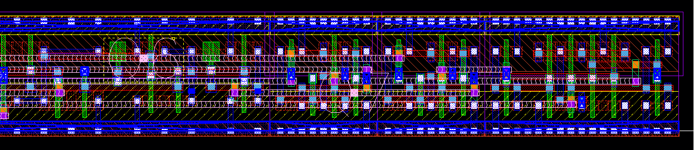
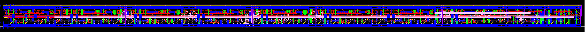
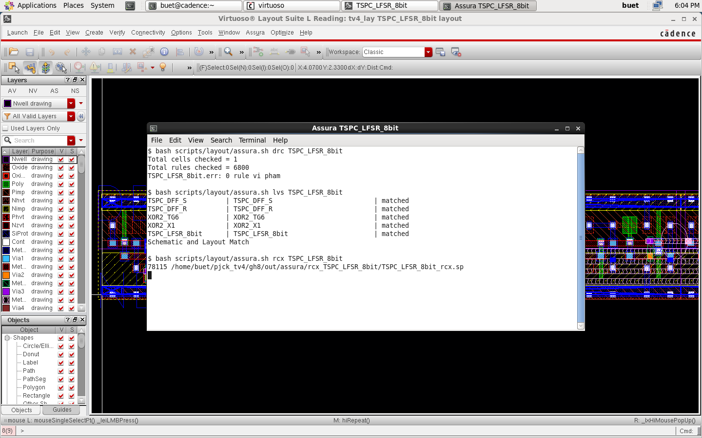

# 5. Layout dải LFSR 8 bit

[← 4. Kết quả](4_ket_qua.md) · [README](../README.md)

Tuần 3: layout hai dải LFSR 8 bit (`TSPC_LFSR_8bit`, `MS_LFSR_8bit`) khớp bước (pitch-matched) với cell của TV3, kiểm tra DRC/LVS bằng Assura, trích RC và mô phỏng hậu layout so với golden model.

> **Từ 22/11/2026, dải TSPC dùng layout flip-flop thật của TV2** (`TSPC_DFF_S`, `TSPC_DFF_R`, branch `cell/TSPC_DFF(2)` commit `ac228bf`, bản sao trong [`depend/tv2/layout/`](../depend/tv2/NGUON.md)). Dải MS vẫn dùng flip-flop tạm DFF_MS_TMP của TV4: TV1 đã nộp schematic `MS_DFF_SetReset` (netlist đã thay vào khối MS ngày 24/11, xem [4. Kết quả](4_ket_qua.md)), nhưng view layout trên branch TV1 (commit `fa999e9`) chưa có hình vẽ nào. Khi TV1 có layout, chỉ cần thay cell lá rồi chạy lại `build_layout.py` và Assura; phần đi dây của dải tự sinh lại theo vị trí chân mới (bảng `ACC` trong `scripts/layout/build_layout.py`). Số của dải TSPC dùng flip-flop tạm (21/11) giữ ở cuối mục 5.5 để đối chiếu.

> Mọi ảnh layout trong mục này chụp trực tiếp trong Virtuoso Layout Suite (GDS nhập bằng `strmin` vào thư viện `tv4_lay`, gắn tech `gpdk090`), ngày 28/11/2026.

## 5.1. Khuôn cell (lấy từ GDS của TV3)

| Thông số | Giá trị |
|---|---|
| Chiều cao cell | 2,76 µm, ray GND ở dưới, VDD ở trên (Metal1, rộng 0,30 µm), dùng chung khi đặt cạnh nhau |
| Bước cột | 0,27 µm; cột tiếp xúc (C) và cột cổng poly (G) xen kẽ |
| NMOS / PMOS | khuếch tán NMOS từ y = 0,52 µm (W ≥ 0,24) hoặc tâm 0,64 µm; PMOS tâm 2,00 µm; L = 0,10 µm |
| Nwell | y = 1,38 … 3,00 µm, phủ ra ngoài biên 0,12 µm |
| Tiếp xúc đế / giếng | dãy contact dưới ray GND và ray VDD, cách 0,27 µm |
| Đi dây trong cell | Metal1 dọc theo cột, Metal2 ngang trên 7 rãnh (y = 0,50 … 2,24 µm, cách 0,29 µm) |
| Đi dây giữa các cell | Metal3 dọc từ chân lên, Metal4 ngang trên 8 rãnh (y = 0,38 … 2,41 µm) |
| Chân | nhãn Metal1/Metal2 trong cell, Metal4 ở dải (layermap gpdk090), biên `prBoundary` |

Nhờ cùng khuôn, các cell của TV3 (XOR2_TG6, XOR2_X1), của TV2 (TSPC_DFF_S/R) và của TV4 đặt sát nhau thành một hàng, ray nguồn nối liền mà không cần dây phụ. Cell TV2 cùng chiều cao 2,76 µm, cùng vị trí ray, dãy tiếp xúc đế/giếng và Nwell như khuôn trên, nhưng không theo bước cột 0,27 µm (rộng 8,00 / 8,68 µm); điều này không ảnh hưởng vì các cell chỉ cần khớp ray khi đặt sát nhau.

## 5.2. Cell lá

Flip-flop TSPC của TV2 (layout, DRC/LVS do TV2 làm; TV4 chạy lại DRC/LVS khi ghép dải):

| Cell | Transistor | Kích thước (µm) | Diện tích (µm²) | Chân |
|---|---:|---|---:|---|
| TSPC_DFF_S (FF0, nạp seed) | 15 | 8,00 × 2,76 | 22,08 | D CLK SET Q QB VDD GND |
| TSPC_DFF_R (FF1–FF7) | 15 | 8,68 × 2,76 | 23,96 | D CLK RST Q QB VDD GND |

| TSPC_DFF_S | TSPC_DFF_R |
|---|---|
|  |  |

Cell của TV4 (DFF_TSPC_TMP không còn dùng trong dải từ 22/11, giữ lại để đối chiếu):

| Cell | Transistor | Cột | Kích thước (µm) | Diện tích (µm²) |
|---|---:|---:|---|---:|
| DFF_TSPC_TMP | 17 | 21 | 5,94 × 2,76 | 16,39 |
| DFF_MS_TMP (4 cổng truyền + 4 NOR2, vẽ phẳng) | 24 | 33 | 9,18 × 2,76 | 25,34 |
| INV_CLK (2 ngón, tạo CLKB cho bản MS) | 4 | 5 | 1,62 × 2,76 | 4,47 |

| DFF_TSPC_TMP | DFF_MS_TMP | INV_CLK |
|---|---|---|
|  |  |  |

Thứ tự cột của DFF_TSPC_TMP (C = tiếp xúc, G = cổng; N / P là net phía NMOS / PMOS):

```text
C0  RSTB/RSTB   G1  RST         C2  GND/VDD   G3  D        C4  X/p1      G5  CLK (P)
C6  Y/X         G7  X (N)       C8  n1/Y      G9  CLK      C10 GND/VDD   G11 RSTB
C12 n3/QB       G13 Y           C14 n2/p2     G15 CLK (N)  C16 QB/p2     G17 SET
C18 GND/VDD     G19 QB          C20 Q/Q
```

Các net dùng chung nguồn (GND/VDD ở C2, C10, C18) chia đều để mỗi nhánh nối tiếp chỉ dài 1–2 transistor; Metal2 nội bộ được gán rãnh tự động (`cellgen.autoroute`) sao cho hai chân cùng cột không chạm nhau.

## 5.3. Dải LFSR 8 bit

Hai dải đều là **một hàng cao 2,76 µm**: 8 flip-flop Q0 → Q7 nối tiếp, rồi mạng hồi tiếp XORTAP8 của TV3 (XOR2_TG6(Q0, Q5), XOR2_TG6(Q6, Q7), XOR2_X1 ra D0). Bản MS có thêm INV_CLK ở đầu hàng tạo CLKB.

| Dải | Thành phần | Kích thước (µm) | Diện tích (µm²) |
|---|---|---|---:|
| **TSPC_LFSR_8bit** | TSPC_DFF_S + 7 TSPC_DFF_R (TV2) + 2 XOR2_TG6 + XOR2_X1 | 79,02 × 2,76 | **218,10** |
| MS_LFSR_8bit | INV_CLK + 8 DFF_MS_TMP + 2 XOR2_TG6 + XOR2_X1 | 85,32 × 2,76 | 235,48 |
| TSPC so với MS | | | **−7,4 %** |
| TSPC_LFSR_8bit bản 21/11 (8 DFF_TSPC_TMP, để đối chiếu) | | 57,78 × 2,76 | 159,47 |

Với flip-flop của TV2, dải TSPC chỉ nhỏ hơn MS 7,4 % (bản flip-flop tạm là −32,3 %). Lý do: mỗi cell TV2 rộng 8,00–8,68 µm (so với 5,94 µm của DFF_TSPC_TMP) vì có 2 keeper dài L = 0,40 µm và phần lớn transistor rộng 0,48 µm (DFF_TSPC_TMP không có keeper, nhiều nMOS chỉ 0,12–0,36 µm). Bản MS vẫn là flip-flop tạm; khi có cell MS của TV1, so sánh này cần làm lại.


Ảnh chụp trong Virtuoso (GDS nhập bằng `strmin` vào thư viện `tv4_lay`, gắn tech `gpdk090`): đầu dải (FF0 = TSPC_DFF_S, FF1, FF2) và cuối dải (FF7 + XOR2_TG6 × 2 + XOR2_X1):








Đi dây giữa các cell (`scripts/layout/rowgen.py`):

- mỗi chân có một Via2 đặt trên đoạn Metal2 của chính net đó trong cell (vị trí tìm bằng `pinaccess.py`, gộp các lớp Poly/Contact/Metal1/Via1/Metal2 để biết điểm nào thuộc net nào);
- từ đó Metal3 đi dọc lên rãnh Metal4 ngang của net; rãnh Metal4 được gán theo thuật toán left-edge để các đoạn trên cùng rãnh không chồng nhau;
- chân SET/RST không dùng của flip-flop tạm nối xuống GND bằng một đoạn Metal2 ngắn xuống ray (cell TV2 chỉ có một trong hai chân nên không cần);
- cell TV2: CLK và Q đặt Via2 thẳng trên đoạn Metal2 có sẵn (y = 1,10 µm). D, SET, RST chỉ có pad Metal1 ở y = 1,2–1,6 µm và bị Metal2 nội bộ của net khác chạy ngang phía trên, nên ở mức dải vẽ thêm (không sửa cell TV2) một sóc Metal1 rộng 0,12 µm kéo xuống y = 0,50 µm, rồi Via1 + đệm Metal2 0,26 × 0,32 µm (luật METAL2.A.1, diện tích ≥ 0,08 µm²) + Via2 (`drop()` trong `build_layout.py`);
- chân của dải (CLK, RST, Q0…Q7) đặt nhãn Metal4 ngay trên đoạn dây của net, VDD/GND là nhãn Metal1 trên ray.

Số rãnh Metal4 dùng: TSPC 6/8, MS 8/8 (xem `metal4_tracks` trong [`layout/dien_tich.json`](../layout/dien_tich.json)).

## 5.4. DRC, LVS, trích RC (Assura 4.1, gpdk090)

| Cell / dải | DRC | LVS |
|---|---|---|
| DFF_TSPC_TMP | 0 lỗi | khớp |
| DFF_MS_TMP | 0 lỗi | khớp |
| INV_CLK | 0 lỗi | khớp |
| TSPC_DFF_S, TSPC_DFF_R (GDS của TV2) | 0 lỗi (TV2 chạy) | khớp (TV2 chạy; khớp lại trong LVS của dải) |
| **TSPC_LFSR_8bit** (flip-flop TV2, 22/11) | **0 lỗi** | **khớp** (TSPC_DFF_S, TSPC_DFF_R, XOR2_TG6, XOR2_X1, top) |
| **MS_LFSR_8bit** | **0 lỗi** | **khớp** (INV_CLK, DFF_MS_TMP, XOR2_TG6, XOR2_X1, top) |
| Cell TV3 dùng trong dải: XOR2_TG6, XOR2_X1 | 0 lỗi | khớp |

Lần DRC đầu của dải với cell TV2 báo 16 lỗi METAL2.A.1 (đệm Metal2 0,26 × 0,26 µm = 0,068 µm² < 0,08 µm²) tại các điểm kéo chân D/SET/RST; đổi đệm thành 0,26 × 0,32 µm thì sạch.



Ảnh trên là terminal trong máy ảo Cadence in tóm tắt file báo cáo Assura (`.sum`, `.err`, `.csm`) của lần chạy cuối; dòng LVS lấy từ bước LVS trong `assura.sh rcx`. Báo cáo LVS gốc: [`layout/assura/`](../layout/assura/). Netlist so sánh `layout/cdl/*.cdl` sinh thẳng từ netlist Spectre đã mô phỏng (`scs2cdl.py`), nên LVS khớp nghĩa là layout đúng với mạch đã kiểm chứng bằng golden model.

Trích RC đầy đủ (R + C nối đất, decoupled), netlist trong [`layout/rcx/`](../layout/rcx/):

| Dải | MOS | Điện trở | Tụ |
|---|---:|---:|---:|
| TSPC_LFSR_8bit (flip-flop TV2) | 144 | 1087 | 666 |
| MS_LFSR_8bit | 220 | 1118 | 945 |

MS có 220 MOS trong layout (so với 218 của netlist dùng flip-flop tạm) vì INV_CLK vẽ 2 ngón song song; LVS gộp ngón nên vẫn khớp.

## 5.5. Mô phỏng hậu layout

> ⚠️ **Chưa hoàn thành (chỉ phần so sánh với TV1):** số sau layout của MS_LFSR_8bit và các dòng "TSPC so với MS" là tham khảo, đo với flip-flop tạm DFF_MS_TMP vì layout của TV1 chưa có; chạy lại khi TV1 có layout `MS_DFF_SetReset`. Số của bản TSPC là chính thức. So sánh trước layout với cell thật của TV1 ở [4.2](4_ket_qua.md#42-so-sánh-ở-nn); PVT của dải TSPC sau layout (27/27 điểm PASS) ở [4.7](4_ket_qua.md#47-pvt-24112026).

Testbench `tb/tb_*_post_{NN,SS,FF}.scs` giống hệt testbench trước layout (cùng 300 cạnh clock, cùng tải, cùng clock qua 2 INV_CLK đệm), chỉ thay khối LFSR bằng netlist trích RC `layout/rcx/<dải>_post.scs`. Kết quả so với golden model ([`results/hau_layout.txt`](../results/hau_layout.txt)):

| Dải (hậu layout) | Corner | Kết quả | Trễ CLK→Q (ps) | P_DUT (µW) | P_clock (µW) |
|---|---|---|---:|---:|---:|
| TSPC_LFSR_8bit (flip-flop TV2) | NN | PASS 301/301 | 238,8 | 61,5 | 40,7 |
| | SS | PASS 301/301 | 335,7 | 57,2 | 39,9 |
| | FF | PASS 301/301 | 186,8 | 66,8 | 41,8 |
| MS_LFSR_8bit | NN | PASS 301/301 | 381,6 | 118,3 | 42,3 |
| | SS | PASS 301/301 | 535,7 | 111,6 | 41,7 |
| | FF | PASS 301/301 | 298,1 | 126,0 | 43,1 |

So sánh ở NN, 500 MHz, sau layout:


| | TSPC_LFSR_8bit | MS_LFSR_8bit | TSPC so với MS |
|---|---:|---:|---:|
| Diện tích (µm²) | 218,10 | 235,48 | −7,4 % |
| Trễ CLK→Q (ps) | 238,8 | 381,6 | −37,4 % |
| P_DUT + P_clock (µW) | 102,3 | 160,6 | −36,3 % |
| f_max NN (301/301 đúng) | 2,63 GHz (380 ps đúng, 370 ps sai) | 1,33 GHz (750 ps đúng, 700 ps sai) | ×2,0 |
| f_max SS | 1,85 GHz (540 ps đúng, 530 ps sai) | – | – |

Nhận xét:
- Cả ba corner đều đúng 301/301, **không có lỗi race** như flip-flop tạm ở corner FF (xem phần lịch sử bên dưới). Ở flip-flop TV2, nMOS tầng 1 (M3, 0,24 µm) nhỏ hơn hai nMOS nối tiếp của tầng 2 (M4, M5, 0,48 µm) và có keeper trên nút Y; đây có thể là lý do lề hold đủ, nhưng chưa tách riêng để chứng minh.
- So với trước layout (cùng flip-flop TV2): trễ tăng 28 % (186,6 → 238,8 ps), f_max NN giảm 24 % (3,45 → 2,63 GHz), SS giảm 22 % (2,38 → 1,85 GHz). P_clock tăng 70 % (24,0 → 40,7 µW) vì 2 INV_CLK đệm phải nạp dây CLK chạy dọc 60 µm của dải. P_DUT lại giảm nhẹ (63,5 → 61,5 µW), có thể vì netlist trước layout không có `ad/as/pd/ps` nên Spectre lấy diện tích khuếch tán mặc định lớn hơn thực tế (TV2 cũng ghi nhận điều này ở mức cell).
- Ở các điểm sai đã mở log (NN 350 ps, SS 530 ps), bit sai đầu tiên là **Q0** (vector 9), tức đường giới hạn đi qua khối hồi tiếp: Q0 → XOR2_TG6 → XOR2_X1 → D0 của FF0. Trong layout, dây Q0 dài 62 µm và dây D0 quay về đầu hàng dài 75 µm.
- **Thử đặt khối XOR ở đầu hàng** (trước FF0, `TSPC_XOR=-1`) để rút dây Q0, D0 (còn 19 µm và 4 µm), đổi lại Q5–Q7 dài 60–73 µm. DRC 0, LVS khớp, 3 corner PASS; trễ CLK→Q giảm 6,5 % (223,2 ps) nhưng f_max NN không tăng (400 ps đúng, 380 ps sai 295/301), nên giữ cách đặt cũ (XOR cuối hàng, cùng kiểu với dải MS). Số liệu ở [`results/hau_layout.txt`](../results/hau_layout.txt).
- So với MS (flip-flop tạm), TSPC sau layout vẫn hơn rõ: trễ −37,4 %, công suất −36,3 %, f_max ×2,0, nhưng diện tích chỉ còn −7,4 % (xem 5.3).

Dải TSPC bản 21/11 (8 DFF_TSPC_TMP của TV4), để đối chiếu: 159,47 µm²; NN 201,5 ps, P_DUT 54,7 µW, P_clock 35,1 µW; SS 283,6 ps; FF 157,1 ps; f_max NN 3,45 GHz. Flip-flop tạm nhỏ và nhanh hơn vì không có keeper và chỉ có 17T kích thước nhỏ, nhưng không có keeper nên không giữ được trạng thái khi clock dừng.

### Lỗi race tìm thấy ở hậu layout của bản flip-flop tạm (21/11) và cách sửa

Lần chạy đầu (DFF_TSPC_TMP có MN1 rộng 0,24 µm), TSPC_LFSR_8bit hậu layout **sai ở corner FF** (13/301 trạng thái đúng), trong khi NN, SS và cả mô phỏng trước layout đều đúng. Vector sai đầu tiên là vector 13: Q4 phải về 0 nhưng tại thời điểm lấy mẫu vẫn ở 0,93 V; sau đó trạng thái sai lan ra cả thanh ghi.

Nguyên nhân là race trong tầng 1 của TSPC: ngay sau cạnh lên của clock, Q3 của flip-flop trước đổi 0 → 1; ở corner FF thay đổi này đến D của FF4 rất sớm, MN1 kéo X xuống và cắt MN2 trong lúc Y của FF4 đang xả chưa xong. Y bị kẹt ở mức giữa (tầng 2 không còn nạp lại khi CLK = 1), nên ở tầng 3 cả nhánh kéo lên (MP4) lẫn nhánh kéo xuống (MN4–MN5) cùng dẫn, QB nằm ở mức trung gian và Q4 không về được 0. Trước layout lề thời gian này vẫn đủ; tụ dây thêm vào sau layout (trên Y, X và Q) làm lề âm ở corner nhanh nhất nên lỗi chỉ lộ ra ở hậu layout.

Thử hai cách trên chính netlist RCX ở corner FF: giảm MN1 xuống 0,12 µm (X xả chậm lại) → PASS, trễ 157,1 ps, P_DUT 63,0 µW; tăng MN2, MN3 lên 0,48 µm (Y xả nhanh hơn) → PASS, trễ 154,8 ps, P_DUT 65,5 µW nhưng tăng tải clock. Chọn **giảm MN1 xuống 0,12 µm** vì không đụng tới tải clock và tốn ít diện tích khuếch tán hơn. Đã sửa netlist `cells/DFF_TSPC_TMP`, vẽ lại cell, chạy lại DRC/LVS/RCX và toàn bộ mô phỏng trước và sau layout của các mạch dùng flip-flop TSPC; mọi số liệu trong tài liệu này là của bản đã sửa.

> Đã kiểm tra lại với layout flip-flop TV2 (22/11): dải 8 bit nối Q → D thẳng, hậu layout corner FF **PASS 301/301**, không có lỗi race này.

## 5.6. Cách chạy lại

Các lệnh gõ trong **terminal**, đứng ở thư mục gốc `Huynh_Anh_Tuan/`, không gõ trong CIW của Virtuoso:
- bước 1 và lệnh `rcx2scs.py` ở bước 3: máy nào có Python 3 cũng được (Windows, Linux);
- bước 2 và lệnh `run_tv4.sh` ở bước 3: terminal Linux của máy có Cadence (Assura 4.1, Spectre, gpdk090), ví dụ máy ảo CentOS của nhóm.

Chỉ phần xem layout cuối mục mới làm trong giao diện Virtuoso.

```bash
# 1. Sinh GDS + CDL + hình xem nhanh vào out/hinh_layout/ (Python 3, gdstk, matplotlib)
pip install gdstk matplotlib
python3 scripts/layout/build_layout.py

# 2. DRC / LVS / RCX (terminal máy Cadence; biến PDK trỏ tới gpdk090_v4.6)
bash scripts/layout/assura.sh drc TSPC_LFSR_8bit
bash scripts/layout/assura.sh lvs TSPC_LFSR_8bit
bash scripts/layout/assura.sh rcx TSPC_LFSR_8bit

# 3. Đổi netlist RCX (HSPICE) sang Spectre (Python 3) rồi mô phỏng hậu layout (terminal máy Cadence)
python3 scripts/layout/rcx2scs.py out/assura/rcx_TSPC_LFSR_8bit/TSPC_LFSR_8bit_rcx.sp \
        layout/rcx/TSPC_LFSR_8bit_post.scs TSPC_LFSR_8bit "CLK RST Q0 Q1 Q2 Q3 Q4 Q5 Q6 Q7 VDD GND"
bash scripts/run_tv4.sh tb/tb_TSPC_LFSR_post_NN.scs
```

Để xem trong Virtuoso: *File → Import → Stream*, chọn `layout/gds/TSPC_LFSR_8bit.gds`, tech library `gpdk090`.

| File | Nội dung |
|---|---|
| `scripts/layout/cellgen.py` | khuôn cell, sinh cell lá từ danh sách cột, gán rãnh Metal2 |
| `scripts/layout/rowgen.py` | đặt cell thành hàng, đi dây Metal3/Metal4, nối GND, chân |
| `scripts/layout/pinaccess.py` | tìm vùng đặt Via2 của từng chân trong cell |
| `scripts/layout/scs2cdl.py` | netlist Spectre → CDL cho LVS |
| `scripts/layout/render.py` | vẽ hình PNG xem nhanh từ GDS (ghi vào `out/hinh_layout/`; ảnh trong tài liệu chụp từ Virtuoso) |
| `scripts/layout/build_layout.py` | chạy toàn bộ: cell lá, hai dải (TSPC dùng GDS + CDL của TV2 trong `depend/tv2/layout/`), CDL, hình, `dien_tich.json`; biến `TSPC_XOR` đổi chỗ đặt khối XOR |
| `scripts/layout/assura.sh` | DRC / LVS / RCX trên GDS |
| `scripts/layout/rcx2scs.py` | netlist RCX → file include Spectre cho testbench hậu layout |
