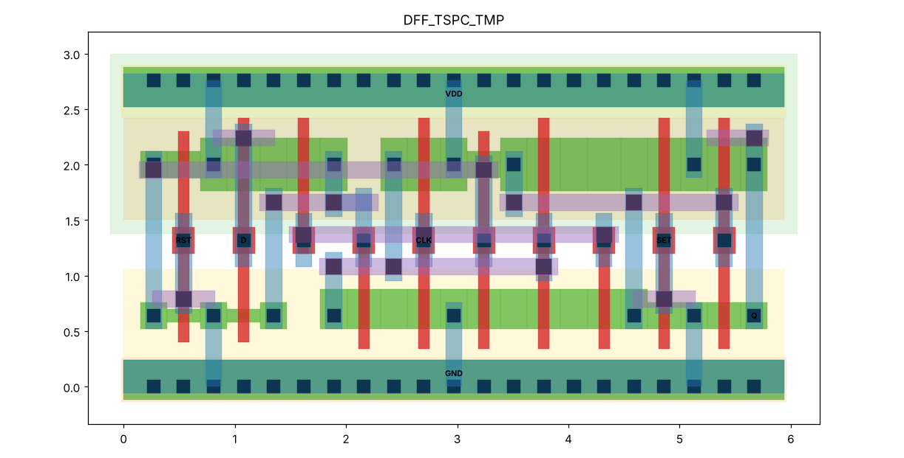
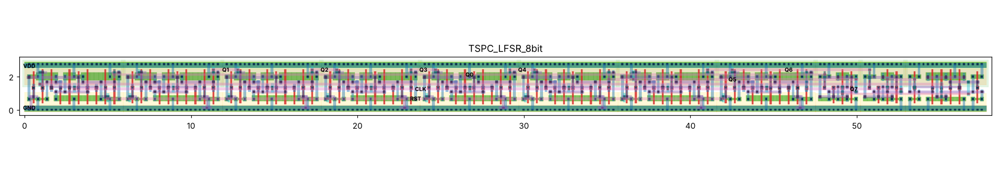
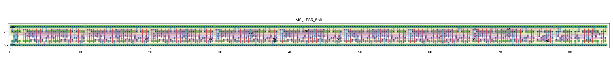
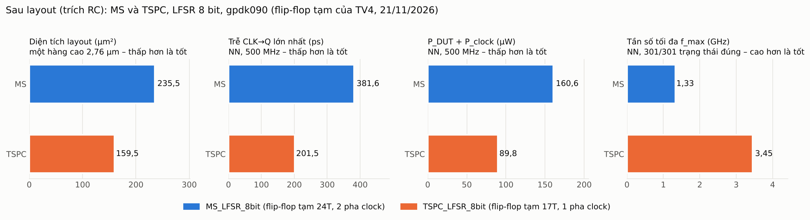

# 5. Layout dải LFSR 8 bit

[← 4. Kết quả](4_ket_qua.md) · [README](../README.md)

Tuần 3: layout hai dải LFSR 8 bit (`TSPC_LFSR_8bit`, `MS_LFSR_8bit`) khớp bước (pitch-matched) với cell của TV3, kiểm tra DRC/LVS bằng Assura, trích RC và mô phỏng hậu layout so với golden model.

> Flip-flop trong layout là **bản tạm của TV4** (DFF_TSPC_TMP, DFF_MS_TMP), vẽ cùng khuôn cell với TV3. Từ 22/11/2026 mô phỏng trước layout của bản TSPC đã dùng netlist flip-flop thật của TV2 (TSPC_DFF_R/S), nhưng TV2 chưa có layout nên trang này vẫn dùng DFF_TSPC_TMP. Khi TV1/TV2 có layout flip-flop thật, chỉ cần thay cell lá rồi chạy lại `build_layout.py` và Assura; phần đi dây của dải tự sinh lại theo vị trí chân mới (bảng `ACC` trong `scripts/layout/build_layout.py`).

## 5.1. Khuôn cell (lấy từ GDS của TV3)

| Thông số | Giá trị |
|---|---|
| Chiều cao cell | 2,76 µm, ray GND ở dưới, VDD ở trên (Metal1, rộng 0,30 µm), dùng chung khi đặt cạnh nhau |
| Bước cột | 0,27 µm; cột tiếp xúc (C) và cột cổng poly (G) xen kẽ |
| NMOS / PMOS | khuếch tán NMOS từ y = 0,52 µm (W ≥ 0,24) hoặc tâm 0,64 µm; PMOS tâm 2,00 µm; L = 0,10 µm |
| Nwell | y = 1,38 … 3,00 µm, phủ ra ngoài biên 0,12 µm |
| Tiếp xúc đế / giếng | dãy contact dưới ray GND và ray VDD, cách 0,27 µm |
| Đi dây trong cell | Metal1 dọc theo cột, Metal2 ngang trên 7 rãnh (y = 0,50 … 2,24 µm, cách 0,29 µm) |
| Đi dây giữa các cell | Metal3 dọc từ chân lên, Metal4 ngang trên 8 rãnh (y = 0,38 … 2,41 µm) |
| Chân | nhãn Metal1/Metal2 trong cell, Metal4 ở dải (layermap gpdk090), biên `prBoundary` |

Nhờ cùng khuôn, các cell của TV3 (XOR2_TG6, XOR2_X1) và cell của TV4 đặt sát nhau thành một hàng, ray nguồn nối liền mà không cần dây phụ.

## 5.2. Cell lá của TV4

| Cell | Transistor | Cột | Kích thước (µm) | Diện tích (µm²) |
|---|---:|---:|---|---:|
| DFF_TSPC_TMP | 17 | 21 | 5,94 × 2,76 | 16,39 |
| DFF_MS_TMP (4 cổng truyền + 4 NOR2, vẽ phẳng) | 24 | 33 | 9,18 × 2,76 | 25,34 |
| INV_CLK (2 ngón, tạo CLKB cho bản MS) | 4 | 5 | 1,62 × 2,76 | 4,47 |

| DFF_TSPC_TMP | DFF_MS_TMP | INV_CLK |
|---|---|---|
|  |  |  |

Thứ tự cột của DFF_TSPC_TMP (C = tiếp xúc, G = cổng; N / P là net phía NMOS / PMOS):

```text
C0  RSTB/RSTB   G1  RST         C2  GND/VDD   G3  D        C4  X/p1      G5  CLK (P)
C6  Y/X         G7  X (N)       C8  n1/Y      G9  CLK      C10 GND/VDD   G11 RSTB
C12 n3/QB       G13 Y           C14 n2/p2     G15 CLK (N)  C16 QB/p2     G17 SET
C18 GND/VDD     G19 QB          C20 Q/Q
```

Các net dùng chung nguồn (GND/VDD ở C2, C10, C18) chia đều để mỗi nhánh nối tiếp chỉ dài 1–2 transistor; Metal2 nội bộ được gán rãnh tự động (`cellgen.autoroute`) sao cho hai chân cùng cột không chạm nhau.

## 5.3. Dải LFSR 8 bit

Hai dải đều là **một hàng cao 2,76 µm**: 8 flip-flop Q0 → Q7 nối tiếp, rồi mạng hồi tiếp XORTAP8 của TV3 (XOR2_TG6(Q0, Q5), XOR2_TG6(Q6, Q7), XOR2_X1 ra D0). Bản MS có thêm INV_CLK ở đầu hàng tạo CLKB.

| Dải | Thành phần | Kích thước (µm) | Diện tích (µm²) |
|---|---|---|---:|
| **TSPC_LFSR_8bit** | 8 DFF_TSPC_TMP + 2 XOR2_TG6 + XOR2_X1 | 57,78 × 2,76 | **159,47** |
| MS_LFSR_8bit | INV_CLK + 8 DFF_MS_TMP + 2 XOR2_TG6 + XOR2_X1 | 85,32 × 2,76 | 235,48 |
| TSPC so với MS | | | **−32,3 %** |





Đi dây giữa các cell (`scripts/layout/rowgen.py`):

- mỗi chân có một Via2 đặt trên đoạn Metal2 của chính net đó trong cell (vị trí tìm bằng `pinaccess.py`, gộp các lớp Poly/Contact/Metal1/Via1/Metal2 để biết điểm nào thuộc net nào);
- từ đó Metal3 đi dọc lên rãnh Metal4 ngang của net; rãnh Metal4 được gán theo thuật toán left-edge để các đoạn trên cùng rãnh không chồng nhau;
- chân SET/RST không dùng của flip-flop nối xuống GND bằng một đoạn Metal2 ngắn xuống ray;
- chân của dải (CLK, RST, Q0…Q7) đặt nhãn Metal4 ngay trên đoạn dây của net, VDD/GND là nhãn Metal1 trên ray.

Số rãnh Metal4 dùng: TSPC 8/8, MS 8/8 (xem `metal4_tracks` trong [`layout/dien_tich.json`](../layout/dien_tich.json)).

## 5.4. DRC, LVS, trích RC (Assura 4.1, gpdk090)

| Cell / dải | DRC | LVS |
|---|---|---|
| DFF_TSPC_TMP | 0 lỗi | khớp |
| DFF_MS_TMP | 0 lỗi | khớp |
| INV_CLK | 0 lỗi | khớp |
| **TSPC_LFSR_8bit** | **0 lỗi** | **khớp** (DFF_TSPC_TMP, XOR2_TG6, XOR2_X1, top) |
| **MS_LFSR_8bit** | **0 lỗi** | **khớp** (INV_CLK, DFF_MS_TMP, XOR2_TG6, XOR2_X1, top) |
| Cell TV3 dùng trong dải: XOR2_TG6, XOR2_X1 | 0 lỗi | khớp |

Báo cáo LVS gốc: [`layout/assura/`](../layout/assura/). Netlist so sánh `layout/cdl/*.cdl` sinh thẳng từ netlist Spectre đã mô phỏng (`scs2cdl.py`), nên LVS khớp nghĩa là layout đúng với mạch đã kiểm chứng bằng golden model.

Trích RC đầy đủ (R + C nối đất, decoupled), netlist trong [`layout/rcx/`](../layout/rcx/):

| Dải | MOS | Điện trở | Tụ |
|---|---:|---:|---:|
| TSPC_LFSR_8bit | 160 | 778 | 677 |
| MS_LFSR_8bit | 220 | 1118 | 945 |

MS có 220 MOS trong layout (so với 218 trong netlist) vì INV_CLK vẽ 2 ngón song song; LVS gộp ngón nên vẫn khớp.

## 5.5. Mô phỏng hậu layout

Testbench `tb/tb_*_post_{NN,SS,FF}.scs` giống hệt testbench trước layout (cùng 300 cạnh clock, cùng tải, cùng clock qua 2 INV_CLK đệm), chỉ thay khối LFSR bằng netlist trích RC `layout/rcx/<dải>_post.scs`. Kết quả so với golden model ([`results/hau_layout.txt`](../results/hau_layout.txt)):

| Dải (hậu layout) | Corner | Kết quả | Trễ CLK→Q (ps) | P_DUT (µW) | P_clock (µW) |
|---|---|---|---:|---:|---:|
| TSPC_LFSR_8bit | NN | PASS 301/301 | 201,5 | 54,7 | 35,1 |
| | SS | PASS 301/301 | 283,6 | 49,8 | 34,3 |
| | FF | PASS 301/301 | 157,1 | 63,1 | 36,1 |
| MS_LFSR_8bit | NN | PASS 301/301 | 381,6 | 118,3 | 42,3 |
| | SS | PASS 301/301 | 535,7 | 111,6 | 41,7 |
| | FF | PASS 301/301 | 298,1 | 126,0 | 43,1 |

So sánh ở NN, 500 MHz, sau layout:



| | TSPC_LFSR_8bit | MS_LFSR_8bit | TSPC so với MS |
|---|---:|---:|---:|
| Diện tích (µm²) | 159,47 | 235,48 | −32,3 % |
| Trễ CLK→Q (ps) | 201,5 | 381,6 | −47,2 % |
| P_DUT + P_clock (µW) | 89,8 | 160,6 | −44,1 % |
| f_max NN (301/301 đúng) | 3,45 GHz (290 ps đúng, 280 ps sai) | 1,33 GHz (750 ps đúng, 700 ps sai) | ×2,6 |

So với trước layout, dây nối làm trễ TSPC tăng 12 % (180,3 → 201,5 ps), còn MS tăng 59 % (240,1 → 381,6 ps), nhiều khả năng vì bản MS có CLKB tạo bên trong bằng một INV_CLK phải kéo dây CLKB dài 85 µm tới 32 cổng truyền, và mỗi DFF_MS_TMP rộng 9,18 µm nên dây nội bộ dài hơn. P_clock tăng ở cả hai bản vì 2 INV_CLK đệm giờ phải nạp thêm tụ của dây clock chạy dọc dải. f_max giảm ít ở TSPC (3,57 → 3,45 GHz) nhưng giảm mạnh ở MS (1,82 → 1,33 GHz). Khoảng cách giữa TSPC và MS **rộng ra** sau layout (×2,6 so với ×2,0 trước layout).

### Lỗi race tìm thấy ở hậu layout và cách sửa

Lần chạy đầu (DFF_TSPC_TMP có MN1 rộng 0,24 µm), TSPC_LFSR_8bit hậu layout **sai ở corner FF** (13/301 trạng thái đúng), trong khi NN, SS và cả mô phỏng trước layout đều đúng. Vector sai đầu tiên là vector 13: Q4 phải về 0 nhưng tại thời điểm lấy mẫu vẫn ở 0,93 V; sau đó trạng thái sai lan ra cả thanh ghi.

Nguyên nhân là race trong tầng 1 của TSPC: ngay sau cạnh lên của clock, Q3 của flip-flop trước đổi 0 → 1; ở corner FF thay đổi này đến D của FF4 rất sớm, MN1 kéo X xuống và cắt MN2 trong lúc Y của FF4 đang xả chưa xong. Y bị kẹt ở mức giữa (tầng 2 không còn nạp lại khi CLK = 1), nên ở tầng 3 cả nhánh kéo lên (MP4) lẫn nhánh kéo xuống (MN4–MN5) cùng dẫn, QB nằm ở mức trung gian và Q4 không về được 0. Trước layout lề thời gian này vẫn đủ; tụ dây thêm vào sau layout (trên Y, X và Q) làm lề âm ở corner nhanh nhất nên lỗi chỉ lộ ra ở hậu layout.

Thử hai cách trên chính netlist RCX ở corner FF: giảm MN1 xuống 0,12 µm (X xả chậm lại) → PASS, trễ 157,1 ps, P_DUT 63,0 µW; tăng MN2, MN3 lên 0,48 µm (Y xả nhanh hơn) → PASS, trễ 154,8 ps, P_DUT 65,5 µW nhưng tăng tải clock. Chọn **giảm MN1 xuống 0,12 µm** vì không đụng tới tải clock và tốn ít diện tích khuếch tán hơn. Đã sửa netlist `cells/DFF_TSPC_TMP`, vẽ lại cell, chạy lại DRC/LVS/RCX và toàn bộ mô phỏng trước và sau layout của các mạch dùng flip-flop TSPC; mọi số liệu trong tài liệu này là của bản đã sửa.

> Ghi chú cho TV2: flip-flop TSPC thật cũng cần kiểm tra hold kiểu này: cho Q của một flip-flop nối thẳng vào D của flip-flop kế tiếp (đúng như trong thanh ghi dịch), chạy hậu layout ở corner FF.

## 5.6. Cách chạy lại

Các lệnh gõ trong **terminal**, đứng ở thư mục gốc `Huynh_Anh_Tuan/`, không gõ trong CIW của Virtuoso:
- bước 1 và lệnh `rcx2scs.py` ở bước 3: máy nào có Python 3 cũng được (Windows, Linux);
- bước 2 và lệnh `run_tv4.sh` ở bước 3: terminal Linux của máy có Cadence (Assura 4.1, Spectre, gpdk090), ví dụ máy ảo CentOS của nhóm.

Chỉ phần xem layout cuối mục mới làm trong giao diện Virtuoso.

```bash
# 1. Sinh GDS + CDL + hình (Python 3, gdstk, matplotlib)
pip install gdstk matplotlib
python3 scripts/layout/build_layout.py

# 2. DRC / LVS / RCX (terminal máy Cadence; biến PDK trỏ tới gpdk090_v4.6)
bash scripts/layout/assura.sh drc TSPC_LFSR_8bit
bash scripts/layout/assura.sh lvs TSPC_LFSR_8bit
bash scripts/layout/assura.sh rcx TSPC_LFSR_8bit

# 3. Đổi netlist RCX (HSPICE) sang Spectre (Python 3) rồi mô phỏng hậu layout (terminal máy Cadence)
python3 scripts/layout/rcx2scs.py out/assura/rcx_TSPC_LFSR_8bit/TSPC_LFSR_8bit_rcx.sp \
        layout/rcx/TSPC_LFSR_8bit_post.scs TSPC_LFSR_8bit "CLK RST Q0 Q1 Q2 Q3 Q4 Q5 Q6 Q7 VDD GND"
bash scripts/run_tv4.sh tb/tb_TSPC_LFSR_post_NN.scs
```

Để xem trong Virtuoso: *File → Import → Stream*, chọn `layout/gds/TSPC_LFSR_8bit.gds`, tech library `gpdk090`.

| File | Nội dung |
|---|---|
| `scripts/layout/cellgen.py` | khuôn cell, sinh cell lá từ danh sách cột, gán rãnh Metal2 |
| `scripts/layout/rowgen.py` | đặt cell thành hàng, đi dây Metal3/Metal4, nối GND, chân |
| `scripts/layout/pinaccess.py` | tìm vùng đặt Via2 của từng chân trong cell |
| `scripts/layout/scs2cdl.py` | netlist Spectre → CDL cho LVS |
| `scripts/layout/render.py` | vẽ hình PNG từ GDS |
| `scripts/layout/build_layout.py` | chạy toàn bộ: cell lá, hai dải, CDL, hình, `dien_tich.json` |
| `scripts/layout/assura.sh` | DRC / LVS / RCX trên GDS |
| `scripts/layout/rcx2scs.py` | netlist RCX → file include Spectre cho testbench hậu layout |
