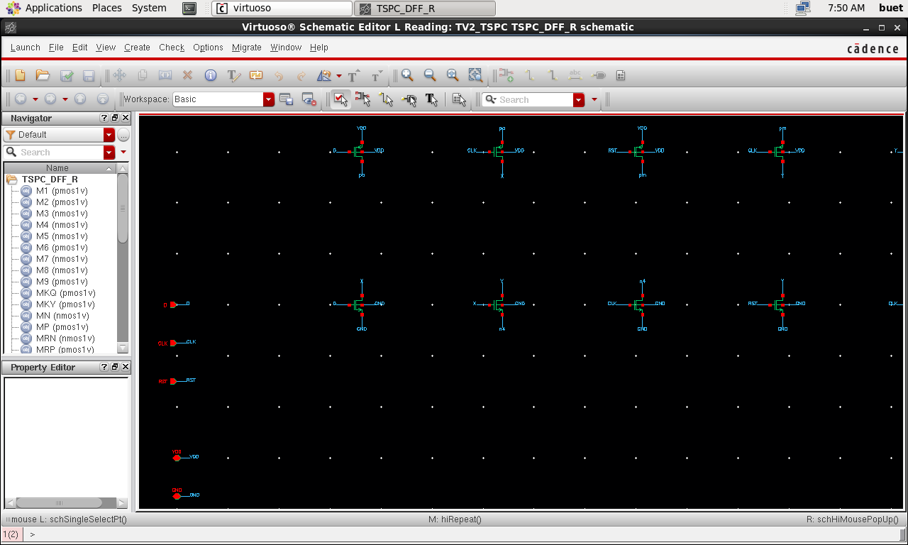
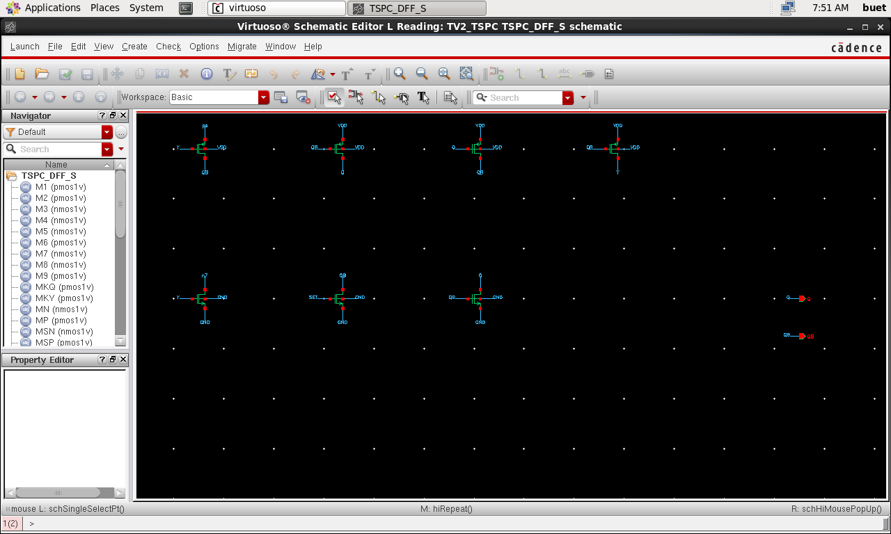
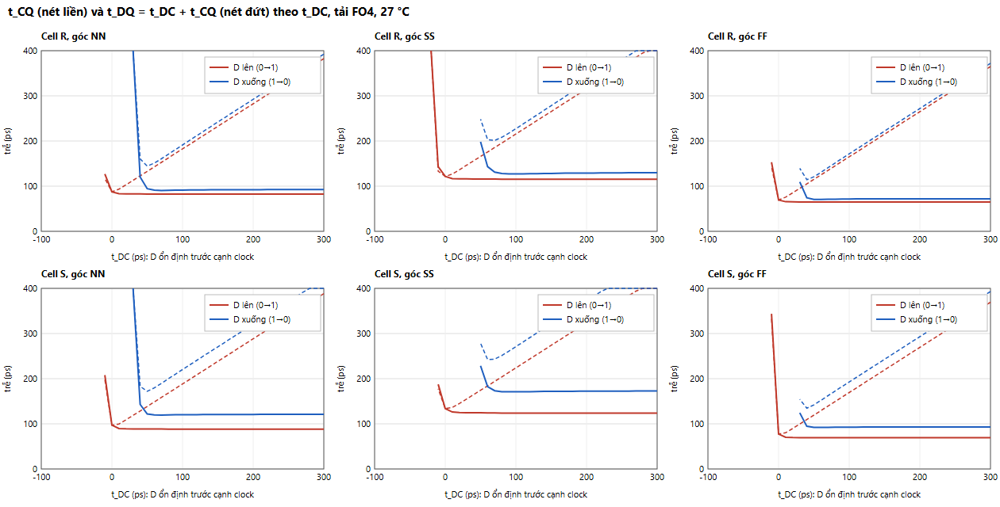
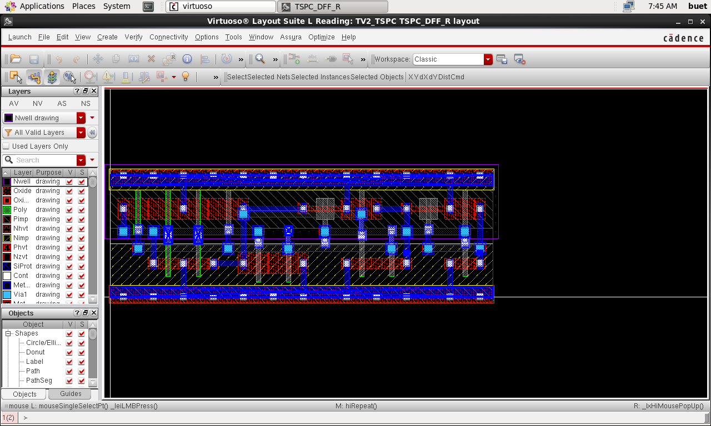
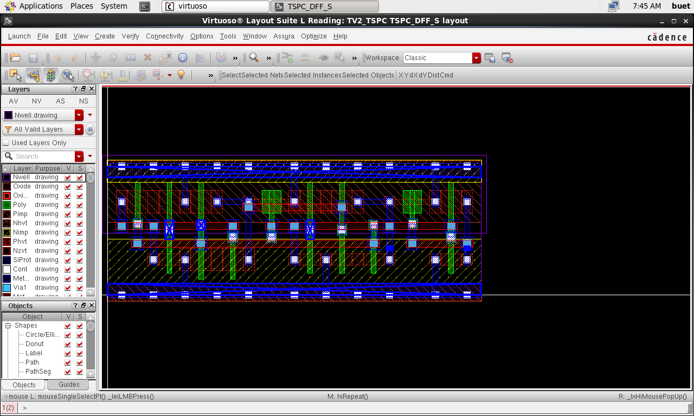
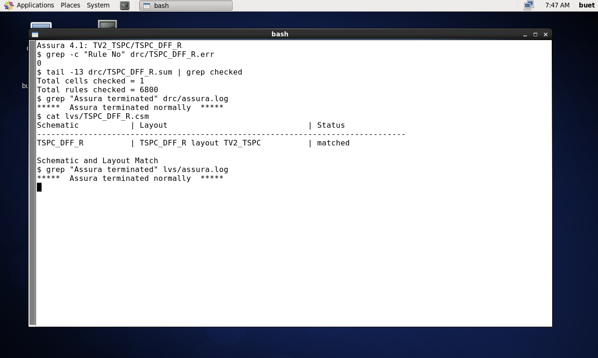
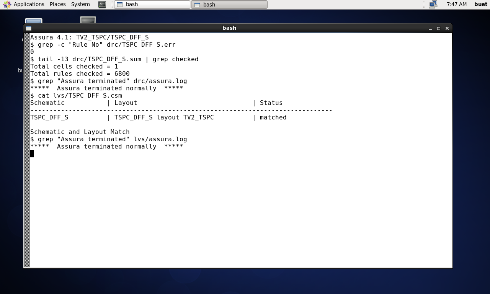

# BÁO CÁO TIẾN ĐỘ: THIẾT KẾ TSPC D FLIP-FLOP CÓ RESET / SET (TV2)

Nguyễn Phước An (TV2) · Nhánh Git: `cell/TSPC_DFF(2)` · gpdk090, VDD = 1,2 V · Cadence Virtuoso IC6.1.5, Spectre, Assura 4.1 · Thư viện: `cadence/TV2_TSPC` · Trạng thái: **đã có schematic, symbol, layout; DRC 0, LVS Match; mô phỏng sau layout; PVT 45 điểm**

## 1. Tóm tắt việc đã làm

| Hạng mục | Kết quả | Minh chứng |
|---|---|---|
| Schematic và Symbol `TSPC_DFF_R` (Reset bất đồng bộ) và `TSPC_DFF_S` (Set bất đồng bộ) | 15 transistor mỗi cell (gồm 2 keeper), một pha clock | Hình 2.1 đến 2.4; `cadence/TV2_TSPC` |
| Chức năng | 11/11 vector ở NN, SS, FF, trước và sau layout | Bảng 3.1; `Tuan1/`, `Tuan3/KET_QUA_TUAN3.md` |
| Đặc tính định thời, công suất, f_max | t_pcq, setup/hold, PDP/EDP, bộ chia 2, chuỗi 2 FF | Bảng 3.2, Hình 3.1; `Tuan2/` |
| Layout | R 8,68 × 2,76 µm = 23,96 µm²; S 8,00 × 2,76 µm = 22,08 µm² | Hình 4.1, 4.2 |
| DRC / LVS | DRC 0 luật vi phạm; LVS Schematic and Layout Match, cả hai cell | Hình 4.3, 4.4 |
| Trích ký sinh và mô phỏng sau layout | 55 tụ (R), 54 tụ (S); 11/11 vector; chuỗi 8 FF | Bảng 5.1; `Tuan3/layout/*_rcx.scs` |
| PVT | 45 điểm, đúng ở 45/45 | Bảng 5.2; `Tuan4/data/` |
| So sánh với MS-DFF của TV1 | Bảng A, trước layout | Bảng 6.1; `Tuan4/SO_SANH_TV1.md` |

## 2. Thiết kế cell và Schematic

Cell gồm bốn tầng nối tiếp, ba nút động X, Y, QB và hai keeper PMOS yếu (W = 0,12 µm, L = 0,40 µm) giữ QB và Y khi clock dừng. Reset (cell R): RST = 1 ép Y về 0 nên Q = 0 bất kể CLK. Set (cell S): SET = 1 kéo QB về 0 nên Q = 1; chỉ nhả SET khi CLK = 0. Kích thước: L = 100 nm; PMOS 480 nm; NMOS 240 nm, riêng M4, M5 là 480 nm (tỉ lệ k = 2). Stack tầng 3 đặt M7 (cổng CLK) sát QB để nút giữa không chia sẻ điện tích với QB khi CLK đổi (QB lệch 1 mV, −3 mV, 2 mV ở NN, SS, FF).

Chân: R gồm D, CLK, RST, Q, QB, VDD, GND; S gồm D, CLK, SET, Q, QB, VDD, GND.






## 3. Mô phỏng chức năng và đặc tính (trước layout)

### 3.1 Chức năng

Testbench 11 vector, 500 MHz, tải FO4: mức logic nghiêm ngặt (Q ≥ 0,9·VDD hoặc ≤ 0,1·VDD khi lấy mẫu), D giữ nhiều chu kỳ, RST/SET ép khi CLK = 0 và CLK = 1, rồi nhả.

| Cell | NN | SS | FF |
|---|---|---|---|
| `TSPC_DFF_R` | PASS 11/11 | PASS 11/11 | PASS 11/11 |
| `TSPC_DFF_S` | PASS 11/11 | PASS 11/11 | PASS 11/11 |

### 3.2 Định thời và công suất (NN, 27 °C, tải FO4 trên Q và QB, clock dốc 50 ps)

| Cell | t_pcq lên / xuống (ps) | Setup xấu nhất NN / SS / FF (ps) | T_min bộ chia 2, nối QB → D, NN / SS / FF (ps) | P_avg 1 GHz, D ngẫu nhiên (µW) |
|---|---|---|---|---|
| R | 82,6 / 92,7 | 30 / 50 / 30 | 150 / 220 / 120 | 9,62 |
| S | 88,3 / 121,0 | 30 / 50 / 30 | 180 / 250 / 140 | 9,28 |

Chuỗi 2 FF nối thẳng: T nhỏ nhất vẫn đúng là 138 ps (NN), 200 ps (SS), 111 ps (FF). Giữ dữ liệu: Q giữ đúng hơn 20 µs khi clock dừng ở 16/16 điều kiện đã thử (R và S, FF 125 °C và NN 27 °C), nên f_min dưới 50 kHz.



## 4. Layout, DRC và LVS

Mỗi cell cao 2,76 µm: hàng pMOS ở trên, hàng nMOS ở dưới; GND Metal1 ở mép dưới, VDD Metal1 ở mép trên (rộng 0,24 µm); chân tín hiệu Metal1; dây Metal1 và Metal2.





| Cell | Kích thước (µm) | Diện tích (µm²) | Số cột cổng | DRC | LVS |
|---|---|---|---|---|---|
| R | 8,68 × 2,76 | 23,96 | 11 | 0 luật vi phạm | Match |
| S | 8,00 × 2,76 | 22,08 | 10 | 0 luật vi phạm | Match |





Hai hình 4.3 và 4.4 chụp cửa sổ dòng lệnh chạy Assura, không phải cửa sổ Virtuoso. DRC và LVS được chạy lại ngày 24/11/2026 trên chính thư viện đã xuất trong `cadence/`.

## 5. Sau layout và PVT

### 5.1 Mô phỏng sau layout (Assura RCX, netlist trích RC)

| Cell | Transistor | Tụ ký sinh | t_pcq NN, lên / xuống (ps) | t_pcq SS, lên / xuống (ps) | t_pcq FF, lên / xuống (ps) | Glitch tĩnh lớn nhất ở Q (mV) |
|---|---|---|---|---|---|---|
| R | 15 | 55 | 75,7 / 74,6 | 105,2 / 104,6 | 59,9 / 58,2 | 1 |
| S | 15 | 54 | 78,9 / 97,3 | 109,9 / 138,8 | 62,3 / 75,0 | 3 |

Chức năng sau layout đúng 11/11 vector ở NN, SS, FF. Chuỗi 8 FF nối thẳng (7 R và 1 S, tải FO4): dịch đúng ở cả ba góc khi cạnh clock từ 200 ps trở xuống; ở cạnh 400 ps sai ở NN và FF, đúng ở SS.

### 5.2 PVT 45 điểm (sau layout)

| | R | S |
|---|---|---|
| Điểm đúng chức năng | 45/45 | 45/45 |
| t_pcq NN, 1,2 V, 27 °C (ps) | 75,9 | 97,4 |
| t_pcq xấu nhất, SS, 0,8 V, 125 °C (ps) | 259,9 | 333,9 |
| t_pcq tốt nhất, FF, 1,2 V, 0 °C (ps) | 54,8 | 69,1 |
| T_min bộ chia 2, NN (ps) | 130 | 130 |
| T_min bộ chia 2, SS, 0,8 V, 125 °C (ps) | 500 | 500 |

## 6. So sánh với MS-DFF của TV1 (trước layout)

Cùng điều kiện: NN, 27 °C, có `as/ad`, Q tải FO4, QB hở. MS-DFF tính 26 transistor cộng 2 transistor của inverter clock ngoài.

| Chỉ tiêu | R | S | MS-DFF | TSPC thấp hơn |
|---|---|---|---|---|
| Transistor | 15 | 15 | 26 (+2) | 42% |
| Diện tích cổng W×L (µm²) | 0,600 | 0,600 | 1,128 | 47% |
| t_pcq lên / xuống NN (ps) | 45,9 / 50,3 | 47,3 / 61,4 | 60,0 / 79,1 | 20 đến 38% |
| Setup xấu nhất NN (ps) | 20 | 20 | 50 | 60% |
| T_min bộ chia 2 (QB → D), NN (ps) | 90 | 110 | 160 | 31 đến 44% |
| P_avg 1 GHz, D ngẫu nhiên (µW) | 4,51 | 4,43 | 4,78 (gồm inverter clock) | 6 đến 7% |
| P_avg 1 GHz, D = 0101 (µW) | 12,03 | 12,26 | 24,38 | 50 đến 51% |
| P_avg 1 GHz, D toàn 0 (µW) | 6,91 | 6,69 | 1,80 | TSPC cao hơn 272 đến 284% |

Công suất phụ thuộc mạnh vào mẫu D nên không kết luận một con số chung. Số đo thô và netlist MS-DFF dùng để so sánh nằm trong `Tuan4/so_sanh/`. Số trong mục 3.2 và 5 đo trong điều kiện khác (tải FO4 cả trên QB, chưa có `as/ad` ở Tuần 1 và 2), nên chậm hơn số trong mục này; không so trực tiếp hai bảng.

## 7. Đối chiếu việc được giao và chuẩn TV3

| Việc trong kế hoạch | Trạng thái | Tệp |
|---|---|---|
| Schematic và Symbol cell TSPC | Hoàn thành | `cadence/TV2_TSPC`, `anh/schematic/` |
| Tuần 1: chức năng, W/L chống chia sẻ điện tích | Hoàn thành | `Tuan1/` |
| Tuần 2: t_pcq, setup, hold, công suất, f_max; bảng so với TV1 | Hoàn thành | `Tuan2/`, `Tuan4/SO_SANH_TV1.md` |
| Tuần 3: layout, DRC 0, LVS Match, diện tích | Hoàn thành | `Tuan3/`, `anh/` |
| Tuần 4: PVT, bản nháp Chương 3 | Hoàn thành | `Tuan4/` |
| Stick diagram | Chưa làm | |
| View `av_extracted` trong thư viện; ảnh dạng sóng chụp từ ViVA | Chưa làm | |
| Slide phần TV2 | Chưa làm | |

Đối chiếu với TV3: chiều cao cell 2,76 µm, ray Metal1 0,24 µm, chân Metal1, tên chân VDD/GND trùng. Chưa trùng: chiều rộng cell không phải bội của bước cột 0,27 µm; chân Reset tên `RST` (kế hoạch ghi `RESET`). Hai điểm này cần nhóm thống nhất trước khi ghép dải 8 bit với TV4.

## 8. Cách kiểm lại

```
cd Nguyen_Phuoc_An/cadence && virtuoso &
```

Library Manager → `TV2_TSPC` → `TSPC_DFF_R` hoặc `TSPC_DFF_S` → các view `schematic`, `symbol`, `layout`. Cần gpdk090 v4.6; sửa đường dẫn trong `cadence/cds.lib` nếu cài ở nơi khác. Số liệu chi tiết nằm trong `Tuan1/` đến `Tuan4/` (mỗi báo cáo có bản `.md` và `.pdf`); bản tổng hợp cấu trúc thư mục ở `README.md`.
