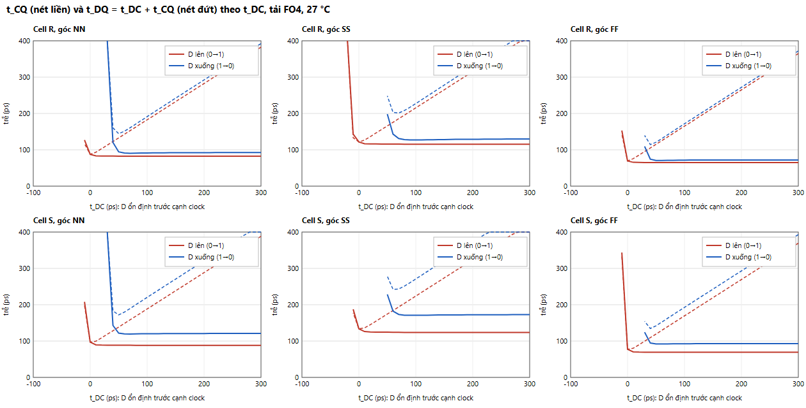

# Báo cáo Tuần 2: Đặc tính hóa pre-layout TSPC D Flip-Flop

Nguyễn Phước An (TV2) · gpdk090 (90 nm), VDD = 1,2 V · Cadence Spectre · Trạng thái: **trước layout**

Thiết kế, schematic và netlist của `TSPC_DFF_R` và `TSPC_DFF_S` (15 transistor) nằm trong `../Tuan1/BAO_CAO_SO_BO_TV2.md`. Số liệu chi tiết của tuần này nằm trong `KET_QUA_TUAN2.md`.

## 1. Mục tiêu Tuần 2

Đặc tính hóa cell trước layout: setup/hold và t_pcq, công suất, f_max, f_min và kiểm tra race trong chuỗi FF. Báo cáo này nêu các hạng mục đã hoàn thành trong tuần.

## 2. Phương pháp

- **t_CQ, t_DQ theo t_DC:** quét độ lệch giữa cạnh D và cạnh CLK từ −300 đến +100 ps, bước 10 ps; t_DC = −d, t_DQ = t_DC + t_CQ.
- **PDP, EDP:** P_avg × t_pcq và PDP × t_pcq ở 1 GHz, với bốn mẫu dữ liệu D.
- **Bộ chia 2:** ngõ ra đảo nối về D, kiểm tra Q đổi trạng thái đúng ở mọi chu kỳ; quét chu kỳ clock T.
- **Chuỗi 2 FF:** hai cell nối tiếp, D ngẫu nhiên 22 bit; mỗi tầng phải chốt đúng dữ liệu của tầng trước.

## 3. Kết quả

**Đường t_CQ và t_DQ theo t_DC** (sáu trường hợp: R và S, ba góc). t_CQ phẳng ở vùng t_DC lớn rồi tăng vọt gần setup; t_DQ có cực tiểu ở điểm đó. Setup xấu nhất (D xuống): 30 ps ở NN và FF, 50 ps ở SS.

**PDP và EDP** (NN, 1 GHz, t_pcq lớn hơn trong hai hướng: R 92,7 ps, S 121,0 ps):

| Cell | PDP (fJ): toàn 0 / toàn 1 / 0101 / ngẫu nhiên | EDP (fJ·ps), ngẫu nhiên |
|---|---|---|
| R | 1,248 / 0,039 / 2,791 / 0,892 | 82,7 |
| S | 1,460 / 0,045 / 3,845 / 1,123 | 135,9 |

**f_max bằng bộ chia 2** (T nhỏ nhất còn đúng):

| Cell | Góc | QB → D | Q → INV → D |
|---|---|---|---|
| R | NN | 150 ps (6,7 GHz) | 140 ps (7,1 GHz) |
| R | SS | 220 ps (4,5 GHz) | 200 ps (5,0 GHz) |
| R | FF | 120 ps (8,3 GHz) | 110 ps (9,1 GHz) |
| S | NN | 180 ps (5,6 GHz) | 140 ps (7,1 GHz) |
| S | SS | 250 ps (4,0 GHz) | 220 ps (4,5 GHz) |
| S | FF | 140 ps (7,1 GHz) | 120 ps (8,3 GHz) |

Nối QB thẳng vào D thấp hơn khoảng 10–20% so với nối qua inverter, vì QB là nút động và phải lái thêm cổng D.

**Chuỗi 2 FF** (R→R và S→R, cả hai tầng đúng): T nhỏ nhất là 138 ps (7,2 GHz) ở NN, 200 ps (5,0 GHz) ở SS, 111 ps (9,0 GHz) ở FF.

## 4. Chưa làm

- Bảng so sánh định thời và công suất với MS-DFF (Bảng A): đã làm ở `../Tuan4/SO_SANH_TV1.md`.
- Ma trận corner rút gọn cho PDP/EDP; độ dốc clock tối đa cho chuỗi 2 FF.
- Layout, DRC/LVS, PEX (Tuần 3).
