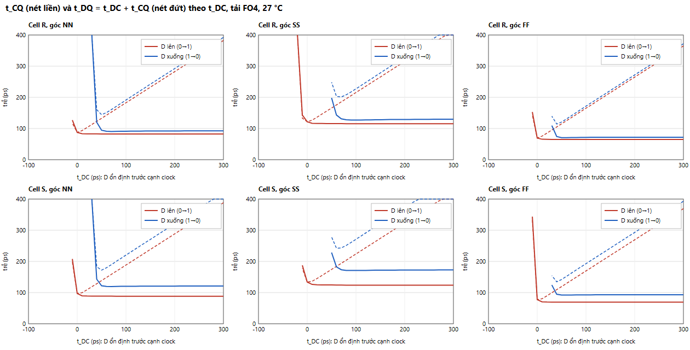

# Kết quả Tuần 2: Đặc tính hóa pre-layout, TSPC D Flip-Flop (R và S)

Người thực hiện: Nguyễn Phước An (TV2). Công nghệ gpdk090, VDD = 1,2 V, Spectre, **trước layout**. Cell: `TSPC_DFF_R` và `TSPC_DFF_S` (15 transistor, netlist trong `../cells/`). Tải: 4 × `INV_X1` (FO4) ở Q (và QB nếu ghi). Các số t_pcq, setup/hold, công suất, f_max, f_min đã đo ở Tuần 1 (xem `../Tuan1/KET_QUA_TV2.md`); tài liệu này gồm các hạng mục bổ sung của Tuần 2.

## 1. Đường t_CQ và t_DQ theo t_DC

t_DC là thời gian D ổn định trước cạnh clock (t_DC = −d, d là độ lệch của cạnh D so với cạnh CLK); t_DQ = t_DC + t_CQ. Quét d từ −300 đến +100 ps, bước 10 ps, độ dốc D 50 ps, clock dốc 50 ps, 27 °C. Dữ liệu từ 12 phép quét (R và S, NN, SS, FF, D lên và D xuống).

t_CQ phẳng ở vùng t_DC lớn (bằng t_pcq), rồi tăng vọt khi t_DC gần setup; t_DQ có cực tiểu ở điểm đó. Setup xấu nhất (D xuống): 30 ps ở NN và FF, 50 ps ở SS cho cả hai cell.

## 2. PDP và EDP (NN, 27 °C, 1 GHz)

PDP = P_avg × t_pcq; EDP = PDP × t_pcq, với t_pcq là giá trị lớn hơn trong hai hướng Q lên / Q xuống (R: 92,7 ps; S: 121,0 ps). P_avg gồm tải FO4.

| Cell | D toàn 0 | D toàn 1 | 0101 | Ngẫu nhiên |
|---|---|---|---|---|
| R, P_avg (µW) | 13,46 | 0,42 | 30,11 | 9,62 |
| R, PDP (fJ) | 1,248 | 0,039 | 2,791 | 0,892 |
| R, EDP (fJ·ps) | 115,7 | 3,6 | 258,7 | 82,7 |
| S, P_avg (µW) | 12,07 | 0,37 | 31,78 | 9,28 |
| S, PDP (fJ) | 1,460 | 0,045 | 3,845 | 1,123 |
| S, EDP (fJ·ps) | 176,7 | 5,4 | 465,2 | 135,9 |

## 3. f_max bằng bộ chia 2

Ngõ ra đảo nối về D; Q phải đổi trạng thái đúng ở mọi chu kỳ (19 chu kỳ kiểm tra sau reset/set). Clock 50%, cạnh 20 ps. Hai cách nối: (a) QB nối thẳng D (QB đồng thời lái D và 4 inverter tải); (b) Q qua một `INV_X1` về D. Dãy T khảo sát: 400, 300, 250, 220, 200, 180, 160, 150, 140, 130, 120, 110, 100, 90 ps. Bảng ghi T nhỏ nhất mà mọi chu kỳ còn đúng.

| Cell | Góc | (a) QB → D | (b) Q → INV → D |
|---|---|---|---|
| R | NN | 150 ps (6,7 GHz) | 140 ps (7,1 GHz) |
| R | SS | 220 ps (4,5 GHz) | 200 ps (5,0 GHz) |
| R | FF | 120 ps (8,3 GHz) | 110 ps (9,1 GHz) |
| S | NN | 180 ps (5,6 GHz) | 140 ps (7,1 GHz) |
| S | SS | 250 ps (4,0 GHz) | 220 ps (4,5 GHz) |
| S | FF | 140 ps (7,1 GHz) | 120 ps (8,3 GHz) |

Dưới các giá trị trên, bộ chia đúng không trọn (ví dụ 9/19 hoặc 1/19 chu kỳ). Nối QB thẳng vào D thấp hơn khoảng 10–20% so với nối qua đệm, vì QB là nút động đang lái thêm cổng của D.

## 4. Chuỗi 2 FF, D ngẫu nhiên

Hai cell nối tiếp, Q của FF1 nối D của FF2, clock chung 50% cạnh 20 ps, 22 bit ngẫu nhiên, tải FO4 ở Q2 và QB2. Chuỗi R→R và S→R. FF1 đúng khi Q1 trước cạnh k+1 bằng D trước cạnh k; FF2 đúng khi Q2 trước cạnh k+2 bằng D trước cạnh k.

| Chuỗi | Góc | T nhỏ nhất vẫn đúng cả hai tầng | Sai ở (T kế tiếp) |
|---|---|---|---|
| R→R và S→R | NN | 138 ps (7,2 GHz) | 134 ps (FF2 19/21) |
| R→R và S→R | SS | 200 ps (5,0 GHz) | 190 ps (FF2 19/21) |
| R→R và S→R | FF | 111 ps (9,0 GHz) | 105 ps (FF2 19/21) |

Hai chuỗi cho cùng ngưỡng. Ở T ngay dưới ngưỡng, FF1 vẫn đúng và chỉ FF2 sai; ở T nhỏ hơn nữa (NN, T ≤ 120 ps) cả hai tầng sai. Giá trị cao hơn f_max của một cell riêng lẻ (Tuần 1) vì tải của FF1 chỉ là cổng của FF2, nhẹ hơn tải FO4.

## 5. Còn lại của Tuần 2

- Bảng so sánh định thời và công suất với MS-DFF (Bảng A): đã làm ở `../Tuan4/SO_SANH_TV1.md` (cùng tải FO4 trên Q, QB để hở, cùng mẫu D, cùng góc). Lưu ý số Tuần 1–2 đo không có `as/ad` và có tải FO4 cả trên QB, nên chậm hơn số trong Bảng A (R, NN: t_pcq lên 75,9 ps so với 45,9 ps).
- Ma trận corner rút gọn cho PDP/EDP (hiện chỉ ở NN, 1 GHz).
- Độ dốc clock tối đa cho chuỗi 2 FF.
