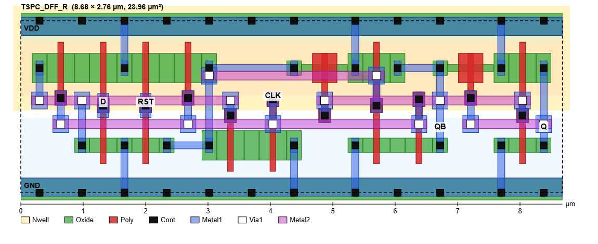
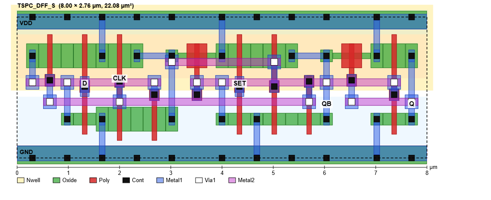

# Báo cáo Tuần 3: Layout và kiểm tra sau layout của TSPC D Flip-Flop

Nguyễn Phước An (TV2) · gpdk090 (90 nm), VDD = 1,2 V · Cadence Virtuoso, Assura, Spectre · Trạng thái: **sau layout (DRC, LVS, RC)**

Thiết kế và netlist của `TSPC_DFF_R` và `TSPC_DFF_S` (15 transistor) nằm trong `../Tuan1/BAO_CAO_SO_BO_TV2.md`. Số liệu chi tiết của tuần này nằm trong `KET_QUA_TUAN3.md`.

## 1. Mục tiêu Tuần 3

Vẽ layout hai cell, kiểm tra DRC và LVS, trích ký sinh và mô phỏng lại trên netlist trích để biết số liệu sau layout.

## 2. Layout

Mỗi cell là một hàng pMOS ở trên và một hàng nMOS ở dưới, cao 2,76 µm, đường GND và VDD Metal1 ở hai mép, tap nền trong cell. Cổng poly chạy dọc; khuếch tán dùng chung giữa các transistor nối tiếp; dây dùng Metal1 và Metal2. Hai keeper có L = 0,40 µm nên poly của chúng rộng hơn các cổng còn lại.

| | R | S |
|---|---|---|
| Kích thước | 8,68 × 2,76 µm | 8,00 × 2,76 µm |
| Diện tích | 23,96 µm² | 22,08 µm² |

Hai ảnh được vẽ lại từ dữ liệu view `layout` của Virtuoso, không phải ảnh chụp màn hình Virtuoso.

## 3. Kiểm tra layout

| Cell | DRC | LVS |
|---|---|---|
| R | 0 luật vi phạm | Match |
| S | 0 luật vi phạm | Match |

## 4. Sau layout

- **Chức năng:** R và S đúng 11/11 vector ở NN, SS, FF.
- **t_pcq:** R, NN: 75,7 ps (Q lên) và 74,6 ps (Q xuống); S, NN: 78,9 ps và 97,3 ps. Điện dung dây thêm khoảng 10 ps ở NN so với netlist không có điện dung dây.
- **Glitch tĩnh ở Q:** 1 mV (R) và 3 mV (S) lớn nhất.
- **Chuỗi 8 FF** (7 R, 1 S): dịch đúng ở cả ba góc khi cạnh clock từ 200 ps trở xuống; ở 400 ps sai ở NN và FF, đúng ở SS.

## 5. Chưa làm

- Ghép thử dải 8-bit với TV4. Đã đối chiếu với TV3 (xem `../README.md`): chiều cao 2,76 µm, ray VDD/GND Metal1 rộng 0,24 µm, chân Metal1 và tên chân VDD, GND trùng với chuẩn của TV3; chiều rộng cell chưa là bội của bước cột 0,27 µm của TV3.
- Setup/hold, công suất, f_max trên netlist trích.
- Ảnh chụp thật của Virtuoso đã có trong `../anh/` (schematic, layout, DRC/LVS); thư viện Virtuoso trong `../cadence/`.
- PVT 45 điểm (Tuần 4, đã làm); so sánh với MS-DFF của TV1 (`../Tuan4/SO_SANH_TV1.md`, trước layout; TV1 chưa có layout nên chưa so sánh diện tích layout).

## 6. Tệp đi kèm

`layout/TV2_TSPC.gds` (GDS hai cell), `layout/*.cdl` (netlist LVS), `layout/*_rcx.scs` (netlist trích RC cho Spectre, cùng tên và thứ tự chân với cell trước layout).
