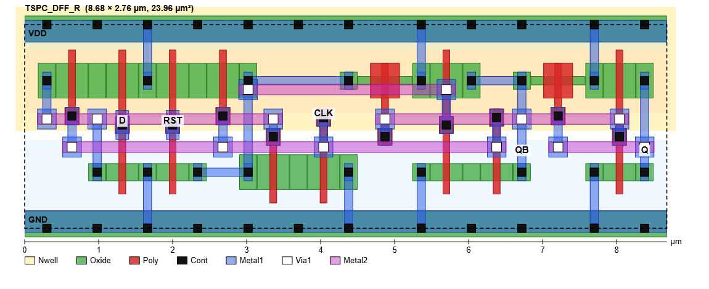
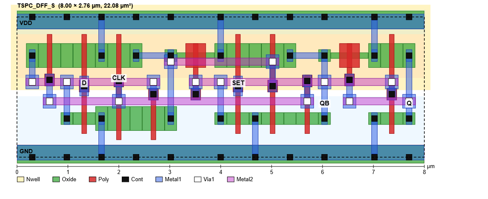

# Kết quả Tuần 3: Layout, DRC/LVS, trích ký sinh, mô phỏng sau layout (TSPC D Flip-Flop R và S)

Người thực hiện: Nguyễn Phước An (TV2). Công nghệ gpdk090, VDD = 1,2 V, Cadence Virtuoso IC6.1.5, Assura 4.1, Spectre. Cell: `TSPC_DFF_R` và `TSPC_DFF_S` (15 transistor, gồm 2 keeper). Netlist trước layout nằm trong `../cells/`; số đo trước layout ở `../Tuan1/KET_QUA_TV2.md`.

## 1. Layout

Mỗi cell là một hàng pMOS (phía trên) và một hàng nMOS (phía dưới), cao 2,76 µm. Đường GND (Metal1) ở mép dưới, đường VDD (Metal1) ở mép trên, mỗi đường có tap nền (P+ ở dưới, N+ trong Nwell ở trên). Cổng poly chạy dọc, khuếch tán dùng chung giữa các transistor nối tiếp. Dây dùng Metal1 và Metal2 (Via1 ở các điểm đổi lớp). Hai keeper (`MKQ`, `MKY`) có W = 0,12 µm, L = 0,40 µm, nên poly của chúng rộng 0,40 µm.

| | `TSPC_DFF_R` | `TSPC_DFF_S` |
|---|---|---|
| Chân | D, CLK, RST, Q, QB, VDD, GND | D, CLK, SET, Q, QB, VDD, GND |
| Kích thước (µm) | 8,68 × 2,76 | 8,00 × 2,76 |
| Diện tích (µm²) | 23,96 | 22,08 |
| Số cột cổng | 11 | 10 |
| Transistor | 15 | 15 |

Ghi chú về ảnh: hai ảnh trên được vẽ lại từ các hình chữ nhật trong view `layout` của Virtuoso (xuất bằng SKILL), không phải ảnh chụp màn hình cửa sổ Virtuoso.

## 2. DRC và LVS (Assura, luật gpdk090)

| Cell | DRC | LVS |
|---|---|---|
| `TSPC_DFF_R` | 0 luật vi phạm | Schematic and Layout Match |
| `TSPC_DFF_S` | 0 luật vi phạm | Schematic and Layout Match |

LVS so với netlist CDL tạo từ netlist Spectre của cell (15 transistor, đủ W và L, kể cả keeper W = 0,12 µm, L = 0,40 µm). Lần LVS trong bước trích ký sinh cũng cho Match.

## 3. Trích ký sinh (Assura RCX, điện trở và điện dung)

| Cell | Transistor | Tụ | Netlist |
|---|---|---|---|
| R | 15 | 55 | `layout/TSPC_DFF_R_rcx.scs` |
| S | 15 | 54 | `layout/TSPC_DFF_S_rcx.scs` |

Netlist trích được đổi sang subckt Spectre cùng tên và cùng thứ tự chân với cell trước layout, nên testbench cũ dùng lại, chỉ đổi file include. Mỗi transistor mang `ad`, `as`, `pd`, `ps` từ layout.

## 4. Mô phỏng sau layout

### 4.1 Chức năng (testbench 11 vector, 500 MHz, tải FO4)

| Cell | NN | SS | FF |
|---|---|---|---|
| R | PASS 11/11 | PASS 11/11 | PASS 11/11 |
| S | PASS 11/11 | PASS 11/11 | PASS 11/11 |

Testbench gồm mức logic nghiêm ngặt (Q ≥ 0,9·VDD hoặc ≤ 0,1·VDD khi lấy mẫu), D giữ nhiều chu kỳ, RST hoặc SET ép khi CLK = 0 và CLK = 1, và nhả RST/SET.

### 4.2 Trễ clock → Q (t_pcq, ps, ngưỡng 50%, clock dốc 50 ps)

Cột "Trước layout" là số của Tuần 1 (netlist không có `ad/as/pd/ps` và không có điện dung dây). Cột "Sau layout, không tụ dây" là netlist trích với các điện dung dây bị bỏ (chỉ giữ `ad/as/pd/ps` và điện trở dây; chỉ đo ở NN).

| Cell | Góc | Trước layout (lên / xuống) | Sau layout, không tụ dây (lên / xuống) | Sau layout (lên / xuống) |
|---|---|---|---|---|
| R | NN | 82,6 / 92,7 | 65,7 / 64,0 | 75,7 / 74,6 |
| R | SS | 115,5 / 130,1 | | 105,2 / 104,6 |
| R | FF | 65,0 / 72,2 | | 59,9 / 58,2 |
| S | NN | 88,3 / 121,0 | 67,4 / 82,9 | 78,9 / 97,3 |
| S | SS | 123,9 / 172,9 | | 109,9 / 138,8 |
| S | FF | 69,3 / 93,1 | | 62,3 / 75,0 |

Với tụ dây, t_pcq tăng khoảng 10 ps (R, NN) và khoảng 11–14 ps (S, NN) so với cột không tụ dây.

### 4.3 Glitch tĩnh ở Q (mV, độ lệch lớn nhất so với giá trị cuối cửa sổ ổn định)

Cửa sổ: từ 0,45 ns đến 1,9 ns sau cạnh clock, chỉ lấy các chu kỳ không có xung RST/SET (R: bốn chu kỳ từ cạnh 9 ns; S: hai chu kỳ đầu của đoạn D giữ).

| Cell | Góc | Trước layout | Sau layout |
|---|---|---|---|
| R | NN, SS, FF | 1, 1, 1 | 1, 1, 1 |
| S | NN, SS, FF | 2, 2, 1 | 3, 3, 2 |

### 4.4 Chuỗi 8 FF nối thẳng (7 × R, 1 × S), D ngẫu nhiên 22 bit, T = 2 ns, tải FO4 ở ngõ ra

Tầng j đúng khi Q_j trước cạnh k+j bằng D trước cạnh k. Cột là thời gian cạnh lên/xuống của clock. "PASS" nghĩa là cả 8 tầng đúng toàn bộ.

| Góc | 50 ps | 100 ps | 200 ps | 400 ps |
|---|---|---|---|---|
| NN, trước layout | PASS | PASS | PASS | PASS |
| NN, sau layout | PASS | PASS | PASS | **FAIL** (F2 20/21 … F8 12/15) |
| SS, trước layout | PASS | PASS | PASS | PASS |
| SS, sau layout | PASS | PASS | PASS | PASS |
| FF, trước layout | PASS | PASS | PASS | **FAIL** (F2 20/21 … F8 11/15) |
| FF, sau layout | PASS | PASS | PASS | **FAIL** (F2 20/21 … F8 9/15) |

Với cạnh clock từ 200 ps trở xuống, chuỗi 8 FF dịch đúng ở cả ba góc sau layout.

## 5. Chưa làm trong Tuần 3

- Ghép thử dải 8-bit với TV4. Đối chiếu với TV3 đã làm (`../README.md`): chiều cao 2,76 µm, ray Metal1 0,24 µm, chân Metal1, tên VDD/GND trùng; chiều rộng cell chưa là bội của bước cột 0,27 µm của TV3.
- Setup/hold, công suất, f_max, f_min trên netlist trích (số hiện có là trước layout).
- Ảnh chụp màn hình thật của cửa sổ Virtuoso (layout, kết quả DRC, LVS): đã có trong `../anh/layout`, `../anh/drc_lvs`, `../anh/schematic`.
- Ma trận PVT 45 điểm trên bản sau layout (Tuần 4).
- Bảng so sánh diện tích với cell MS-DFF của TV1 (chờ có cell).

## 6. Tệp trong `layout/`

- `TV2_TSPC.gds`: GDS của hai cell (xuất bằng `strmout` từ view `layout`).
- `TSPC_DFF_R.cdl`, `TSPC_DFF_S.cdl`: netlist dùng cho LVS.
- `TSPC_DFF_R_rcx.scs`, `TSPC_DFF_S_rcx.scs`: netlist trích RC dạng Spectre.
