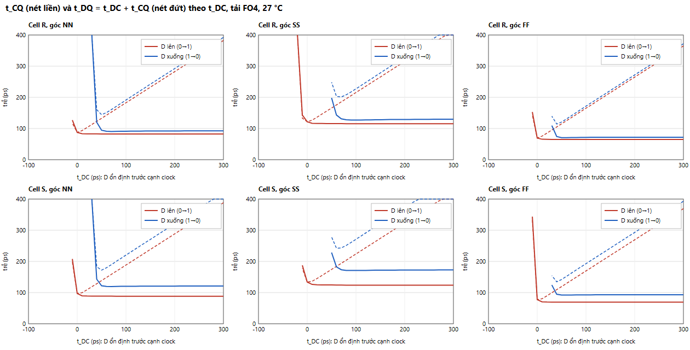
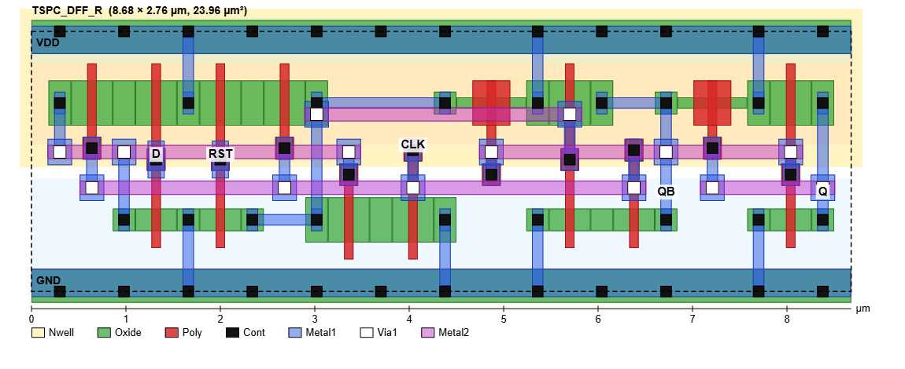
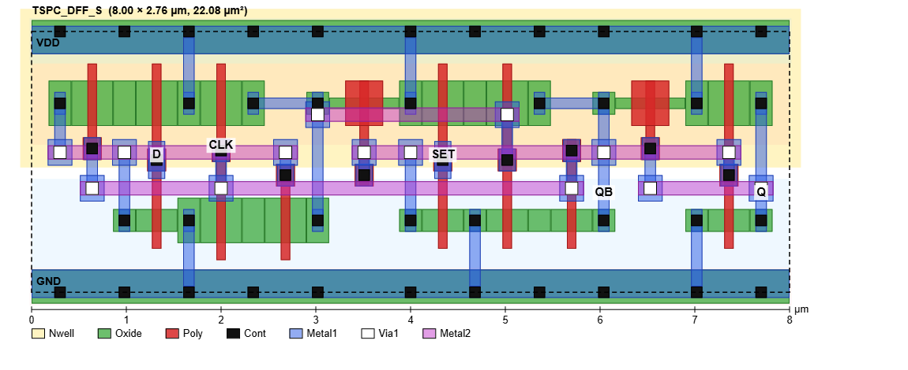

# Bản nháp phần TV2, Chương 3: TSPC D Flip-Flop có Reset và Set

Nguyễn Phước An (TV2) · gpdk090 (90 nm), VDD = 1,2 V · Cadence Virtuoso, Assura, Spectre. Số liệu tuần này: `KET_QUA_TUAN4.md` (Bảng B, PVT 45 điểm). Các bảng số đo chi tiết khác: `../Tuan1/KET_QUA_TV2.md`, `../Tuan2/KET_QUA_TUAN2.md`, `../Tuan3/KET_QUA_TUAN3.md`.

## 3.1. Vai trò và nguyên lý

LFSR/BILBO cần phần tử nhớ kích cạnh lên, có chân điều khiển bất đồng bộ để nạp seed. Hai cell được thiết kế theo kiểu TSPC (true single-phase clock): `TSPC_DFF_R` (Reset: RST = 1 thì Q = 0) và `TSPC_DFF_S` (Set: SET = 1 thì Q = 1). Mỗi cell chỉ dùng một pha clock, không cần clock đảo, và có 15 transistor gồm 2 keeper.

Cell gồm bốn tầng nối tiếp, ba nút động X, Y, QB:

| Tầng | Vai trò | Nút ra |
|---|---|---|
| 1 | Nửa chốt P: đảo D khi CLK = 0 | X = D̄ |
| 2 | N-precharge: precharge Y lên VDD khi CLK = 0, lấy mẫu X khi CLK = 1 | Y = D |
| 3 | N-C²MOS: đảo Y ra QB khi CLK = 1 | QB = D̄ |
| 4 | Inverter ngõ ra có đệm | Q = D |

Khi CLK = 0, tầng 1 chốt X = D̄ và tầng 2 precharge Y lên 1. Khi CLK lên 1, nếu X = 1 thì chuỗi M4–M5 xả Y về 0, nếu X = 0 thì Y giữ 1; tầng 3 và 4 truyền giá trị đó ra Q. Dữ liệu chỉ được lấy mẫu tại cạnh lên của CLK.

## 3.2. Thiết kế Reset và Set

- **Cell R:** RST = 1 ép Y về 0 qua MRN (NMOS) và chặn precharge qua MRP (PMOS nối tiếp M6), nên Q = 0 bất kể CLK. Nhả RST ở thời điểm nào cũng được.
- **Cell S:** M6 nối thẳng VDD. Tầng 3 thêm MSP (PMOS, cổng SET, nối tiếp M9) và MSN (NMOS, cổng SET, kéo QB xuống GND): SET = 1 thì QB = 0 nên Q = 1. **Quy tắc:** chỉ nhả SET khi CLK = 0; nhả khi CLK = 1 thì Q tự lật về giá trị D đã giữ sẵn ở tầng 2 và giá trị nạp sẵn bị mất (đã xác nhận bằng mô phỏng).

## 3.3. Kích thước

L = 100 nm trừ keeper.

| Nhóm | W |
|---|---|
| PMOS M1, M2, M6, MRP / MSP, M9, MP | 480 nm |
| NMOS M3, M7, M8, MRN / MSN, MN | 240 nm |
| NMOS M4, M5 | 480 nm |
| Keeper MKQ, MKY (PMOS) | 120 nm, L = 400 nm |

Tỉ lệ k = W(M4, M5) / W(M7, M8) = 2. Stack tầng 3 đặt M7 (cổng CLK) sát QB và M8 (cổng Y) phía GND, nên nút giữa n7 không chia sẻ điện tích với QB khi CLK đổi (QB lệch 1 mV, −3 mV, 2 mV ở NN, SS, FF). M6 có cổng nối CLK nên D đổi khi CLK = 1 không làm Q đổi theo. Hai keeper yếu giữ QB và Y khi clock dừng hoặc chậm, không cản việc chuyển trạng thái.

Schematic từ Virtuoso nằm trong `../Tuan1/BAO_CAO_SO_BO_TV2.pdf`.

## 3.4. Kết quả

**Chức năng.** R và S đúng 11/11 vector (Reset/Set ở cả hai pha clock, tải FO4) ở NN, SS, FF, cả trước và sau layout. Trên 45 điểm PVT sau layout, cả hai cell đúng ở 45/45 điểm.

**Trễ và tần số (sau layout, Bảng B).**

| | R | S |
|---|---|---|
| t_pcq, NN, 1,2 V, 27 °C (ps) | 75,9 | 97,4 |
| t_pcq, SS, 0,8 V, 125 °C (ps, xấu nhất) | 259,9 | 333,9 |
| t_pcq, FF, 1,2 V, 0 °C (ps, tốt nhất) | 54,8 | 69,1 |
| T_min bộ chia 2, NN, 1,2 V, 27 °C (ps) | 130 | 130 |
| T_min bộ chia 2, SS, 0,8 V, 125 °C (ps, xấu nhất) | 500 | 500 |

**Đường t_CQ và t_DQ theo t_DC** (trước layout): t_CQ phẳng ở vùng t_DC lớn rồi tăng vọt gần setup; setup xấu nhất (D xuống) là 30 ps ở NN và FF, 50 ps ở SS.

**Công suất** (NN, 27 °C, 1 GHz, trước layout, gồm tải FO4): R 9,62 µW và S 9,28 µW với dữ liệu ngẫu nhiên; phụ thuộc mạnh vào dữ liệu (D = 1 liên tục 0,42 µW, 0101 là 30,11 µW cho R).

**Giữ dữ liệu:** Q giữ đúng hơn 20 µs khi clock dừng (16/16 điều kiện, FF 125 °C và NN 27 °C), nên f_min dưới 50 kHz.

**Chuỗi 8 FF** (7 R + 1 S, sau layout): dịch đúng ở NN, SS, FF khi cạnh clock từ 200 ps trở xuống; cạnh 400 ps sai ở NN và FF.

## 3.5. Layout

Mỗi cell cao 2,76 µm: hàng pMOS ở trên, hàng nMOS ở dưới, đường VDD và GND Metal1 ở hai mép, dây Metal1 và Metal2. R: 8,68 × 2,76 µm = 23,96 µm²; S: 8,00 × 2,76 µm = 22,08 µm². DRC 0 lỗi và LVS Match cho cả hai cell. Với netlist trích RC, t_pcq cao hơn khoảng 10 ps so với netlist không có điện dung dây (R, NN).

Hai ảnh được vẽ lại từ dữ liệu view `layout`, không phải ảnh chụp màn hình Virtuoso.

## 3.6. Giới hạn sử dụng

- Cell S: chỉ nhả SET khi CLK = 0.
- Cạnh clock: giữ không quá khoảng 200 ps ở chuỗi nối thẳng, hoặc dùng đệm clock.
- QB là nút động bên trong, không dùng để lái tải ngoài; chỉ Q có đệm.
- Công suất phụ thuộc dữ liệu; mọi số công suất phải ghi mẫu D.

## 3.7. Câu hỏi dễ gặp (trả lời dựa trên số đo)

**TSPC có những hạn chế gì?** Cell chỉ cần một pha clock, không cần clock đảo. Đổi lại, các nút động X, Y, QB cần keeper và nhạy với độ dốc clock (chuỗi 8 FF sai khi cạnh 400 ps), và công suất phụ thuộc dữ liệu.

**f_min là bao nhiêu, dữ liệu có mất khi clock dừng không?** Giữ đúng hơn 20 µs ở cả 16 điều kiện đã thử (R và S, FF 125 °C và NN 27 °C, D = 0 và 1, clock dừng thấp và cao), nên f_min dưới 50 kHz; chưa thử dừng clock lâu hơn 20 µs.

**Glitch ở Q lớn không?** Sau layout, độ lệch lớn nhất của Q trong cửa sổ ổn định là 1 mV (R) và 3 mV (S); khi D = 0 lặp lại qua cạnh clock thứ hai, glitch 12–13 mV (R, trước layout), khoảng 1% VDD.

**Cell có chạy ở 0,8 V không?** Có: chức năng đúng ở 45/45 điểm PVT, gồm cả VDD = 0,8 V với T = 2 ns; ở 0,8 V, T_min của bộ chia 2 là 140–500 ps tùy góc và nhiệt độ.

**Vì sao cell S phải nhả SET khi CLK = 0?** Mô phỏng cho thấy nhả SET lúc CLK = 1 làm Q tự lật về giá trị D đã giữ sẵn ở tầng 2 (trường hợp D = 0), nên giá trị nạp sẵn bị mất.

## 3.8. Chưa làm

- Đối chiếu chiều cao cell và quy ước chân với TV3; ghép thử dải 8-bit với TV4.
- Setup/hold, công suất, f_min, hold/race, glitch và charge sharing trên toàn bộ ma trận PVT.
- Bảng so sánh với cell MS-DFF của TV1 (Bảng A): chưa có cell để đo cùng testbench.
- Ảnh chụp màn hình thật của Virtuoso (layout, DRC, LVS); slide phần TV2.
