# Chương 3 (phần TV3): Mạng hồi tiếp đa thức, cổng XOR và cơ chế chống kẹt trạng thái 0

Phần này trình bày mạng hồi tiếp tuyến tính của bộ LFSR 8 bit, ba cấu trúc cổng XOR2 được thiết kế và so sánh,
mạch chống kẹt trạng thái toàn 0 (CFSR) cùng layout và kết quả kiểm tra DRC/LVS trên công nghệ gpdk090
(VDD = 1,2 V, L = 0,1 µm). Số liệu mô phỏng lấy từ Spectre ở 27 °C với ba góc công nghệ NN, SS, FF.

## 3.x.1 Mạng hồi tiếp đa thức

Bộ LFSR 8 bit dùng đa thức nguyên thủy P(x) = 1 + x + x⁶ + x⁷ + x⁸ [1, Mục 11.5.4]. Với thanh ghi dịch Q0 → Q7,
giá trị hồi tiếp về ngõ vào D0 là

  FB = Q0 ⊕ Q5 ⊕ Q6 ⊕ Q7.

Vì P(x) nguyên thủy, chuỗi trạng thái có chu kỳ cực đại 2⁸ − 1 = 255 và đi qua mọi trạng thái khác 00000000.
Mô hình chuẩn của LFSR xác nhận 255 trạng thái khác nhau; bảng giá trị mong đợi của các testbench
được sinh từ cùng công thức này.

Bốn tín hiệu được XOR theo cây hai tầng (khối XORTAP8): tầng 1 gồm XOR(Q0, Q5) và XOR(Q6, Q7), tầng 2 XOR hai kết quả.
Cây hai tầng có độ trễ bằng hai cổng XOR thay vì ba cổng nếu nối tiếp.

## 3.x.2 Cổng XOR2

Ba cấu trúc được thiết kế (Bảng 3.1). Kích thước nhỏ nhất: nMOS 0,12 µm, pMOS 0,24 µm; nhánh nối tiếp được nhân đôi
bề rộng để giữ dòng kéo tương đương inverter chuẩn.

Bảng 3.1. Ba cấu trúc cổng XOR2

| Cell | Cấu trúc | Số transistor | Tổng W | Diện tích layout |
|---|---|---|---|---|
| XOR2_X1 | CMOS tĩnh: 2 inverter + cổng phức Y = !(A·B + Ā·B̄) | 12 | 3,60 µm | 13,41 µm² |
| XOR2_TG | 2 inverter + 2 cổng truyền (A = 0 cho B qua, A = 1 cho B̄ qua) | 8 | 2,16 µm | 8,94 µm² |
| XOR2_TG6 | 1 inverter + 1 cổng truyền + cặp đảo B lấy nguồn từ A/Ā | 6 | 1,44 µm | 7,45 µm² |

Ở XOR2_TG6, khi A = 0 cổng truyền (nMOS cổng Ā, pMOS cổng A) đưa B ra Y; khi A = 1 cặp MP1/MN1 hoạt động như
inverter cấp nguồn bởi A và Ā, cho Y = B̄. Cặp này được làm rộng gấp đôi (0,24/0,48 µm) để kéo Y nhanh; quét 8 bộ kích
thước cho thấy làm rộng hơn nữa (0,36/0,72 µm) không giảm trễ mà tăng năng lượng.

Bảng 3.2 so sánh ba cổng khi ngõ vào đi qua 2 inverter đệm (giống ngõ ra flip-flop), ngõ ra tải 4 inverter (FO4),
duyệt cả 9 cạnh chuyển của hai ngõ vào. Số "sau layout" dùng netlist trích ký sinh R và C bằng Assura RCX.

Bảng 3.2. Trễ lớn nhất và năng lượng mỗi phép của cổng XOR2 (FO4)

| Cell | NN trước layout | NN sau layout | SS sau layout | FF sau layout | Năng lượng NN sau layout |
|---|---|---|---|---|---|
| XOR2_X1 | 136,0 ps | 121,6 ps | 170,7 ps | 95,4 ps | 0,017 pJ |
| XOR2_TG | 147,4 ps | 113,9 ps | 159,1 ps | 89,7 ps | 0,017 pJ |
| XOR2_TG6 | 137,6 ps | 113,9 ps | 160,6 ps | 88,8 ps | 0,016 pJ |

Trễ sau layout nhỏ hơn trước layout vì netlist trước layout không ghi diện tích cực nguồn, máng; model gpdk090 khi đó
lấy mặc định 1 µm² cho mỗi cực, lớn gấp khoảng 20 lần giá trị thực trên layout, nên điện dung tiếp giáp bị tính dư.

Để đánh giá trong bộ 8 bit, ngõ ra được tải 8 inverter (FO8), tương đương 8 ngõ vào D của thanh ghi (Bảng 3.3).

Bảng 3.3. Cổng XOR2 với tải 8 cổng, sau layout

| Cell | Trễ NN | Trễ SS | Trễ FF | Năng lượng NN |
|---|---|---|---|---|
| XOR2_X1 | 137,8 ps | 193,3 ps | 108,3 ps | 0,027 pJ |
| XOR2_TG | 135,4 ps | 188,7 ps | 107,1 ps | 0,031 pJ |
| XOR2_TG6 | 135,0 ps | 190,1 ps | 106,4 ps | 0,029 pJ |

Nhận xét: sau layout ba cấu trúc có trễ gần bằng nhau (chênh dưới 3 ps ở NN, dưới 5 ps ở SS). XOR2_TG6 dùng ít hơn
50 % transistor và nhỏ hơn 44 % diện tích so với CMOS 12T. XOR2_X1 tốn ít năng lượng nhất khi tải lớn và luôn phục hồi
mức logic về ray. Hai cổng cổng truyền không phục hồi mức: nối tiếp hai XOR 6T làm suy mức logic, trễ tăng khoảng 25 %
(274,9 ps NN trước layout). Do đó XORTAP8 dùng XOR2_TG6 ở tầng 1 (ngõ vào lấy từ flip-flop) và XOR2_X1 ở tầng 2.

Bảng 3.4. Mạng hồi tiếp XORTAP8 (16 tổ hợp, sau layout)

| Khối | Transistor | Diện tích cell | Trễ NN | Trễ SS | Năng lượng NN |
|---|---|---|---|---|---|
| XORTAP8_CMOS (3 XOR CMOS) | 36 | 40,2 µm² | 196,5 ps | 278,0 ps | 0,026 pJ |
| XORTAP8 (2 XOR 6T + 1 XOR CMOS) | 24 | 28,3 µm² | 195,2 ps | 277,9 ps | 0,024 pJ |

## 3.x.3 Cơ chế chống kẹt trạng thái 0 (CFSR)

LFSR thuần không bao giờ đi vào trạng thái 00000000; nếu vì nhiễu hoặc khởi tạo sai mà rơi vào trạng thái này,
FB = 0 và thanh ghi kẹt mãi. Theo Hình 15.19b [1], hồi tiếp được bổ sung một nhánh NOR của các bit Q0…Q6:

  FB = Q0 ⊕ Q5 ⊕ Q6 ⊕ Q7 ⊕ NOR(Q0, Q1, …, Q6).

Khi Q0…Q6 đều bằng 0, nhánh NOR bằng 1 và đảo giá trị hồi tiếp, chèn trạng thái 00000000 vào chuỗi. Bộ đếm trở thành
thanh ghi hồi tiếp đầy đủ với 2⁸ = 256 trạng thái và tự thoát khỏi trạng thái toàn 0. Mô hình chuẩn xác nhận 256 trạng thái.

NOR 7 ngõ vào trực tiếp cần 7 pMOS nối tiếp, rất chậm. Khối ZERO7 thực hiện cùng hàm bằng cây
Z = NOR(NAND(NOR3(Q0,Q1,Q2), NOR3(Q3,Q4,Q5)), Q6), chỉ 20 transistor, tối đa 3 pMOS nối tiếp. Khối CFSR_FB gồm
XORTAP8 + ZERO7 + một XOR2_X1 cuối. Bản đối chứng CFSR_FB_CMOS dùng XOR CMOS và cây NOR2/NAND2/INV.

Bảng 3.5. Khối hồi tiếp đầy đủ CFSR (256 tổ hợp ngõ vào, sau layout)

| Khối | Transistor | Diện tích cell | Trễ NN | Trễ SS | Trễ FF | Năng lượng NN |
|---|---|---|---|---|---|---|
| CFSR_FB_CMOS | 74 | 83,5 µm² | 281,0 ps | 398,5 ps | 218,5 ps | 0,043 pJ |
| CFSR_FB | 56 | 62,6 µm² | 275,5 ps | 390,6 ps | 214,9 ps | 0,040 pJ |

CFSR_FB đúng cả 256/256 tổ hợp ở ba góc công nghệ, giảm 24 % transistor, 25 % diện tích, 7 % năng lượng và nhanh hơn
2 % so với bản CMOS. Trễ 390,6 ps ở SS là phần tổ hợp giữa hai flip-flop của bộ LFSR.

## 3.x.4 Layout và kiểm tra DRC/LVS

Cell lá dùng chung một khuôn: cao 2,76 µm, bước cột 0,27 µm, hàng nMOS tâm y = 0,64 µm, hàng pMOS tâm y = 2,00 µm,
ray GND và VDD bằng Metal1 ở hai biên để các cell xếp liền hàng dùng chung ray (Hình 3.1, Hình 3.2). MOS nối tiếp dùng
chung vùng khuếch tán; dây nội bộ chạy Metal1 dọc theo cột và Metal2 theo hàng. Các khối ghép được đặt và đi dây tự động
bằng Encounter từ các cell lá, có vòng nguồn Metal2/Metal3 (Hình 3.3). Kết quả kiểm tra bằng Assura 4.1 với bộ luật
gpdk090 cho ở Bảng 3.6.

Bảng 3.6. Kết quả layout

| Cell / khối | Kích thước | Diện tích | DRC | LVS |
|---|---|---|---|---|
| INV_X1 | 1,08 × 2,76 µm | 2,98 µm² | 0 lỗi | Match |
| NAND2_X1 | 1,62 × 2,76 µm | 4,47 µm² | 0 lỗi | Match |
| NOR2_X1 | 1,62 × 2,76 µm | 4,47 µm² | 0 lỗi | Match |
| NOR3_X1 | 2,16 × 2,76 µm | 5,96 µm² | 0 lỗi | Match |
| XOR2_X1 | 4,86 × 2,76 µm | 13,41 µm² | 0 lỗi | Match |
| XOR2_TG | 3,24 × 2,76 µm | 8,94 µm² | 0 lỗi | Match |
| XOR2_TG6 | 2,70 × 2,76 µm | 7,45 µm² | 0 lỗi | Match |
| XORTAP8 | 14,74 × 11,71 µm (cả vòng nguồn) | 28,3 µm² cell | 0 lỗi | Match |
| ZERO7 | 12,49 × 11,71 µm | 20,9 µm² cell | 0 lỗi | Match |
| CFSR_FB | 18,79 × 14,47 µm | 62,6 µm² cell | 0 lỗi | Match |

Hình 3.1. Layout XOR2_TG6 (6 transistor).

Hình 3.2. Layout XOR2_X1 (CMOS 12 transistor).

Hình 3.3. Layout khối CFSR_FB sau đặt và đi dây.

## 3.x.5 Tối ưu khối hồi tiếp (CFSR_FB_OPT)

Hàm hồi tiếp được rút gọn thêm dựa trên quan hệ giữa các số hạng. Khi Z = NOR(Q0, …, Q6) = 1 thì Q0 = Q5 = Q6 = 0,
do đó (Q0 ⊕ Q5) và Z không bao giờ cùng bằng 1 và phép ⊕ giữa chúng tương đương phép OR. Ngoài ra, khi Q0 ⊕ Q5 = 0 và
Q0 = 0 thì Q5 = 0, nên nhánh phát hiện 0 không cần xét Q5:

  FB = (Q6 ⊕ Q7) ⊕ W,  W = (Q0 ⊕ Q5) + NOR3(Q0, Q1, Q2) · NOR3(Q3, Q4, Q6).

Giá trị !W được tạo bằng một cổng AOI21 (6 transistor), thay cho NAND2, NOR2 và một XOR CMOS của CFSR_FB. Tầng cuối
dùng XNOR2 CMOS để phục hồi mức logic khi lái ngõ D: FB = XNOR(Q6 ⊕ Q7, !W). Mạch còn 42 transistor và 3 tầng trên
đường dài nhất (CFSR_FB: 56 transistor, 4 tầng); mô hình chuẩn và mô phỏng ở ba góc công nghệ đều cho 256/256 tổ hợp đúng.
Năm phương án thu nhỏ hoặc tăng kích thước AOI21, NOR3, XNOR2 đều chậm hơn từ 1 đến 6 % mà năng lượng gần như không đổi, nên
khối giữ kích thước của các cell gốc.

Về layout, cell XOR2_X1 được sắp lại thứ tự transistor để chỉ còn một chỗ đứt vùng khuếch tán: bề rộng giảm từ 17 xuống
15 cột (4,86 → 4,32 µm, 11 %) mà trễ và năng lượng sau layout không đổi (Hình 3.4). Khối CFSR_FB_OPT được đặt và đi dây
với mật độ lõi 0,9 và vòng nguồn Metal2/Metal3 rộng 0,3 µm (Hình 3.5); với cấu hình này CFSR_FB chiếm 123,8 µm², còn
CFSR_FB_OPT chiếm 99,2 µm². Bảng 3.7 và Bảng 3.8 tổng hợp kết quả.

Bảng 3.7. Layout các cell và khối của bản tối ưu

| Cell / khối | Transistor | Kích thước | Diện tích | DRC | LVS |
|---|---|---|---|---|---|
| AOI21_X1 | 6 | 2,16 × 2,76 µm | 5,96 µm² | 0 lỗi | Match |
| XNOR2_X1 | 12 | 4,32 × 2,76 µm | 11,92 µm² | 0 lỗi | Match |
| XOR2_X1 (bản nén) | 12 | 4,32 × 2,76 µm | 11,92 µm² | 0 lỗi | Match |
| CFSR_FB_OPT | 42 | 11,85 × 8,37 µm (cả vòng nguồn) | 44,7 µm² cell | 0 lỗi | Match |

Bảng 3.8. So sánh ba khối hồi tiếp đầy đủ (256 tổ hợp, sau layout)

| Khối | Transistor | Diện tích cell | Trễ NN | Trễ SS | Trễ FF | Năng lượng NN |
|---|---|---|---|---|---|---|
| CFSR_FB_CMOS | 74 | 83,5 µm² | 281,0 ps | 398,5 ps | 218,5 ps | 0,043 pJ |
| CFSR_FB | 56 | 62,6 µm² | 275,5 ps | 390,6 ps | 214,9 ps | 0,040 pJ |
| CFSR_FB_OPT | 42 | 44,7 µm² | 244,8 ps | 350,5 ps | 188,4 ps | 0,036 pJ |

So với CFSR_FB, CFSR_FB_OPT giảm 25 % transistor, 29 % diện tích cell, 10 % trễ ở góc SS và 10 % năng lượng; tích
diện tích × trễ × năng lượng giảm 43 % (so với bản CMOS: 61 %).

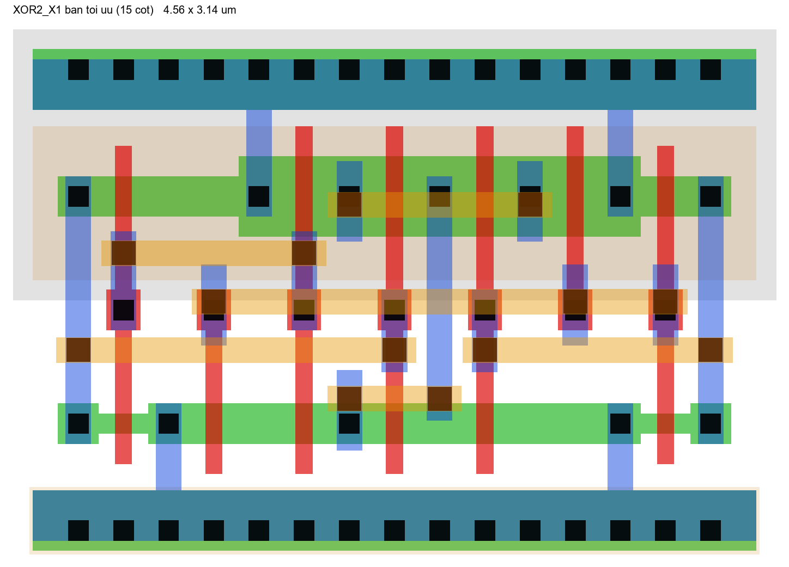
Hình 3.4. Layout XOR2_X1 bản nén 15 cột (so với 17 cột ở Hình 3.2).

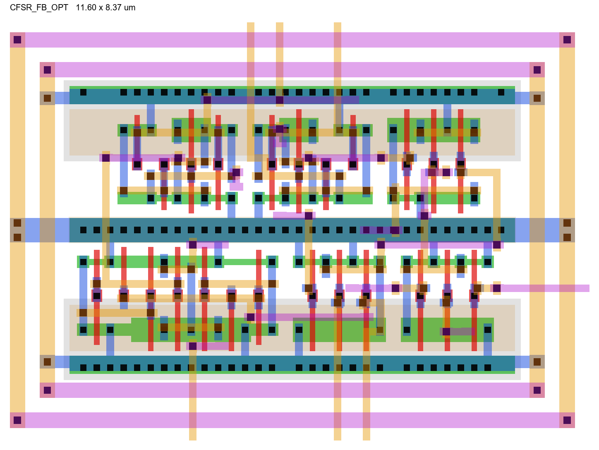
Hình 3.5. Layout khối CFSR_FB_OPT sau đặt và đi dây.

## 3.x.6 Kiểm chứng chức năng và công suất

Sơ đồ nguyên lý của hai cổng XOR được so sánh và của khối hồi tiếp tối ưu được cho ở Hình 3.6, Hình 3.7 và Hình 3.8.
Dạng sóng ở Hình 3.9 cho thấy ngõ ra của ba cấu trúc XOR2 cùng đúng bảng chân trị khi tải 8 cổng. Bảng 3.9 tổng hợp
trễ và công suất sau layout.

Bảng 3.9. Trễ và công suất trung bình của cổng XOR2 sau layout

| Cổng | Tải | Trễ NN | Trễ SS | Trễ FF | Công suất NN | Công suất SS | Công suất FF |
|---|---|---|---|---|---|---|---|
| XOR2_X1 (CMOS 12T) | FO4 | 121,6 ps | 170,7 ps | 95,4 ps | 16,8 µW | 16,1 µW | 17,6 µW |
| XOR2_TG (8T) | FO4 | 113,9 ps | 159,1 ps | 89,7 ps | 17,3 µW | 16,5 µW | 18,3 µW |
| XOR2_TG6 (6T) | FO4 | 113,9 ps | 160,6 ps | 88,8 ps | 15,7 µW | 15,0 µW | 16,5 µW |
| XOR2_X1 (CMOS 12T) | 8 cổng | 137,8 ps | 193,3 ps | 108,3 ps | 26,8 µW | 25,6 µW | 28,3 µW |
| XOR2_TG (8T) | 8 cổng | 135,4 ps | 188,7 ps | 107,1 ps | 30,5 µW | 28,7 µW | 32,7 µW |
| XOR2_TG6 (6T) | 8 cổng | 135,0 ps | 190,1 ps | 106,4 ps | 29,2 µW | 27,6 µW | 31,1 µW |

Công suất là công suất trung bình lấy từ nguồn VDD của cả testbench (cổng, inverter đệm và tải) khi mỗi vector kéo dài
1 ns. Tính cả bộ đệm vì cổng truyền lấy một phần dòng từ ngõ vào.

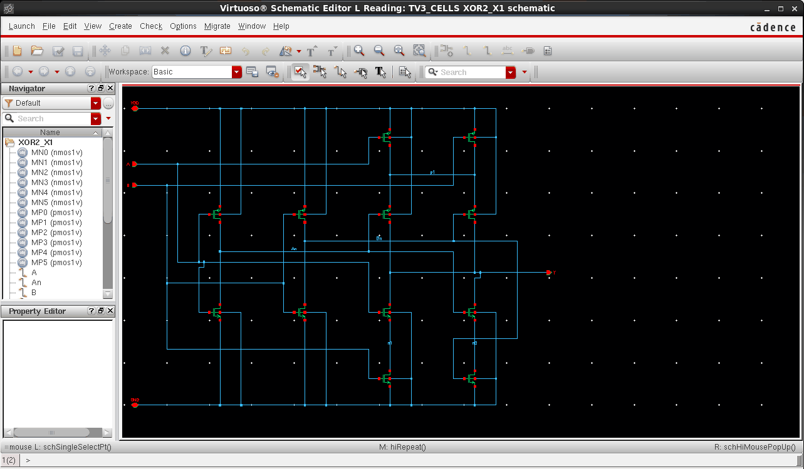
Hình 3.6. Sơ đồ nguyên lý XOR2_X1 (CMOS 12 transistor).

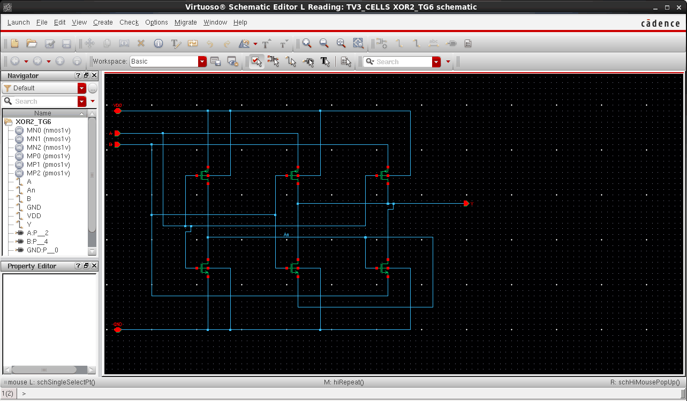
Hình 3.7. Sơ đồ nguyên lý XOR2_TG6 (cổng truyền 6 transistor).

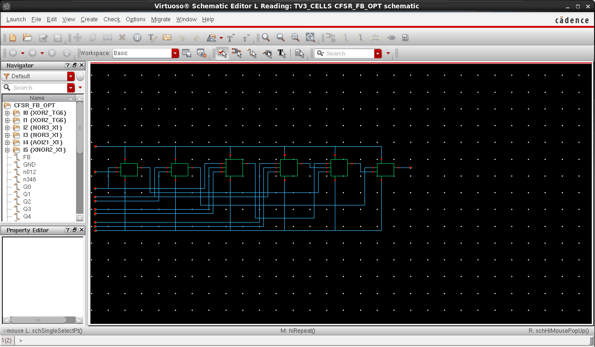
Hình 3.8. Sơ đồ nguyên lý khối CFSR_FB_OPT.

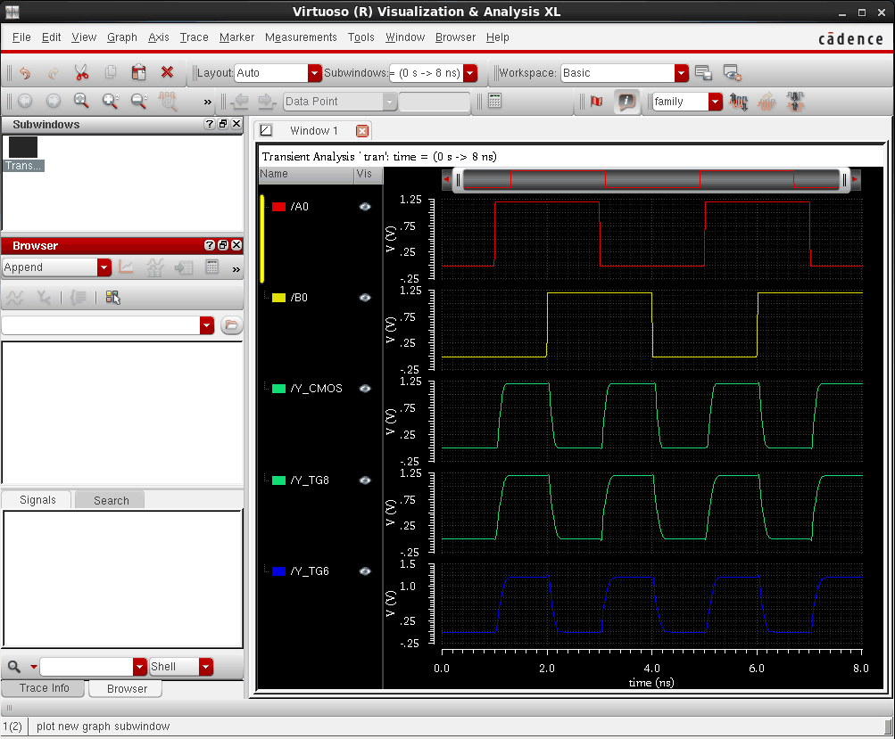
Hình 3.9. Dạng sóng ba cổng XOR2 với tải 8 cổng.

Cơ chế chống kẹt được kiểm trong vòng kín: khối hồi tiếp sau layout nối với tám flip-flop mẫu lý tưởng, xung nhịp 1 GHz
(Bảng 3.10, Hình 3.10). Phép kiểm này xác nhận chức năng; tần số cực đại của hệ thống phụ thuộc flip-flop TSPC thực tế.

Bảng 3.10. Kết quả mô phỏng vòng kín

| Thanh ghi | Trạng thái đầu | Kết quả sau 258 chu kỳ 1 GHz (NN, SS, FF) |
|---|---|---|
| LFSR thuần (XORTAP8) | 00000000 | kẹt ở 00000000 |
| LFSR thuần (XORTAP8) | 00000001 | 255 trạng thái, không qua 00000000, lặp lại ở chu kỳ 255 |
| CFSR_FB_CMOS | 00000000 | tự thoát, 256 trạng thái, về 00000000 ở chu kỳ 256 |
| CFSR_FB | 00000000 | tự thoát, 256 trạng thái, về 00000000 ở chu kỳ 256 |
| CFSR_FB_OPT | 00000000 | tự thoát, 256 trạng thái, về 00000000 ở chu kỳ 256 |

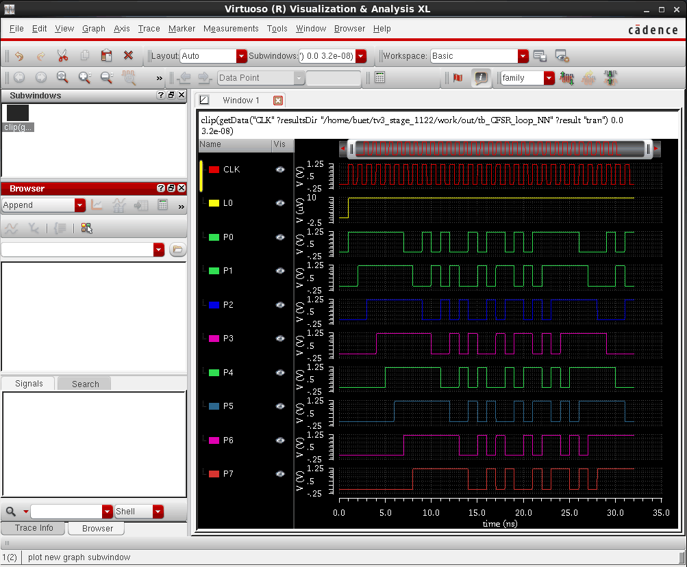
Hình 3.10. CFSR_FB_OPT tự thoát trạng thái toàn 0 (P0 đến P7); LFSR thuần vẫn ở mức 0 (L0, trục tính bằng µV).

Hình 3.11 và Hình 3.12 là stick diagram của hai cổng XOR2, rút ra từ layout. Hình 3.13 và Hình 3.14 là ảnh chụp layout
trong Virtuoso cùng kết quả Assura: số luật DRC vi phạm bằng 0 và LVS khớp với netlist xuất từ schematic.

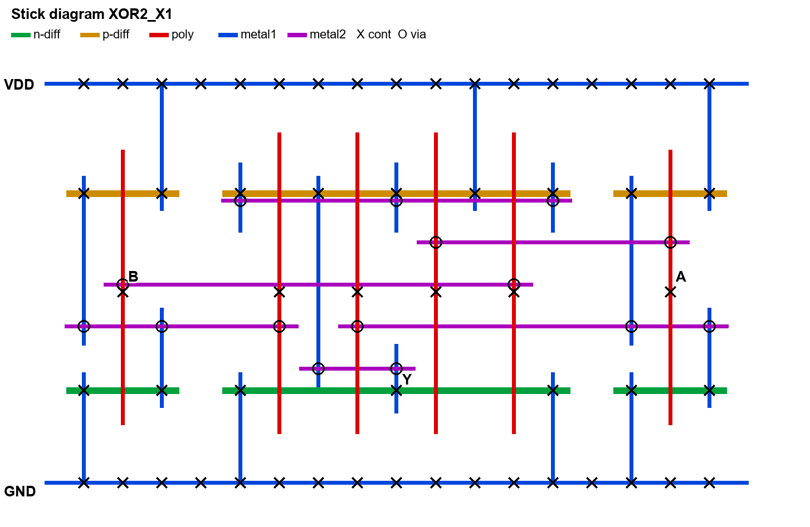
Hình 3.11. Stick diagram XOR2_X1.

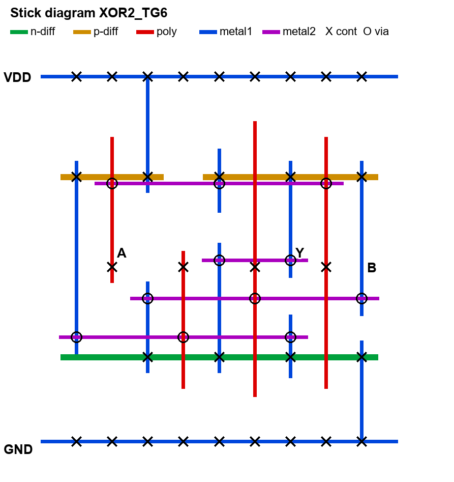
Hình 3.12. Stick diagram XOR2_TG6.

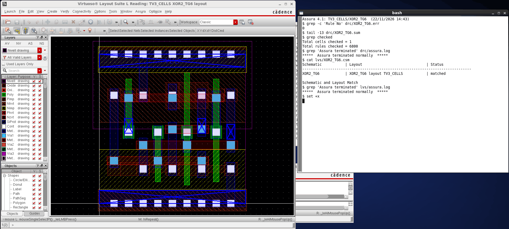
Hình 3.13. Kết quả DRC và LVS của XOR2_TG6.

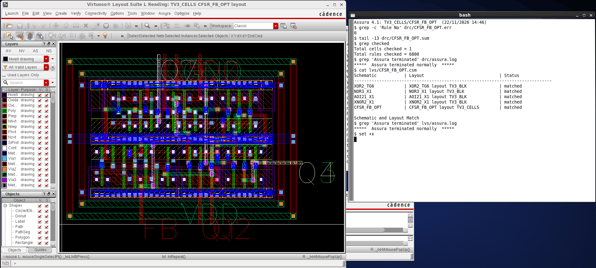
Hình 3.14. Kết quả DRC và LVS của CFSR_FB_OPT.

## 3.x.7 Kết luận phần

Phần TV3 đã xây dựng thư viện cổng INV, NAND2, NOR2, NOR3, AOI21, XNOR2, ba cấu trúc XOR2 và khối hồi tiếp CFSR 8 bit
với đủ schematic, symbol, layout và view trích ký sinh; mọi cell và khối đạt DRC 0 lỗi, LVS khớp. So với bản dùng toàn
cổng CMOS, khối CFSR_FB giảm 24 % transistor và 25 % diện tích, nhanh hơn 2 % và tốn ít hơn 7 % năng lượng. Bản tối ưu
CFSR_FB_OPT rút gọn hàm hồi tiếp bằng quan hệ loại trừ giữa các số hạng, giảm tiếp 25 % transistor, 29 % diện tích cell,
10 % trễ và 10 % năng lượng so với CFSR_FB, đồng thời vẫn bảo đảm thanh ghi không kẹt ở trạng thái toàn 0.
Hướng tiếp theo: ghép CFSR_FB_OPT với flip-flop TSPC của TV2 thành TSPC_LFSR_8bit và đo trễ trên đường hồi tiếp thực tế.

## Tài liệu tham khảo

[1] N. H. E. Weste and D. M. Harris, *CMOS VLSI Design: A Circuits and Systems Perspective*, 4th ed. Boston, MA, USA:
Addison-Wesley, 2011.
